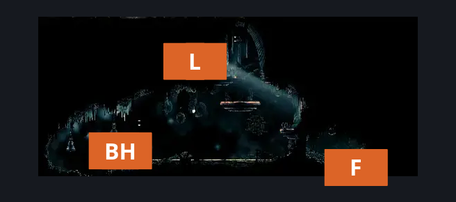
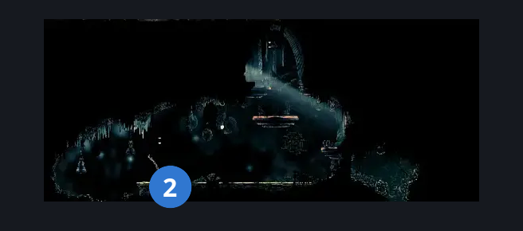
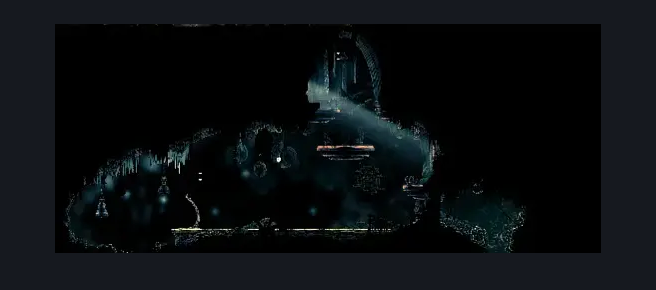

# Bellhart Bellway (Belltown_basement)

**Game ID:** Belltown_basement

**Contributors:** Pyxl

## Subrooms

No subrooms defined.

## Room Transitions

| Alias | Name | From subroom | Destination | Destination alias | Requirements | TODO | Verification | Annotated | Notes |
| --- | --- | --- | --- | --- | --- | --- | --- | --- | --- |
| F | bot1 |  | [Bellhart Lower (Belltown_basement_03)](bellhart-lower.md) | C | None |  | Verified | ✓ |  |
| L | left1 |  | [Belltown (Belltown)](belltown.md) | BD | Ledge Grab left OR Faydown Cloak OR Cling Grip left OR Silk Soar |  | Verified | ✓ |  |
| BH | door_fastTravelExit |  | [Bellway Menu](../fast-travel/bellway-menu.md) | BH | unlock Bellway Bellhart |  | Verified | ✓ |  |

## Subroom Connections

No subroom connections defined.

## Check Locations

| No. | Check | Subroom | Requirements | TODO | Verification | Location Type | Annotated | Notes |
| --- | --- | --- | --- | --- | --- | --- | --- | --- |
| 1 | bellway rosary lock |  | none |  | Verified | lock |  |  |
| 2 | Bellway: Bellhart |  | unlock bellway rosary lock |  | Verified | travel | ✓ |  |

## Room Images

### Connections

### Checks

### Scene

