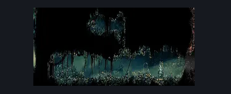

# Bellhart Hallway to Shellwood (Belltown_07)

**Game ID:** Belltown_07

**Contributors:** Pyxl

## Subrooms

No subrooms defined.

## Room Transitions

| Alias | Name | From subroom | Destination | Destination alias | Requirements | TODO | Verification | Annotated | Notes |
| --- | --- | --- | --- | --- | --- | --- | --- | --- | --- |
| L | left1 |  | [Shellwood Right Side Big room (Shellwood_01)](../shellwood/shellwood-right-side-big-room.md) | LR | None |  | Verified | ✓ |  |
| R | right1 |  | [Belltown (Belltown)](belltown.md) | L | None |  | Verified | ✓ |  |

## Subroom Connections

No subroom connections defined.

## Check Locations

| No. | Check | Subroom | Requirements | TODO | Verification | Location Type | Annotated | Notes |
| --- | --- | --- | --- | --- | --- | --- | --- | --- |
| 1 | Rosary Cache: Bellhart #4 |  | Cling Grip Left OR ( Cling Grip Right AND ( Faydown Cloak OR Easy heal stall ) ) OR Silk soar OR ( Scuttlebrace AND Faydown Cloak ) |  | Verified | collectible | ✓ |  |
| 2 | Bellhart- Outer Sign |  | None |  | Verified | lore | ✓ |  |

## Room Images

### Connections

### Checks

### Scene

