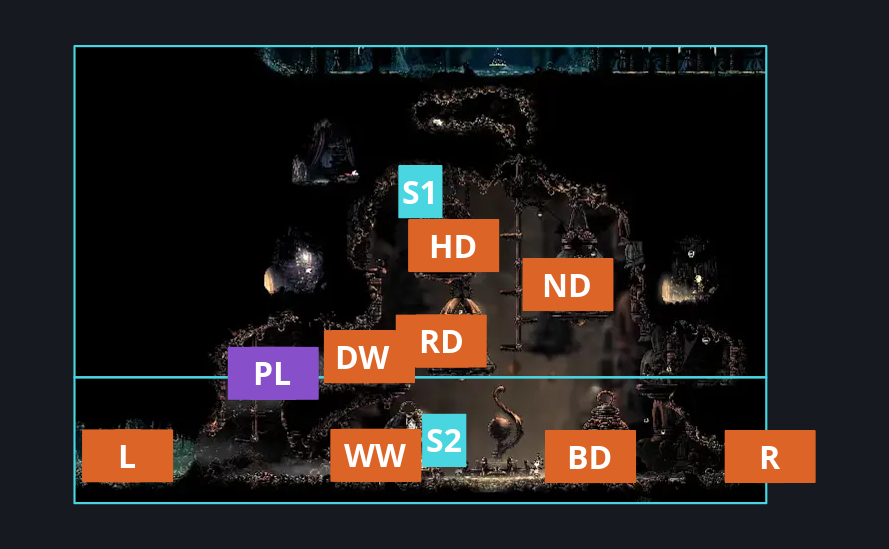
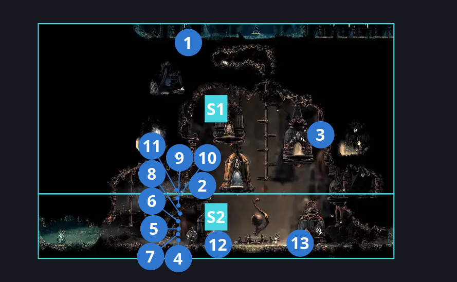
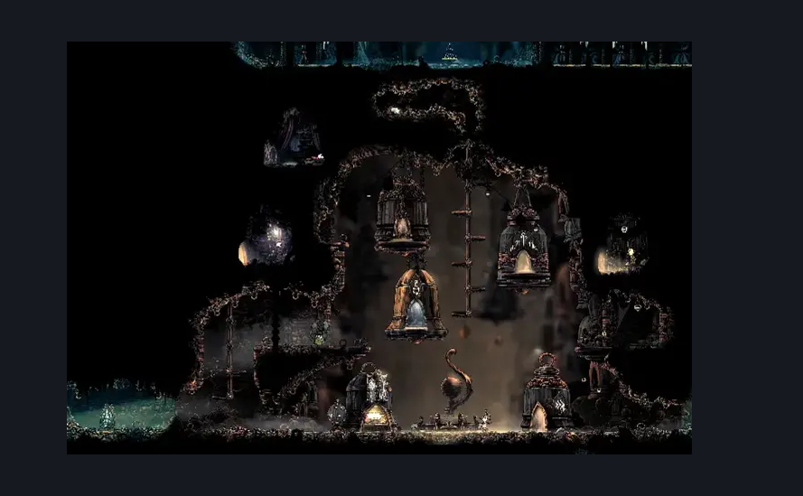

# Belltown (Belltown)

**Game ID:** Belltown

**Contributors:** Pyxl

## Subrooms

| No. | Subroom | Annotated |
| --- | --- | --- |
| S1 | Upper Area | ✓ |
| S2 | Lower Area | ✓ |

## Room Transitions

| Alias | Name | From subroom | Destination | Destination alias | Requirements | TODO | Verification | Annotated | Notes |
| --- | --- | --- | --- | --- | --- | --- | --- | --- | --- |
| RD | door4 | Upper Area | [Bellhart Relic Shop (Belltown_Room_Relic)](bellhart-relic-shop.md) | L | defeat THE Boss Widow |  | Verified | ✓ | Need to know how predicates for boss credits work or if this is good enough  - I made my exporter understand what this means so it's fine  Moriko |
| HD | door5 | Upper Area | [Bellhome (Belltown_room_spare)](bellhome.md) | L | Have bellhome key |  | Verified | ✓ | the randomizer makes this always accessible  ======== Not anymore, you start homeless now.  -Hutyrix, 11/22 |
| ND | door3 | Upper Area | [Bellhart Pinsmith (Belltown_Room_pinsmith)](bellhart-pinsmith.md) | L | defeat THE Boss Widow |  | Verified | ✓ | Need to know how predicates for boss credits work or if this is good enough  - I made my exporter understand what this means so it's fine  Moriko |
| L | left3 | Lower Area | [Bellhart Hallway to Shellwood (Belltown_07)](bellhart-hallway-to-shellwood.md) | R | None |  | Verified | ✓ |  |
| R | right2 | Lower Area | [Bellhart Right Entrance (Belltown_06)](bellhart-right-entrance.md) | LL | None |  | Verified | ✓ |  |
| BD | door1 | Lower Area | [Bellhart Bellway (Belltown_basement)](bellhart-bellway.md) | L | None |  | Verified | ✓ |  |
| WW | wish wall | Lower Area | [Bellhart Wish Wall](../wish-menus/bellhart-wish-wall.md) | BH | defeat THE Boss Widow |  | Verified | ✓ | Need to know how predicates for boss credits work or if this is good enough  - I made my exporter understand what this means so it's fine  Moriko |
| DW | delivery wishes | Upper Area | [Bellhart Deliveries](../wish-menus/bellhart-deliveries.md) | BH | complete THE my missing brother wish granted |  | Verified | ✓ |  |

## Subroom Connections

| Alias | Name | Source | Destination | Requirements | TODO | Verification | Annotated | Notes |
| --- | --- | --- | --- | --- | --- | --- | --- | --- |
| PL | Platforms | Lower Area | Upper Area | Ledge grab either OR Silksoar OR Faydown Cloak OR easy Shaman Crest pogo OR Cling Grip either OR easy plasmium stall OR Easy delvers drill stall |  | Verified | ✓ |  |
| PL | Platforms | Upper Area | Lower Area | None |  | Verified | ✓ |  |

## Check Locations

| No. | Check | Subroom | Requirements | TODO | Verification | Location Type | Annotated | Notes |
| --- | --- | --- | --- | --- | --- | --- | --- | --- |
| 1 | Memory Locket: Bellhart Roof | Upper Area | Silk Soar |  | Verified | collectible | ✓ |  |
| 2 | Couriers Rasher | Upper Area | complete THE Great Taste of Pharloom Wish Promised |  | Verified | logic-point | ✓ |  |
| 3 | Map: Bellhart | Upper Area | None |  | Verified | collectible | ✓ |  |
| 4 | Memory Locket (Frey) | Lower Area | Spend 330 Rosaries |  | Verified | event | ✓ |  |
| 5 | Spool Fragment (Frey) | Lower Area | prereq THE My Missing Courier Wish Granted AND Spend 270 Rosaries |  | Verified | event | ✓ |  |
| 6 | Multibinder | Lower Area | prereq THE My Missing Courier Wish Granted AND Spend 800 Rosaries |  | Verified | collectible | ✓ |  |
| 7 | Desk | Lower Area | Spend 380 Rosaries AND prereq Visit Bellhome IN Bellhome AND ( Prereq Hand In Bone Scroll Relic Bone Scroll Far Fields IN Bellhart Relic shop  OR Prereq Hand In Bone Scroll Greymoor IN Bellhart Relic Shop  OR prereq Hand In Bone Scroll Underworks IN Bellhart Relic Shop  OR Prereq Hand In Bone Scroll Wisp Thicket IN Bellhart Relic Shop  OR Prereq Hand In Weaver Effigy Moss Grotto IN Bellhart Relic shop  OR Prereq Hand In Weaver Effigy Shellwood IN Bellhart Relic Shop OR Prereq Hand In Weaver Effigy  The Slab IN Bellhart Relic shop OR Prereq Hand in Choral Commandment Jubilana IN Bellhart Relic Shop OR Prereq Hand in Choral Commandment Western Whiteward IN Bellhart Relic SHop OR Prereq Hand in Choral Commandment Moss Grotto IN Bellhart Relic shop  OR Prereq Hand in Choral Commandment Eastern Whiteward IN Bellhart Relic Shop OR Prereq Hand in Rune Harp Weavenest Atla IN Bellhart Relic Shop  OR Prereq Hand in Rune Harp Weavenest Cindril IN Bellhart Relic Shop OR Prereq Hand in Rune Harp High Halls IN Bellhart relic Shop OR Prereq Hand in Arcane Egg IN Bellhart Relic SHop ) |  | Verified | collectible | ✓ |  |
| 8 | Gleamlights | Lower Area | Spend 320 Rosaries AND Prereq Visit Bellhome IN Bellhome |  | Verified | collectible | ✓ |  |
| 9 | Bell Lacquer | Lower Area | Spend 520 Rosaries AND Prereq Visit Bellhome IN Bellhome |  | Verified | collectible | ✓ |  |
| 10 | Personal Spa | Lower Area | Get 2 Bellhome Items AND Spend 1100 Rosaries AND Prereq Visit Bellhome IN Bellhome |  | Verified | collectible | ✓ |  |
| 11 | Gramophone | Lower Area | Get 6 Psalm Cylinders Turned In AND Spend 490 Rosaries AND Prereq Visit Bellhome IN Bellhome AND Prereq Desk |  | Verified | collectible | ✓ |  |
| 12 | Bench | Lower Area | none |  | Verified | bench | ✓ |  |
| 13 | Craw Summons | Lower Area | Craw Summons Ready |  | Verified | collectible | ✓ |  |

## Room Images

### Connections

### Checks

### Scene

