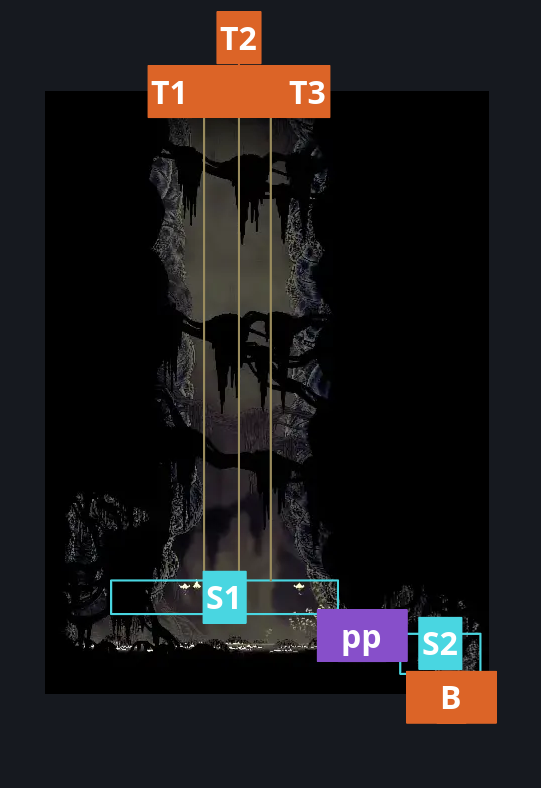
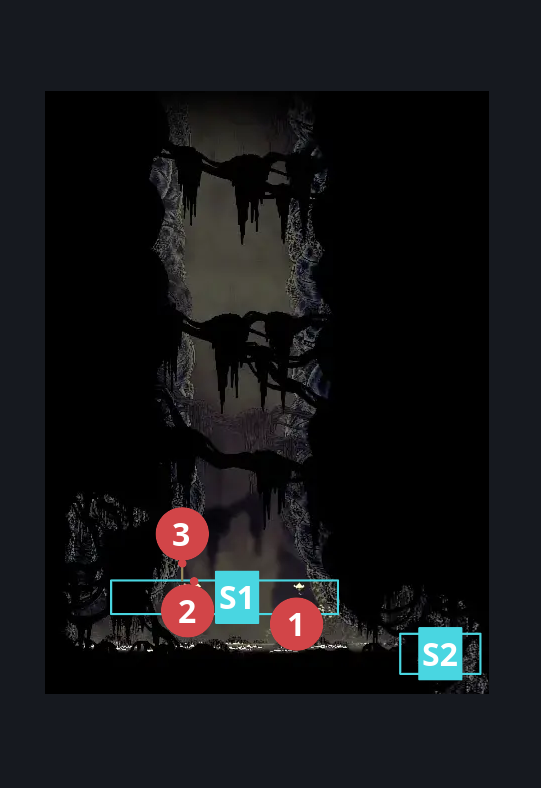
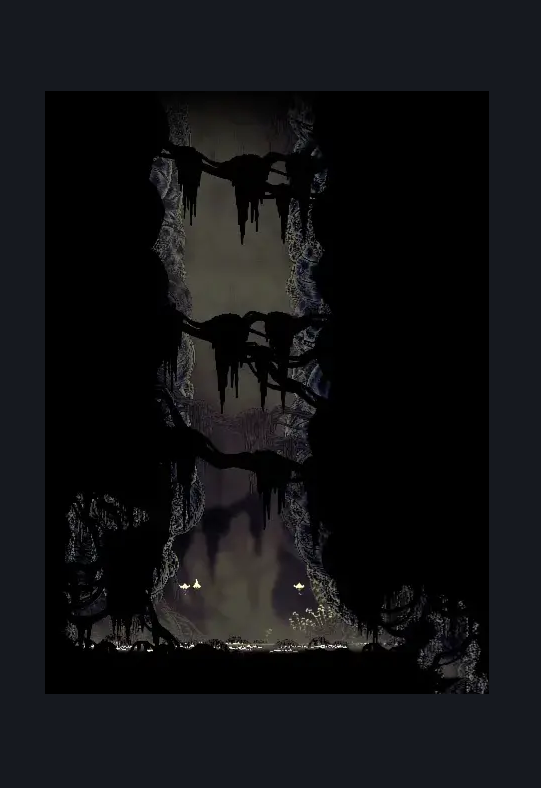

# Bilewater Citadel Exit (Shadow_22)

**Game ID:** Shadow_22

**Contributors:** herchey all by himself this time like a big, strong man
unless he wouldn't forget about scuttlebrace, more proficient movement tactics and that swim isn't enough from bottom to lake
 
Also Hutyrix, who fell into the backrooms without ever having learned how to swim during his childhood years.
What a fool.

## Subrooms

| No. | Subroom | Annotated |
| --- | --- | --- |
| S1 | pond | ✓ |
| S2 | platform | ✓ |

## Room Transitions

| Alias | Name | From subroom | Destination | Destination alias | Requirements | TODO | Verification | Annotated | Notes |
| --- | --- | --- | --- | --- | --- | --- | --- | --- | --- |
| T1 | top1 | pond | [Whispering Vaults Totally Not White Palace (Library_07)](../whispering-vaults/whispering-vaults-totally-not-white-palace.md) | B1 | invalid |  | Verified | ✓ |  |
| T2 | top2 | pond | [Whispering Vaults Totally Not White Palace (Library_07)](../whispering-vaults/whispering-vaults-totally-not-white-palace.md) | B2 | invalid |  | Verified | ✓ |  |
| T3 | top3 | pond | [Whispering Vaults Totally Not White Palace (Library_07)](../whispering-vaults/whispering-vaults-totally-not-white-palace.md) | B3 | invalid |  | Verified | ✓ |  |
| B | bot1 | platform | [Bilewater West Secret Rooms (Shadow_20)](bilewater-west-secret-rooms.md) | C | nada |  | Verified | ✓ |  |

## Subroom Connections

| Alias | Name | Source | Destination | Requirements | TODO | Verification | Annotated | Notes |
| --- | --- | --- | --- | --- | --- | --- | --- | --- |
| pp | pond and platform | pond | platform | (swim AND ( cling grip either OR ledge grab right OR faydown cloak OR easy scuttlebrace)) OR (proficient movement AND ((clawline right OR sharpdart) AND faydown cloak AND ledge grab right))  OR (proficient movement AND drifters AND (clawline right x 1 OR sharpdart x 1) AND cling grip right) |  | Verified | ✓ | Platform was moved, not relevant for this part of logic |
| pp | pond and platform | platform | pond | swim AND (cling grip either OR easy scuttlebrace OR faydown OR ((easy beast heal stall OR easy shaman pogo) AND ledge grab left)) |  | Verified | ✓ | old syntax: swim   silk soar x 1 could work in most ER cases, but not without it, so I guess i won't write it. -Hutyrix, 11/23 |

## Check Locations

| No. | Check | Subroom | Requirements | TODO | Verification | Location Type | Annotated | Notes |
| --- | --- | --- | --- | --- | --- | --- | --- | --- |
| 1 | Mothleaf Lagnia 1 | pond | none |  | Verified | enemy | ✓ |  |
| 2 | Mothleaf Lagnia 2 | pond | none |  | Verified | enemy | ✓ |  |
| 3 | Mothleaf Lagnia 3 | pond | none |  | Verified | enemy | ✓ |  |

## Room Images

### Connections

### Checks

### Scene

