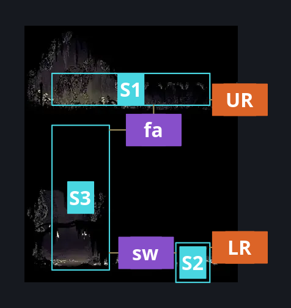
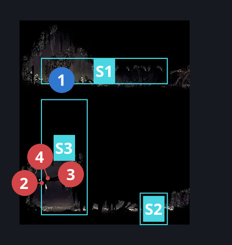
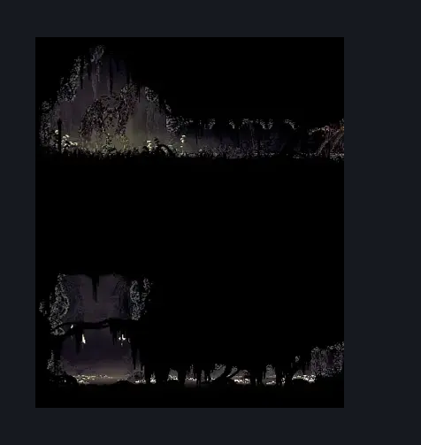

# Bilewater Fake Bench (Shadow_15)

**Game ID:** Shadow_15

**Contributors:** Herchey, hutyrix and The Black Dahlia Murder (band)

## Subrooms

| No. | Subroom | Annotated |
| --- | --- | --- |
| S1 | upper | ✓ |
| S2 | lower | ✓ |
| S3 | fall | ✓ |

## Room Transitions

| Alias | Name | From subroom | Destination | Destination alias | Requirements | TODO | Verification | Annotated | Notes |
| --- | --- | --- | --- | --- | --- | --- | --- | --- | --- |
| LR | lower right | lower | [Bilewater Upper Bloatroach Tower (Shadow_01)](bilewater-upper-bloatroach-tower.md) | ML | none |  | Verified | ✓ |  |
| UR | upper right | upper | [Bilewater Upper Bloatroach Tower (Shadow_01)](bilewater-upper-bloatroach-tower.md) | UL | none |  | Verified | ✓ |  |

## Subroom Connections

| Alias | Name | Source | Destination | Requirements | TODO | Verification | Annotated | Notes |
| --- | --- | --- | --- | --- | --- | --- | --- | --- |
| fa | the fall | upper | fall | swim |  | Verified | ✓ |  |
| fa | the fall | fall | upper | invalid |  | Verified | ✓ | Going back up to upper is impossible. One way connection. |
| sw | swim out | fall | lower | swim |  | Verified | ✓ |  |
| sw | swim out | lower | fall | swim |  | Verified | ✓ |  |

## Check Locations

| No. | Check | Subroom | Requirements | TODO | Verification | Location Type | Annotated | Notes |
| --- | --- | --- | --- | --- | --- | --- | --- | --- |
| 1 | Fake Bench collapser | upper | none |  | Verified | blockade | ✓ |  |
| 2 | Mothleaf Lagnia 1 | fall | attack up OR activate Fake Bench |  | Verified | enemy | ✓ |  |
| 3 | Mothleaf Lagnia 2 | fall | attack up OR activate Fake Bench |  | Verified | enemy | ✓ |  |
| 4 | Mothleaf Lagnia 3 | fall | attack up OR activate Fake Bench |  | Verified | enemy | ✓ |  |

## Notes

archived non-existent wall, added needle rando support 11/25/26 Hutyrix

## Room Images

### Connections

### Checks

### Scene

