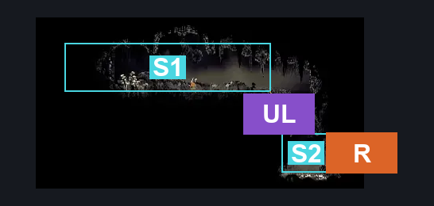
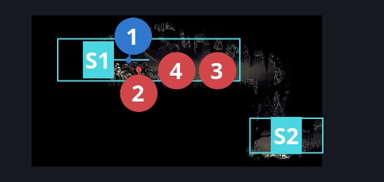
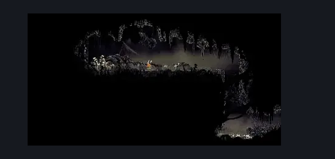

# Bilewater Flea Rescue (Shadow_28)

**Game ID:** Shadow_28

**Contributors:** Herchey and absolutely no one else

## Subrooms

| No. | Subroom | Annotated |
| --- | --- | --- |
| S1 | upper | ✓ |
| S2 | lower | ✓ |

## Room Transitions

| Alias | Name | From subroom | Destination | Destination alias | Requirements | TODO | Verification | Annotated | Notes |
| --- | --- | --- | --- | --- | --- | --- | --- | --- | --- |
| R | right | lower | [Bilewater East Column (Shadow_09)](bilewater-east-column.md) | ML | none |  | Verified | ✓ |  |

## Subroom Connections

| Alias | Name | Source | Destination | Requirements | TODO | Verification | Annotated | Notes |
| --- | --- | --- | --- | --- | --- | --- | --- | --- |
| UL | lower to upper | lower | upper | Scuttlebrace OR cling grip |  | Verified | ✓ |  |
| UL | lower to upper | upper | lower | none |  | Verified | ✓ |  |

## Check Locations

| No. | Check | Subroom | Requirements | TODO | Verification | Location Type | Annotated | Notes |
| --- | --- | --- | --- | --- | --- | --- | --- | --- |
| 1 | Bilewater - The Flea That Bilewater Thieves Stole | upper | none |  | Verified | collectible | ✓ | Formerly: Flea: Bilewater - Thieves |
| 2 | Snitchfly 1 | upper | none |  | Verified | enemy | ✓ |  |
| 3 | Snitchfly 2 | upper | none |  | Verified | enemy | ✓ |  |
| 4 | Snitchfly 3 | upper | none |  | Verified | enemy | ✓ |  |

## Room Images

### Connections

### Checks

### Scene

