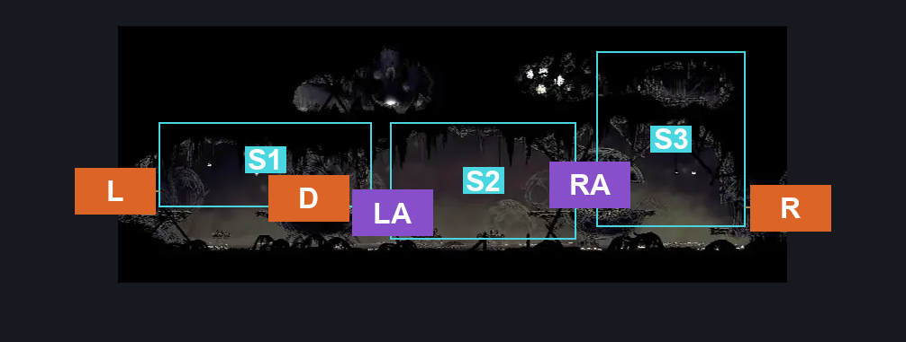
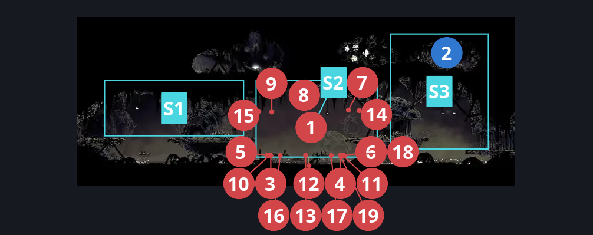
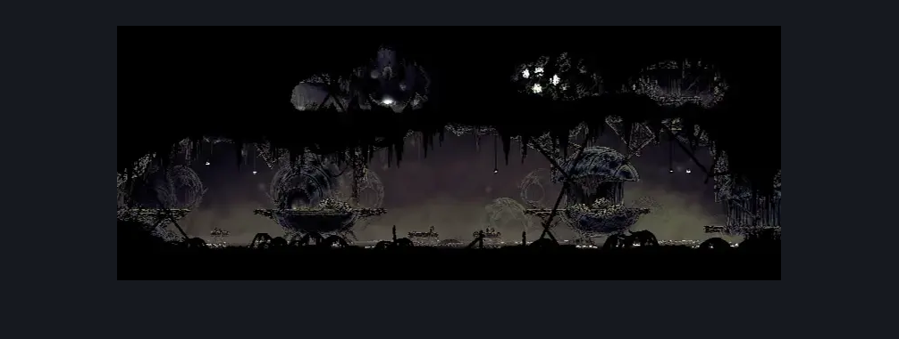

# Bilewater Groal Arena (Shadow_18)

**Game ID:** Shadow_18

**Contributors:** Herchey and Dante (the Divine Comedy one, not DMC)

## Subrooms

| No. | Subroom | Annotated |
| --- | --- | --- |
| S1 | left of arena | ✓ |
| S2 | arena | ✓ |
| S3 | right of arena | ✓ |

## Room Transitions

| Alias | Name | From subroom | Destination | Destination alias | Requirements | TODO | Verification | Annotated | Notes |
| --- | --- | --- | --- | --- | --- | --- | --- | --- | --- |
| R | right | right of arena | [Bilewater Upper Trap Gauntlet Hall (Shadow_12)](bilewater-upper-trap-gauntlet-hall.md) | L | none |  | Verified | ✓ |  |
| D | door | left of arena | [Bilewater Arena Shack (Shadow_Bilehaven_Room)](bilewater-arena-shack.md) | L | none |  | Verified | ✓ |  |
| L | left | left of arena | [Bilewater Upper Bloatroach Tower (Shadow_01)](bilewater-upper-bloatroach-tower.md) | UR | none |  | Verified | ✓ |  |

## Subroom Connections

| Alias | Name | Source | Destination | Requirements | TODO | Verification | Annotated | Notes |
| --- | --- | --- | --- | --- | --- | --- | --- | --- |
| LA | left to arena | left of arena | arena | none |  | Verified | ✓ |  |
| LA | left to arena | arena | left of arena | none |  | Verified | ✓ |  |
| RA | right to arena | right of arena | arena | clawline left OR sharpdart OR drifter's cloak OR sharpdart OR run |  | Verified | ✓ |  |
| RA | right to arena | arena | right of arena | clawline right OR sharpdart OR drifter's cloak OR sharpdart OR run |  | Verified | ✓ |  |

## Check Locations

| No. | Check | Subroom | Requirements | TODO | Verification | Location Type | Annotated | Notes |
| --- | --- | --- | --- | --- | --- | --- | --- | --- |
| 1 | Boss: Groal the Great | arena | Combat Requirements |  | Verified | boss | ✓ | Technically none, lol. |
| 2 | Bilewater - Bilehaven Plaque | right of arena | cling grip right OR silk soar OR scuttlebrace |  | Verified | lore | ✓ |  |
| 3 | Stilkin 1 | arena | none |  | Verified | enemy | ✓ |  |
| 4 | Stilkin 2 | arena | none |  | Verified | enemy | ✓ |  |
| 5 | Stilkin Trapper 1 | arena | none |  | Verified | enemy | ✓ |  |
| 6 | Stilkin Trapper 2 | arena | none |  | Verified | enemy | ✓ |  |
| 7 | Swamp Squit 1 | arena | none |  | Verified | enemy | ✓ |  |
| 8 | Swamp Squit 2 | arena | none |  | Verified | enemy | ✓ |  |
| 9 | Swamp Squit 3 | arena | none |  | Verified | enemy | ✓ |  |
| 10 | Stilkin Trapper 3 | arena | none |  | Verified | enemy | ✓ |  |
| 11 | Stilkin 3 | arena | none |  | Verified | enemy | ✓ |  |
| 12 | Groal the Great 1 | arena | none |  | Verified | enemy | ✓ |  |
| 13 | Stilkin Trapper 4 | arena | none |  | Verified | enemy | ✓ |  |
| 14 | Swamp Squit 4 | arena | none |  | Verified | enemy | ✓ |  |
| 15 | Swamp Squit 5 | arena | none |  | Verified | enemy | ✓ |  |
| 16 | Stilkin Trapper 5 | arena | none |  | Verified | enemy | ✓ |  |
| 17 | Stilkin Trapper 6 | arena | none |  | Verified | enemy | ✓ |  |
| 18 | Stilkin 4 | arena | none |  | Verified | enemy | ✓ |  |
| 19 | Stilkin 5 | arena | none |  | Verified | enemy | ✓ |  |

## Room Images

### Connections

### Checks

### Scene

