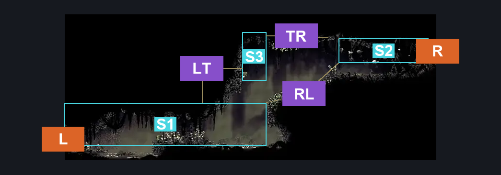
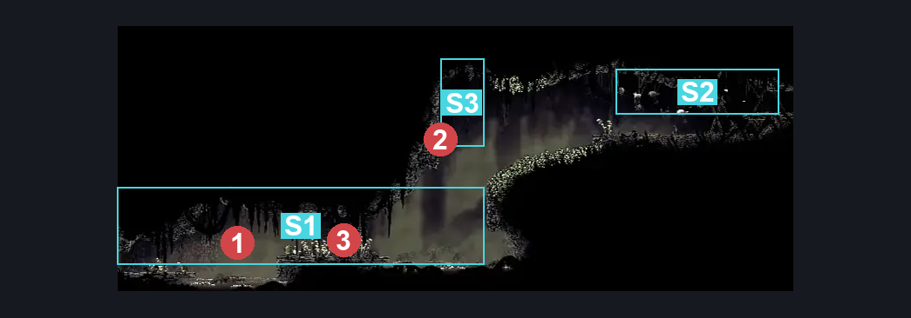
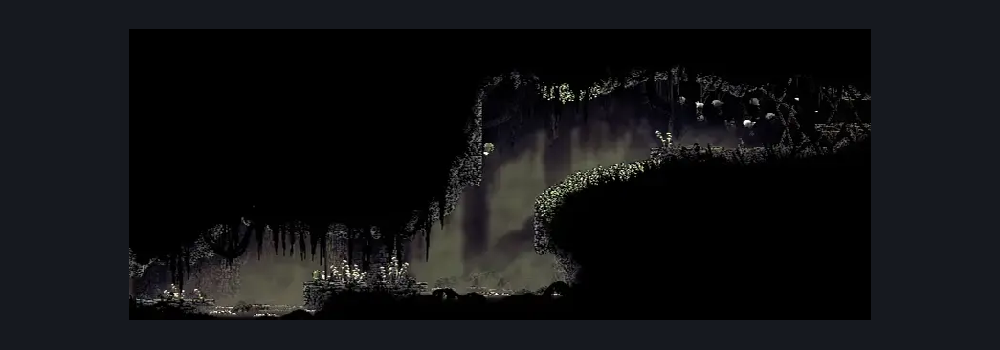

# Bilewater Hanging Corpse Room (Shadow_16)

**Game ID:** Shadow_16

**Contributors:** Herchey and Dude (his neighbor's cat)

## Subrooms

| No. | Subroom | Annotated |
| --- | --- | --- |
| S1 | left | ✓ |
| S2 | right | ✓ |
| S3 | top wall | ✓ |

## Room Transitions

| Alias | Name | From subroom | Destination | Destination alias | Requirements | TODO | Verification | Annotated | Notes |
| --- | --- | --- | --- | --- | --- | --- | --- | --- | --- |
| R | right | right | [Bilewater Lower Trap Gauntlet Hall (Shadow_10)](bilewater-lower-trap-gauntlet-hall.md) | L | none |  | Verified | ✓ |  |
| L | left | left | [Bilewater Upper Bloatroach Tower (Shadow_01)](bilewater-upper-bloatroach-tower.md) | MR | none |  | Verified | ✓ |  |

## Subroom Connections

| Alias | Name | Source | Destination | Requirements | TODO | Verification | Annotated | Notes |
| --- | --- | --- | --- | --- | --- | --- | --- | --- |
| LT | left to top | left | top wall | cling grip both AND (clawline both x 2 OR sharpdart x 2 OR faydown cloak OR (proficient movement AND dash right)) |  | Verified | ✓ |  |
| LT | left to top | top wall | left | none |  | Verified | ✓ |  |
| TR | top to right | top wall | right | (drifter's AND (clawline right OR sharpdart OR (faydown AND (dash right OR easy beast pogo OR ledge grab right))))  OR (faydown AND (clawline right OR (sharpdart AND (ledge grab right OR dash right)))) OR (clawline right X 2) OR (clawline right AND (sharpdart OR (easy beast pogo AND (proficient movement OR ledge grab right)) OR dash right)) OR (sharpdart AND (easy beast pogo AND (proficient movement OR ledge grab right))) |  | Verified | ✓ |  |
| TR | top to right | right | top wall | (faydown cloak AND (clawline left OR (sharpdart AND proficient movement)))  OR  (drifter's cloak AND (dash left OR clawline left OR sharpdart))  OR  clawline left x 2 OR (sharpdart AND dash right AND ledge grab right) |  | Verified | ✓ |  |
| RL | right to left | right | left | drifter's cloak OR (clawline left AND (proficient movement OR swim)) OR ((sharpdart OR faydown cloak) AND dash left) |  | Verified | ✓ | clawline right x 3 AND cling grip right AND easy pogo off miremite |
| RL | right to left | left | right | invalid |  | Verified | ✓ |  |

## Check Locations

| No. | Check | Subroom | Requirements | TODO | Verification | Location Type | Annotated | Notes |
| --- | --- | --- | --- | --- | --- | --- | --- | --- |
| 1 | Stilkin Trapper 1 | left | invalid |  | Verified | enemy | ✓ | swampMuckmanTallInvades == true |
| 2 | Miremite 1 | top wall | none |  | Verified | enemy | ✓ |  |
| 3 | Miremite 2 | left | none |  | Verified | enemy | ✓ |  |

## Room Images

### Connections

### Checks

### Scene

