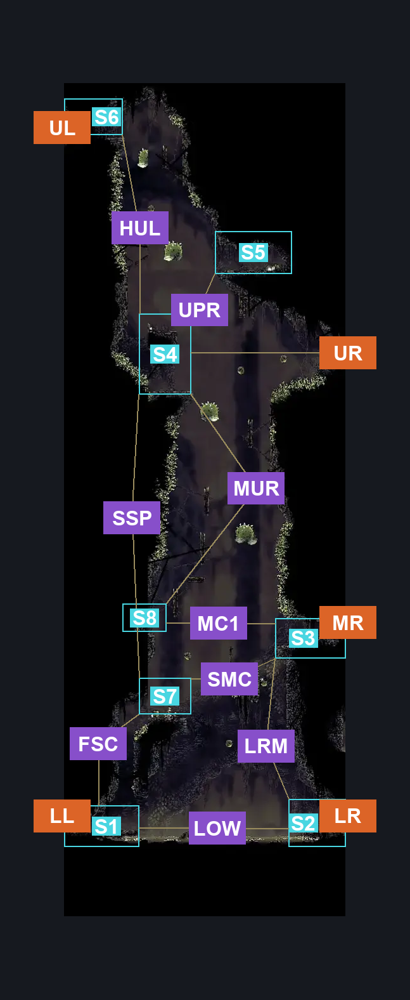
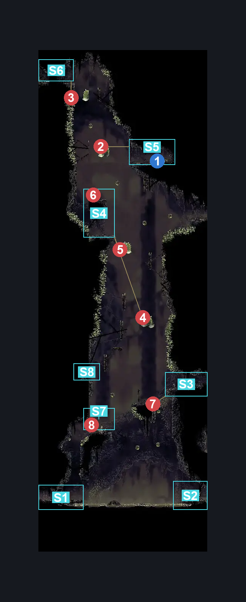
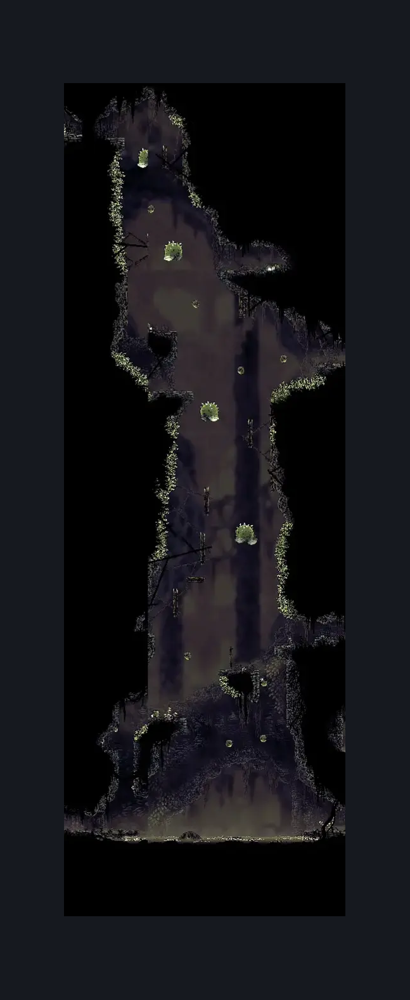

# Bilewater Lower Bloatroach Tower (Shadow_02)

**Game ID:** Shadow_02

**Contributors:** Herchey and Wesker (his cat)

## Subrooms

| No. | Subroom | Annotated |
| --- | --- | --- |
| S1 | low left | ✓ |
| S2 | low right | ✓ |
| S3 | mid right | ✓ |
| S4 | halfway up | ✓ |
| S5 | rosary plat | ✓ |
| S6 | up left | ✓ |
| S7 | first plat up | ✓ |
| S8 | mid climb first | ✓ |

## Room Transitions

| Alias | Name | From subroom | Destination | Destination alias | Requirements | TODO | Verification | Annotated | Notes |
| --- | --- | --- | --- | --- | --- | --- | --- | --- | --- |
| LR | lower right | low right | [Bilewater Lower East Hall (Shadow_03)](bilewater-lower-east-hall.md) | L | none |  | Verified | ✓ |  |
| UR | upper right | halfway up | [Bilewater Upper East Column (Shadow_26)](bilewater-upper-east-column.md) | LL | faydown cloak OR drifter's cloak OR easy beast pogo OR clawline right x 3 |  | Verified | ✓ |  |
| LL | lower left | low left | [Bilewater West Hall (Shadow_04b)](bilewater-west-hall.md) | R | none |  | Verified | ✓ |  |
| MR | middle right | mid right | [Bilewater Shakra Room (Shadow_23)](bilewater-shakra-room.md) | L | none |  | Verified | ✓ |  |
| UL | upper left | up left | [Bilewater Upper West Column (Shadow_14)](bilewater-upper-west-column.md) | LR | none |  | Verified | ✓ |  |

## Subroom Connections

| Alias | Name | Source | Destination | Requirements | TODO | Verification | Annotated | Notes |
| --- | --- | --- | --- | --- | --- | --- | --- | --- |
| LOW | low left and right | low left | low right | swim OR dash right OR clawline right OR sharpdart OR faydown cloak OR drifter's cloak OR easy beast pogo |  | Verified | ✓ |  |
| LOW | low left and right | low right | low left | swim OR dash left OR clawline left OR sharpdart OR faydown cloak OR drifter's cloak OR easy beast pogo |  | Verified | ✓ |  |
| LRM | low right to mid | low right | mid right | silk soar AND faydown cloak AND cling grip right |  | Verified | ✓ | Pretty goddamn precise from the silk soar to faydown. Maybe easy_skip though. Very easy to try again without penalty. |
| LRM | low right to mid | mid right | low right | none |  | Verified | ✓ | falling |
| SMC | second small climb | first plat up | mid right | (cling grip right AND  (proficient movement OR sharpdart OR clawline right OR dash right OR drifter's))  OR  (faydown AND (cling grip either)) |  | Verified | ✓ |  |
| SMC | second small climb | mid right | first plat up | none |  | Verified | ✓ |  |
| MC1 | mid climb 1 | mid right | mid climb first | (cling grip left AND (dash left OR drifter's OR faydown OR clawline left OR sharpdart)) |  | Verified | ✓ |  |
| MC1 | mid climb 1 | mid climb first | mid right | none |  | Verified | ✓ | Just needs the sac pogo. |
| MUR | mid to halfway | mid climb first | halfway up | (cling grip right AND faydown)  OR (cling grip left AND faydown AND scuttlebrace AND clawline left) OR (cling grip both AND (clawline both OR (clawline right AND drifter's cloak) OR (proficient movement AND dash both))) |  | Verified | ✓ |  |
| MUR | mid to halfway | halfway up | mid climb first | none |  | Verified | ✓ | falling |
| UPR | halfway to rosary | halfway up | rosary plat | faydown cloak OR (cling grip left AND intended enemy pogo off bloatroach AND (clawline right OR sharpdart OR drifter's cloak OR easy beast pogo)) |  | Verified | ✓ |  |
| UPR | halfway to rosary | rosary plat | halfway up | none |  | Verified | ✓ | falling |
| HUL | halfway to upper left | halfway up | up left | faydown cloak AND (cling grip both OR (cling grip left AND scuttlebrace AND proficient movement)) |  | Verified | ✓ |  |
| HUL | halfway to upper left | up left | halfway up | none |  | Verified | ✓ | falling |
| FSC | first small climb | low left | first plat up | (faydown cloak AND (cling grip left OR (cling grip right AND (dash right OR clawline right OR sharpdart OR scuttlebrace OR easy beast pogo)))) OR (silk soar AND (clawline right OR sharpdart OR easy beast pogo)) |  | Verified | ✓ |  |
| FSC | first small climb | first plat up | low left | none |  | Verified | ✓ |  |
| SSP | silk soar past everything | first plat up | halfway up | silk soar |  | Verified | ✓ |  |
| SSP | silk soar past everything | halfway up | first plat up | none |  | Verified | ✓ |  |

## Check Locations

| No. | Check | Subroom | Requirements | TODO | Verification | Location Type | Annotated | Notes |
| --- | --- | --- | --- | --- | --- | --- | --- | --- |
| 1 | Bilewater - Rosaries Guarded By A Bloatroach In The Lower Tower | rosary plat | none |  | Verified | collectible | ✓ | Formerly: Bilewater - Frayed Rosary String |
| 2 | Bloatroach 1 | rosary plat | none |  | Verified | enemy | ✓ |  |
| 3 | Bloatroach 2 | up left | none |  | Verified | enemy | ✓ |  |
| 4 | Bloatroach 3 | halfway up | none |  | Verified | enemy | ✓ |  |
| 5 | Bloatroach 4 | halfway up | none |  | Verified | enemy | ✓ |  |
| 6 | Miremite 1 | halfway up | none |  | Verified | enemy | ✓ |  |
| 7 | Miremite 2 | mid right | none |  | Verified | enemy | ✓ |  |
| 8 | Miremite 3 | first plat up | none |  | Verified | enemy | ✓ |  |

## Room Images

### Connections

### Checks

### Scene

