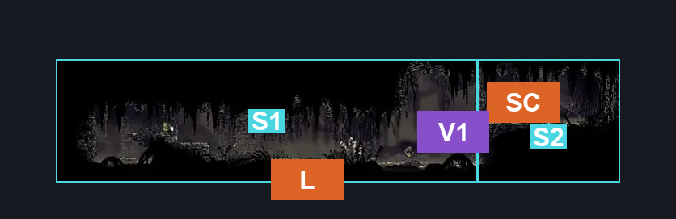
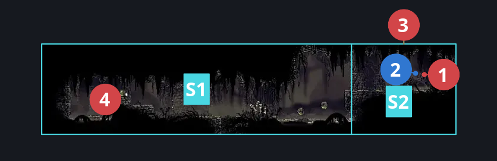
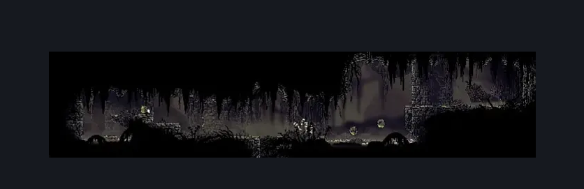

# Bilewater Lower East Hall Secret (Shadow_21)

**Game ID:** Shadow_21

**Contributors:** Herchey and Castle Guard 3

## Subrooms

| No. | Subroom | Annotated |
| --- | --- | --- |
| S1 | lower area | ✓ |
| S2 | upper area | ✓ |

## Room Transitions

| Alias | Name | From subroom | Destination | Destination alias | Requirements | TODO | Verification | Annotated | Notes |
| --- | --- | --- | --- | --- | --- | --- | --- | --- | --- |
| L | lower | lower area | [Bilewater Lower East Hall (Shadow_03)](bilewater-lower-east-hall.md) | C | nada |  | Verified | ✓ |  |
| SC | slab capture | upper area | [Slab Capture](../fast-travel/slab-capture.md) | BW | after Get Kidnapped |  | Verified | ✓ |  |

## Subroom Connections

| Alias | Name | Source | Destination | Requirements | TODO | Verification | Annotated | Notes |
| --- | --- | --- | --- | --- | --- | --- | --- | --- |
| V1 | vertical 1 | lower area | upper area | clawline right OR cling grip right OR ledge grab right OR faydown cloak OR drifter's cloak OR dash right OR easy beast pogo |  | Verified | ✓ | converted get kidnapped into subroom connection to simplify kidnapping requirements |
| V1 | vertical 1 | upper area | lower area | none (falling) |  | Verified | ✓ |  |

## Check Locations

| No. | Check | Subroom | Requirements | TODO | Verification | Location Type | Annotated | Notes |
| --- | --- | --- | --- | --- | --- | --- | --- | --- |
| 1 | Wardenfly | upper area | ( act 1 AND act 2 ) AND defeat THE Bell Beast Boss Fight AND (  after Lace Second Encounter IN Choral Chambers Eastern Shaft OR after Lace Second Encounter IN Grand Bellway Shaft ) |  | Verified | enemy | ✓ | per the wiki |
| 2 | Get Kidnapped | upper area | after Wardenfly |  | Verified | logic-point | ✓ |  |
| 3 | Stilkin 1 | upper area | act 3 |  | Verified | enemy | ✓ |  |
| 4 | Miremite 1 | lower area | none |  | Verified | enemy | ✓ |  |

## Room Images

### Connections

### Checks

### Scene

