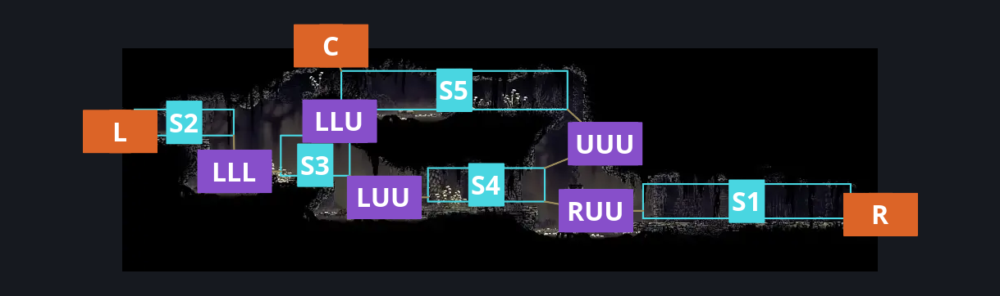
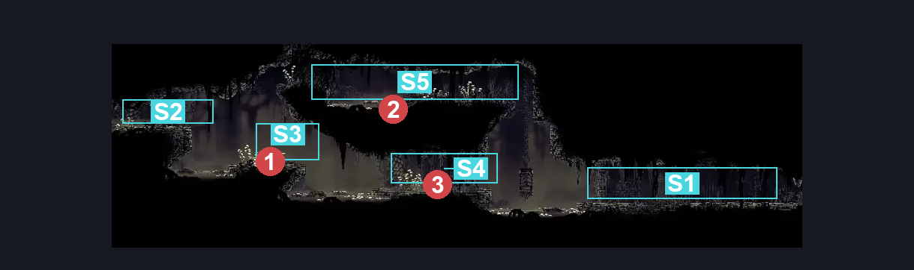
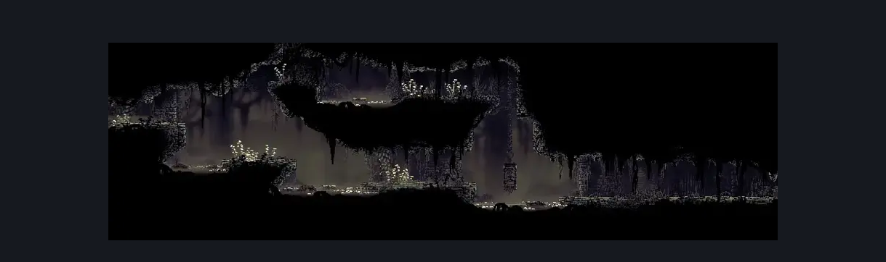

# Bilewater Lower East Hall (Shadow_03)

**Game ID:** Shadow_03

**Contributors:** Herchey and Peter Griffin from Family Guy

## Subrooms

| No. | Subroom | Annotated |
| --- | --- | --- |
| S1 | right hall | ✓ |
| S2 | left platform | ✓ |
| S3 | left lower | ✓ |
| S4 | under upper | ✓ |
| S5 | upper | ✓ |

## Room Transitions

| Alias | Name | From subroom | Destination | Destination alias | Requirements | TODO | Verification | Annotated | Notes |
| --- | --- | --- | --- | --- | --- | --- | --- | --- | --- |
| R | right | right hall | [Bilewater East Column (Shadow_09)](bilewater-east-column.md) | UL | none |  | Verified | ✓ |  |
| C | ceiling | upper | [Bilewater Lower East Hall Secret (Shadow_21)](bilewater-lower-east-hall-secret.md) | L | Faydown cloak OR cling grip either OR silk soar OR easy scuttlebrace |  | Verified | ✓ |  |
| L | left | left platform | [Bilewater Lower Bloatroach Tower (Shadow_02)](bilewater-lower-bloatroach-tower.md) | LR | none |  | Verified | ✓ |  |

## Subroom Connections

| Alias | Name | Source | Destination | Requirements | TODO | Verification | Annotated | Notes |
| --- | --- | --- | --- | --- | --- | --- | --- | --- |
| LLL | left to left lower | left platform | left lower | none |  | Verified | ✓ |  |
| LLL | left to left lower | left lower | left platform | (cling grip left AND (swim OR clawline left OR sharpdart OR drifter’s cloak OR run OR dash left)) OR faydown cloak |  | Verified | ✓ | "OR medium voltvessel water pogo x 1" |
| LLU | left lower to upper | left lower | upper | silk soar |  | Verified | ✓ |  |
| LLU | left lower to upper | upper | left lower | none |  | Verified | ✓ |  |
| LUU | left lower to under upper | left lower | under upper | none |  | Verified | ✓ |  |
| LUU | left lower to under upper | under upper | left lower | Ledge grab left OR cling grip left OR easy scuttlebrace OR medium voltvessels stall x 1 OR clawline left x 1 |  | Verified | ✓ |  |
| UUU | under upper to upper | upper | under upper | invalid |  | Verified | ✓ | itemless route: LLU->LUU |
| UUU | under upper to upper | under upper | upper | (cling grip right OR silk soar) AND (ledge grab left OR run left OR clawline left x 1 OR sharpdart x 1 OR easy voltvessels stall x 1) |  | Verified | ✓ |  |
| RUU | right to under upper | right hall | under upper | ((cling grip left OR ledge grab left) AND (swim OR clawline left OR sharpdart OR drifter’s cloak OR run)) OR faydown cloak |  | Verified | ✓ | Voltvessel water pogo crusade was here 17/11  Cool. Add it when it's a real predicate. >:( - Herchey  "OR easy voltvessel water pogo x 1" |
| RUU | right to under upper | under upper | right hall | swim OR run OR sharpdart OR clawline right x 1 OR scuttlebrace OR drifter's cloak OR faydown cloak OR easy hunter pogo OR easy beast pogo OR easy architect pogo OR medium voltvessels stall x 1 |  | Verified | ✓ |  |

## Check Locations

| No. | Check | Subroom | Requirements | TODO | Verification | Location Type | Annotated | Notes |
| --- | --- | --- | --- | --- | --- | --- | --- | --- |
| 1 | Greg, the Stilkin | left lower | none |  | Verified | enemy | ✓ | Formerly: Stilkin 1 |
| 2 | Abraham, the Stilkin | upper | none |  | Verified | enemy | ✓ | Formerly: Stilkin 2 |
| 3 | Charlotte, the Stilkin | under upper | none |  | Verified | enemy | ✓ | Formerly: Stilkin 3 |

## Room Images

### Connections

### Checks

### Scene

