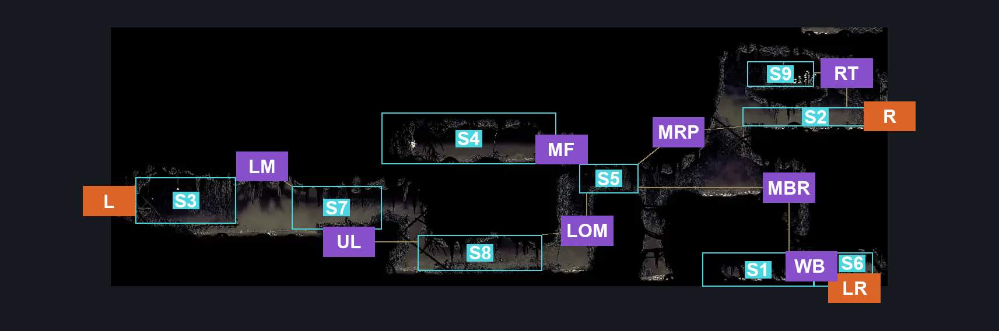
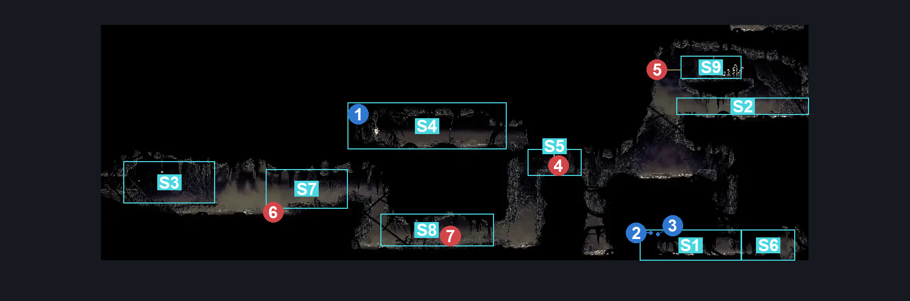
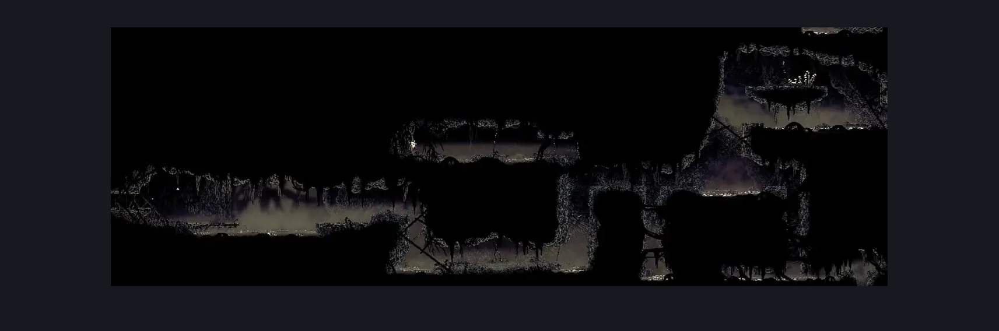

# Bilewater Lower Trap Gauntlet Hall (Shadow_10)

**Game ID:** Shadow_10

**Contributors:** Herchey and Leon Sexgod Kennedy

## Subrooms

| No. | Subroom | Annotated |
| --- | --- | --- |
| S1 | bottom | ✓ |
| S2 | right door plat | ✓ |
| S3 | left door plat | ✓ |
| S4 | flea room | ✓ |
| S5 | below flea | ✓ |
| S6 | bottom right | ✓ |
| S7 | up left plat | ✓ |
| S8 | low hall | ✓ |
| S9 | top plat | ✓ |

## Room Transitions

| Alias | Name | From subroom | Destination | Destination alias | Requirements | TODO | Verification | Annotated | Notes |
| --- | --- | --- | --- | --- | --- | --- | --- | --- | --- |
| LR | lower right | bottom right | [Bilewater East Bench (Shadow_08)](bilewater-east-bench.md) | C | none |  | Verified | ✓ | breakable wall |
| L | left | left door plat | [Bilewater Hanging Corpse Room (Shadow_16)](bilewater-hanging-corpse-room.md) | R | none |  | Verified | ✓ |  |
| R | right | right door plat | [Bilewater Vertical Sac Pogo Room (Shadow_19)](bilewater-vertical-sac-pogo-room.md) | LL | none |  | Verified | ✓ |  |

## Subroom Connections

| Alias | Name | Source | Destination | Requirements | TODO | Verification | Annotated | Notes |
| --- | --- | --- | --- | --- | --- | --- | --- | --- |
| LM | left to mid | left door plat | up left plat | swim OR run OR clawline right OR sharpdart OR faydown cloak OR drifter's cloak OR easy beast pogo |  | Verified | ✓ |  |
| LM | left to mid | up left plat | left door plat | swim OR run OR clawline OR sharpdart OR faydown cloak OR drifter's cloak OR easy beast pogo |  | Verified | ✓ |  |
| MF | mid to flea | below flea | flea room | cling grip left OR (faydown cloak AND cling grip right) OR scuttlebrace |  | Verified | ✓ |  |
| MF | mid to flea | flea room | below flea | none |  | Verified | ✓ |  |
| MBR | mid to bottom right | below flea | bottom | break wall right |  | Verified | ✓ |  |
| MBR | mid to bottom right | bottom | below flea | cling grip either OR scuttlebrace |  | Verified | ✓ |  |
| MRP | mid to right plat | below flea | right door plat | faydown cloak AND cling grip right |  | Verified | ✓ |  |
| MRP | mid to right plat | right door plat | below flea | none |  | Verified | ✓ | falling |
| WB | wall breakthrough | bottom | bottom right | break wall right AND (swim OR (proficient movement AND clawline right AND (faydown OR ledge grab right OR cling grip right))) |  | Verified | ✓ |  |
| WB | wall breakthrough | bottom right | bottom | break wall left AND (swim OR (proficient movement AND faydown AND (clawline left OR sharpdart))) |  | Verified | ✓ |  |
| UL | up to low | up left plat | low hall | (swim OR dash right OR scuttlebrace OR clawline right OR sharpdart OR faydown cloak OR drifter's cloak) |  | Verified | ✓ |  |
| UL | up to low | low hall | up left plat | cling grip left OR (faydown cloak AND cling grip right) OR scuttlebrace |  | Verified | ✓ |  |
| LOM | low to mid | low hall | below flea | cling grip right OR (faydown cloak AND cling grip left) OR scuttlebrace |  | Verified | ✓ |  |
| LOM | low to mid | below flea | low hall | swim OR dash left OR clawline left OR sharpdart OR faydown cloak OR drifter's cloak OR easy beast pogo |  | Verified | ✓ |  |
| RT | right to top | right door plat | top plat | (faydown cloak AND (cling grip either OR ledge grab either)) OR (proficient movement AND scuttlebrace AND clawline) OR (silk soar AND dash left) |  | Verified | ✓ |  |
| RT | right to top | top plat | right door plat | none |  | Verified | ✓ | falling |

## Check Locations

| No. | Check | Subroom | Requirements | TODO | Verification | Location Type | Annotated | Notes |
| --- | --- | --- | --- | --- | --- | --- | --- | --- |
| 1 | Bilewater - The Flea That Couldn't Make It Past All The Bilewater Traps | flea room | break vines left |  | Verified | collectible | ✓ | Formerly: Flea: Bilehaven |
| 2 | Bilewater - Shell Shard Cache #1 | bottom | attack up AND swim |  | Verified | collectible | ✓ |  |
| 3 | Bilewater - Shell Shard Cache #2 | bottom | attack up AND swim |  | Verified | collectible | ✓ |  |
| 4 | Stilkin 1 | below flea | none |  | Verified | enemy | ✓ |  |
| 5 | Stilkin 2 | top plat | none |  | Verified | enemy | ✓ |  |
| 6 | Stilkin 3 | up left plat | none |  | Verified | enemy | ✓ |  |
| 7 | Stilkin 4 | low hall | none |  | Verified | enemy | ✓ |  |

## Room Images

### Connections

### Checks

### Scene

