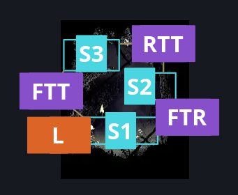
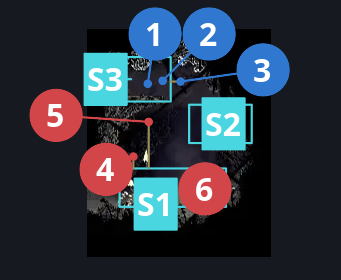
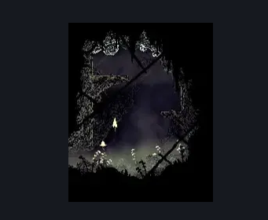

# Bilewater Northeast Tiny Room (Shadow_25)

**Game ID:** Shadow_25

**Contributors:** Herchey and NOT 8bitdo (awful ass controller firmware)

## Subrooms

| No. | Subroom | Annotated |
| --- | --- | --- |
| S1 | floor | ✓ |
| S2 | right | ✓ |
| S3 | top | ✓ |

## Room Transitions

| Alias | Name | From subroom | Destination | Destination alias | Requirements | TODO | Verification | Annotated | Notes |
| --- | --- | --- | --- | --- | --- | --- | --- | --- | --- |
| L | left | floor | [Bilewater Vertical Sac Pogo Room (Shadow_19)](bilewater-vertical-sac-pogo-room.md) | LR | none |  | Verified | ✓ |  |

## Subroom Connections

| Alias | Name | Source | Destination | Requirements | TODO | Verification | Annotated | Notes |
| --- | --- | --- | --- | --- | --- | --- | --- | --- |
| FTR | floor to right | right | floor | none |  | Verified | ✓ |  |
| FTR | floor to right | floor | right | faydown OR easy enemy pogo off Mothleaf Lagnia OR silk soar OR (cling grip left AND (clawline right OR sharpdart OR easy beast pogo OR drifter's OR dash right)) |  | Verified | ✓ |  |
| RTT | right to top | right | top | (cling grip right AND (clawline left OR sharpdart OR easy beast pogo OR dash left)) OR ((ledge grab left OR cling grip left) AND (clawline left OR dash left OR sharpdart)) |  | Verified | ✓ |  |
| RTT | right to top | top | right | none |  | Verified | ✓ |  |
| FTT | floor to top | floor | top | silk soar OR (faydown cloak AND cling grip left) |  | Verified | ✓ |  |
| FTT | floor to top | top | floor | none |  | Verified | ✓ |  |

## Check Locations

| No. | Check | Subroom | Requirements | TODO | Verification | Location Type | Annotated | Notes |
| --- | --- | --- | --- | --- | --- | --- | --- | --- |
| 1 | Bilewater - First Third Of The Shards In A Mothed Up Bilewater Closet | top | none |  | Verified | resource | ✓ | Formerly: Bilewater - Shell Shard Cache #5 |
| 2 | Bilewater - Second Third Of The Shards In A Mothed Up Bilewater Closet | top | none |  | Verified | resource | ✓ | Formerly: Bilewater - Shell Shard Cache #6 |
| 3 | Bilewater - Third Third Of The Shards In A Mothed Up Bilewater Closet | top | none |  | Verified | resource | ✓ | Formerly: Bilewater - Shell Shard Cache #7 |
| 4 | Mothleaf Lagnia 1 | floor | none |  | Verified | enemy | ✓ |  |
| 5 | Mothleaf Lagnia 2 | floor | none |  | Verified | enemy | ✓ |  |
| 6 | Mothleaf Lagnia 3 | floor | none |  | Verified | enemy | ✓ |  |

## Room Images

### Connections

### Checks

### Scene

