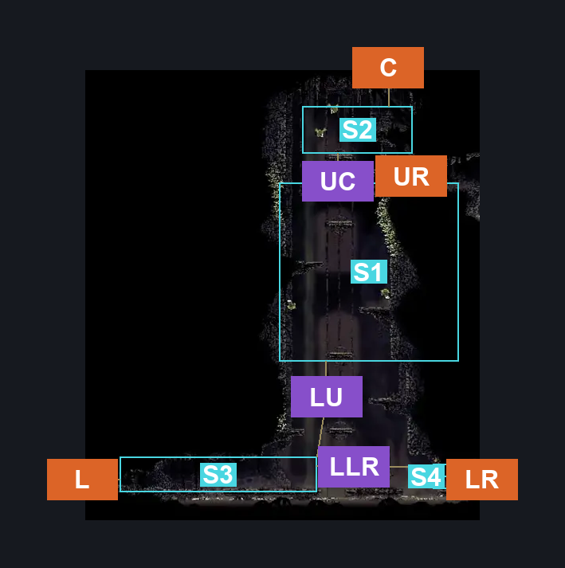
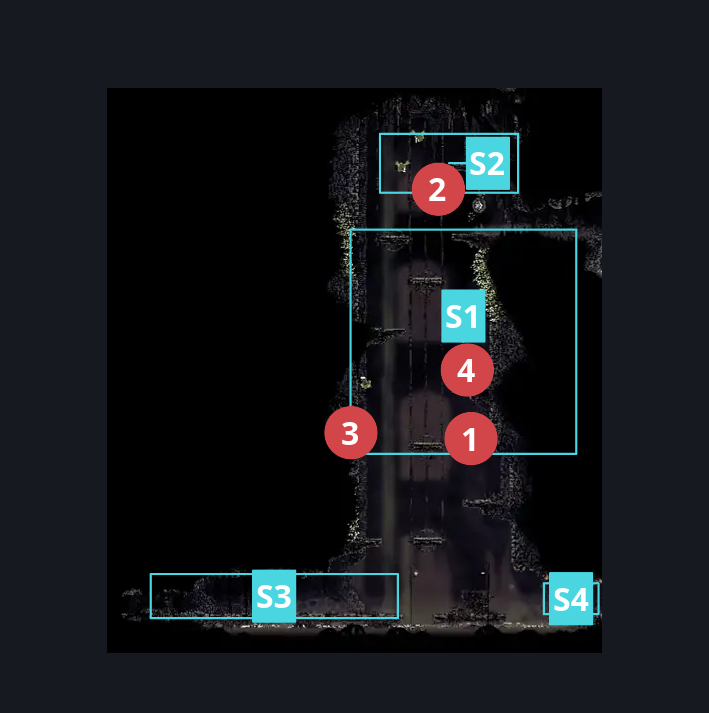
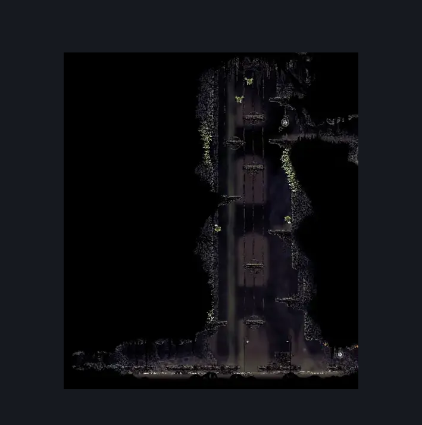

# Bilewater Organ Entrance (Shadow_04)

**Game ID:** Shadow_04

**Contributors:** Herchey and Bill Gates

## Subrooms

| No. | Subroom | Annotated |
| --- | --- | --- |
| S1 | up right | ✓ |
| S2 | ceiling | ✓ |
| S3 | left | ✓ |
| S4 | lower right | ✓ |

## Room Transitions

| Alias | Name | From subroom | Destination | Destination alias | Requirements | TODO | Verification | Annotated | Notes |
| --- | --- | --- | --- | --- | --- | --- | --- | --- | --- |
| LR | lower right | lower right | [Bilewater Bellway (Bellway_Shadow)](bilewater-bellway.md) | L | break wall either |  | Verified | ✓ |  |
| L | left | left | [Exhaust Organ Exterior (Dust_09)](exhaust-organ-exterior.md) | R | none |  | Verified | ✓ |  |
| C | ceiling | ceiling | [Bilewater West Secret Rooms (Shadow_20)](bilewater-west-secret-rooms.md) | L | cling grip right OR scuttlebrace OR silk soar OR (faydown cloak AND easy pogo off Swamp Squit) |  | Verified | ✓ |  |
| UR | upper right | up right | [Bilewater West Hall (Shadow_04b)](bilewater-west-hall.md) | L | none |  | Verified | ✓ |  |

## Subroom Connections

| Alias | Name | Source | Destination | Requirements | TODO | Verification | Annotated | Notes |
| --- | --- | --- | --- | --- | --- | --- | --- | --- |
| LLR | left to low right | left | lower right | drifter's cloak OR faydown cloak OR clawline right OR sharpdart OR scuttlebrace OR run OR easy hunter pogo OR easy beast pogo OR easy architect pogo OR easy shaman pogo OR (cling grip right AND proficient movement) |  | Verified | ✓ |  |
| LLR | left to low right | lower right | left | drifter's cloak OR faydown cloak OR clawline left OR sharpdart OR scuttlebrace OR run OR easy hunter pogo OR easy beast pogo OR easy architect pogo OR easy shaman pogo OR ledge grab  left OR cling grip left |  | Verified | ✓ |  |
| LU | left to up right | left | up right | faydown cloak OR silk soar OR (cling grip both AND (dash both OR drifter's cloak OR (clawline both AND ledge grab right))) |  | Verified | ✓ |  |
| LU | left to up right | up right | left | none |  | Verified | ✓ |  |
| UC | up right to ceiling | up right | ceiling | ledge grab left OR cling grip left OR faydown cloak OR silk soar OR easy pogo off swamp squit |  | Verified | ✓ |  |
| UC | up right to ceiling | ceiling | up right | none |  | Verified | ✓ |  |

## Check Locations

| No. | Check | Subroom | Requirements | TODO | Verification | Location Type | Annotated | Notes |
| --- | --- | --- | --- | --- | --- | --- | --- | --- |
| 1 | Swamp Squit 1 | up right | none |  | Verified | enemy | ✓ |  |
| 2 | Swamp Squit 2 | ceiling | none |  | Verified | enemy | ✓ |  |
| 3 | Miremite 1 | up right | none |  | Verified | enemy | ✓ |  |
| 4 | Miremite 2 | up right | none |  | Verified | enemy | ✓ |  |

## Room Images

### Connections

### Checks

### Scene

