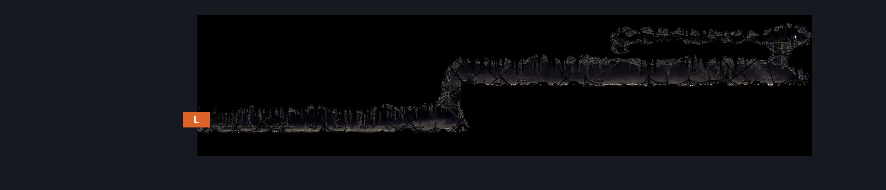
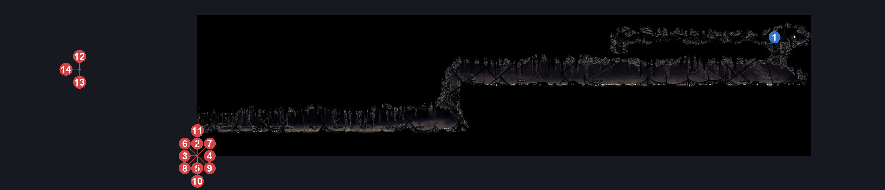
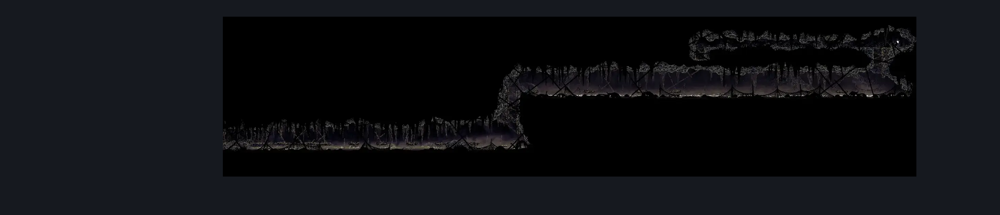

# Bilewater Slubberlug River (Shadow_13)

**Game ID:** Shadow_13

**Contributors:** Herchey and pannenkoek2012

## Subrooms

No subrooms defined.

## Room Transitions

| Alias | Name | From subroom | Destination | Destination alias | Requirements | TODO | Verification | Annotated | Notes |
| --- | --- | --- | --- | --- | --- | --- | --- | --- | --- |
| L | left |  | [Bilewater Spike Ball Ceiling Trap Room (Shadow_11)](bilewater-spike-ball-ceiling-trap-room.md) | R | none |  | Verified | ✓ |  |

## Subroom Connections

No subroom connections defined.

## Check Locations

| No. | Check | Subroom | Requirements | TODO | Verification | Location Type | Annotated | Notes |
| --- | --- | --- | --- | --- | --- | --- | --- | --- |
| 1 | Bilewater - Mask Shard |  | cling grip right  AND  ( (faydown cloak AND drifter's cloak) OR ((clawline right OR sharpdart OR drifter's cloak) AND (faydown cloak OR medium pogo off Slubberlug))) |  | Verified | collectible | ✓ |  |
| 2 | Slubberlug 1 |  | none |  | Verified | enemy | ✓ |  |
| 3 | Slubberlug 2 |  | none |  | Verified | enemy | ✓ |  |
| 4 | Slubberlug 3 |  | none |  | Verified | enemy | ✓ |  |
| 5 | Slubberlug 4 |  | none |  | Verified | enemy | ✓ |  |
| 6 | Slubberlug 5 |  | none |  | Verified | enemy | ✓ |  |
| 7 | Slubberlug 6 |  | none |  | Verified | enemy | ✓ |  |
| 8 | Slubberlug 7 |  | none |  | Verified | enemy | ✓ |  |
| 9 | Slubberlug 8 |  | none |  | Verified | enemy | ✓ |  |
| 10 | Slubberlug 9 |  | none |  | Verified | enemy | ✓ |  |
| 11 | Slubberlug 10 |  | none |  | Verified | enemy | ✓ |  |
| 12 | Swamp Squit 1 |  | Invalid |  | Verified | enemy | ✓ | Disabled; no activation found. |
| 13 | Swamp Squit 2 |  | Invalid |  | Verified | enemy | ✓ | Disabled; no activation found. |
| 14 | Swamp Squit 3 |  | Invalid |  | Verified | enemy | ✓ | Disabled; no activation found. |

## Room Images

### Connections

### Checks

### Scene

