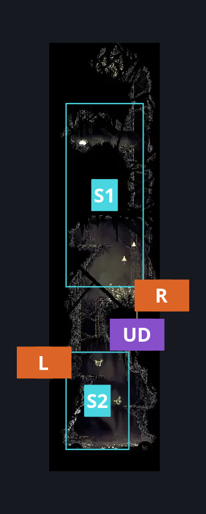
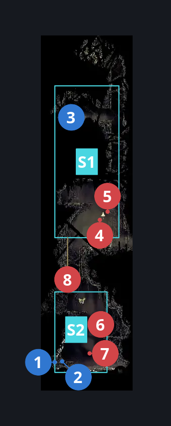
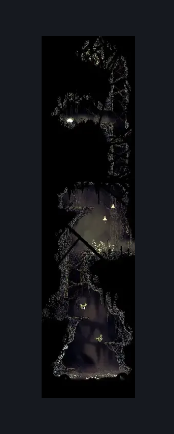

# Bilewater Spike Ball Ceiling Trap Room (Shadow_11)

**Game ID:** Shadow_11

**Contributors:** Herchey and Me

## Subrooms

| No. | Subroom | Annotated |
| --- | --- | --- |
| S1 | upper | ✓ |
| S2 | lower | ✓ |

## Room Transitions

| Alias | Name | From subroom | Destination | Destination alias | Requirements | TODO | Verification | Annotated | Notes |
| --- | --- | --- | --- | --- | --- | --- | --- | --- | --- |
| R | right | upper | [Bilewater Slubberlug River (Shadow_13)](bilewater-slubberlug-river.md) | L | none |  | Verified | ✓ |  |
| L | left | lower | [Bilewater Upper East Column (Shadow_26)](bilewater-upper-east-column.md) | LR | none |  | Verified | ✓ |  |

## Subroom Connections

| Alias | Name | Source | Destination | Requirements | TODO | Verification | Annotated | Notes |
| --- | --- | --- | --- | --- | --- | --- | --- | --- |
| UD | up and down | upper | lower | none |  | Verified | ✓ |  |
| UD | up and down | lower | upper | silk soar OR cling grip left OR (faydown cloak AND (cling grip right OR (scuttlebrace AND (dash right OR clawline right OR sharpdart OR easy [hunter, beast, witch, architect, shaman, reaper] pogo)))) |  | Verified | ✓ |  |

## Check Locations

| No. | Check | Subroom | Requirements | TODO | Verification | Location Type | Annotated | Notes |
| --- | --- | --- | --- | --- | --- | --- | --- | --- |
| 1 | Bilewater - Shell Shard Cache #3 | lower | none |  | Verified | collectible | ✓ |  |
| 2 | Bilewater - Shell Shard Cache #4 | lower | none |  | Verified | collectible | ✓ |  |
| 3 | Quick Sling | upper | (cling grip right OR silk soar) AND break wall up |  | Verified | collectible | ✓ |  |
| 4 | Mothleaf Lagnia 1 | upper | none |  | Verified | enemy | ✓ |  |
| 5 | Mothleaf Lagnia 2 | upper | none |  | Verified | enemy | ✓ |  |
| 6 | Swamp Squit 1 | lower | none |  | Verified | enemy | ✓ |  |
| 7 | Swamp Squit 2 | lower | none |  | Verified | enemy | ✓ |  |
| 8 | Miremite 1 | upper | invalid |  | Verified | enemy | ✓ |  |

## Room Images

### Connections

### Checks

### Scene

