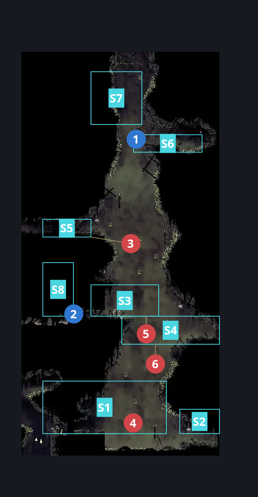
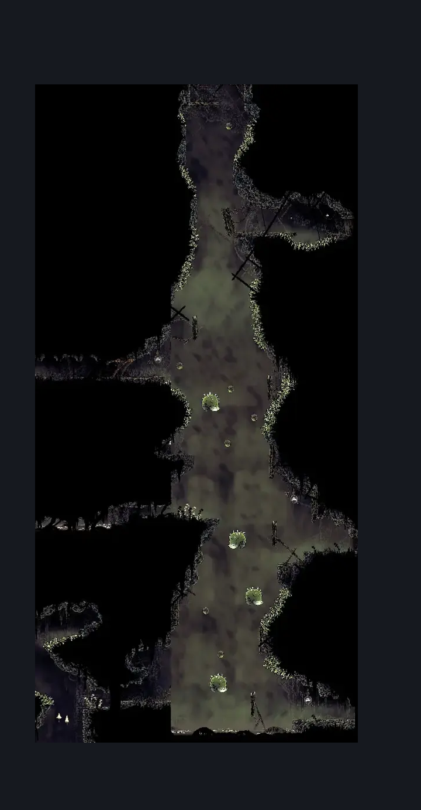

# Bilewater Upper Bloatroach Tower (Shadow_01)

**Game ID:** Shadow_01

**Contributors:** Herchey, Hutyrix and Red (his cat)

## Subrooms

| No. | Subroom | Annotated |
| --- | --- | --- |
| S1 | lower left | ✓ |
| S2 | lower right | ✓ |
| S3 | middle left | ✓ |
| S4 | middle right | ✓ |
| S5 | upper left | ✓ |
| S6 | upper right | ✓ |
| S7 | top | ✓ |

## Room Transitions

| Alias | Name | From subroom | Destination | Destination alias | Requirements | TODO | Verification | Annotated | Notes |
| --- | --- | --- | --- | --- | --- | --- | --- | --- | --- |
| MR | middle right | middle right | [Bilewater Hanging Corpse Room (Shadow_16)](bilewater-hanging-corpse-room.md) | L | none |  | Verified | ✓ |  |
| UR | upper right | upper right | [Bilewater Groal Arena (Shadow_18)](bilewater-groal-arena.md) | L | none |  | Verified | ✓ |  |
| LR | lower right | lower right | [Bilewater Upper East Column (Shadow_26)](bilewater-upper-east-column.md) | UL | none |  | Verified | ✓ |  |
| ML | middle left | middle left | [Bilewater Bullshit Bench (Shadow_15)](bilewater-bullshit-bench.md) | LR | prereq Bilewater Bullshit Bench Exit Wall IN Bilewater Bullshit Bench |  | Verified | ✓ | Cannot enter from right until broken from left. |
| UL | upper left | upper left | [Bilewater Bullshit Bench (Shadow_15)](bilewater-bullshit-bench.md) | UR | none |  | Verified | ✓ |  |
| LL | lower left | lower left | [Bilewater Upper West Column (Shadow_14)](bilewater-upper-west-column.md) | UR | none |  | Verified | ✓ |  |
| C | ceiling | top | [Putrified Ducts Connection To Bilewater (Aqueduct_04)](../putrified-ducts/putrified-ducts-connection-to-bilewater.md) | F | none |  | Verified | ✓ |  |

## Subroom Connections

| Alias | Name | Source | Destination | Requirements | TODO | Verification | Annotated | Notes |
| --- | --- | --- | --- | --- | --- | --- | --- | --- |
| LLR | lower left to lower right | lower left | lower right | swim OR (dash AND (faydown cloak OR cling grip OR enemy pogo)) OR (faydown cloak AND drifter's cloak) OR medium [hunter,wanderer] voltwater pogo |  | Verified | ✓ | Due to the nature of the room, enemy pogos are expected here  Voltvessel water pogo crusade was here 17/11 |
| LLR | lower left to lower right | lower right | lower left | (swim AND faydown cloak AND (ledge grab left OR cling grip left)) OR  (proficient movement AND clawline left x 3) OR  (cling grip left AND faydown cloak AND (easy pogo off Bloatroach OR clawline left)) OR  medium [hunter, wanderer] voltwater pogo |  | Verified | ✓ | "Proficient movement" because apparently you can clawline those spikes on the lower right wall lmao.   Due to the nature of the room, enemy pogos are expected here. |
| LMR | lower left to middle right | lower left | middle right | cling grip AND ((faydown cloak AND (clawline OR enemy pogo)) OR (drifter's cloak AND clawline)) |  | Verified | ✓ | Due to the nature of the room, enemy pogos are expected here |
| LMR | lower left to middle right | middle right | lower left | swim OR enemy pogo OR clawline OR dash |  | Verified | ✓ | Dash only is very easily possible if the nearby bloatroach is dead |
| RML | middle right to middle left | middle right | middle left | cling grip AND  ((drifter's cloak AND (sharpdart OR clawline OR (enemy pogo AND ledge grab))) OR (faydown cloak AND (drifter's cloak OR dash OR clawline OR sharpdart)) OR (run AND faydown cloak AND (clawline OR enemy pogo))) |  | Verified | ✓ |  |
| RML | middle right to middle left | middle left | middle right | drifter's cloak OR faydown cloak OR clawline OR sharpdart OR dash OR run |  | Verified | ✓ | Doing this with only run is a pretty precise coyote jump to make it past the spikes. easy_skips maybe? |
| URT | upper right to top | upper right | top | cling grip AND (dash OR clawline OR (faydown cloak AND ledge grab) OR (drifter's cloak AND enemy pogo)) |  | Verified | ✓ |  |
| URT | upper right to top | top | upper right | none |  | Verified | ✓ |  |
| MLL | middle left to upper left | middle left | upper left | faydown cloak AND (ledge grab OR cling grip) AND (enemy pogo OR clawline) |  | Verified | ✓ |  |
| MLL | middle left to upper left | upper left | middle left | drifter's cloak OR faydown cloak OR clawline OR sharpdart OR run OR dash OR enemy pogo OR scuttlebrace |  | Verified | ✓ | Throw scuttle into easy_skips probably because it's not as intuitive |
| ULR | upper left to upper right | upper left | upper right | faydown cloak AND cling grip AND (enemy pogo OR sharpdart OR clawline) |  | Verified | ✓ |  |
| ULR | upper left to upper right | upper right | upper left | drifter's cloak OR (cling grip AND (dash OR sharpdart OR clawline OR faydown cloak OR easy beast pogo)) |  | Verified | ✓ |  |
| MLT | middle left to top | middle left | top | silk soar |  | Verified | ✓ |  |
| MLT | middle left to top | top | middle left | none |  | Verified | ✓ | falling |

## Check Locations

| No. | Check | Subroom | Requirements | TODO | Verification | Location Type | Annotated | Notes |
| --- | --- | --- | --- | --- | --- | --- | --- | --- |
| 1 | Drop the Bridge to Groal's Back Door | upper right | attack left |  | Verified | blockade | ✓ | Formerly: collapsible bridge |
| 2 | Bloatroach 1 | middle left | none |  | Verified | enemy | ✓ |  |
| 3 | Bloatroach 2 | lower left | none |  | Verified | enemy | ✓ |  |
| 4 | Bloatroach 3 | middle right | none |  | Verified | enemy | ✓ |  |
| 5 | Bloatroach 4 | middle right | none |  | Verified | enemy | ✓ |  |

## Room Images

### Connections

### Checks

### Scene

