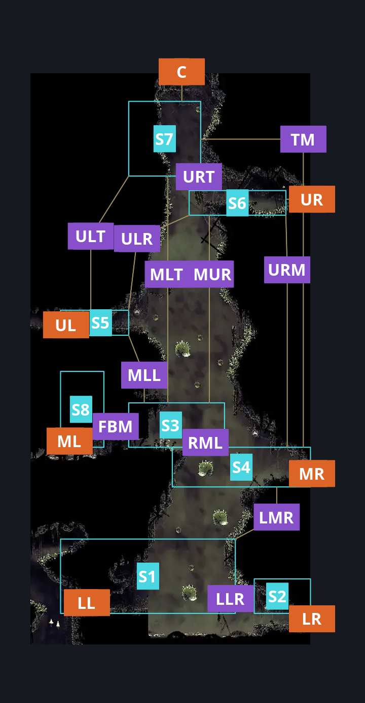

# Bilewater Upper Bloatroach Tower (Shadow_01)

**Game ID:** Shadow_01

**Contributors:** Herchey, Hutyrix and Red (his cat)

## Subrooms

| No. | Subroom | Annotated |
| --- | --- | --- |
| S1 | lower left | ✓ |
| S2 | lower right | ✓ |
| S3 | middle left | ✓ |
| S4 | middle right | ✓ |
| S5 | upper left | ✓ |
| S6 | upper right | ✓ |
| S7 | top | ✓ |
| S8 | fake | ✓ |

## Room Transitions

| Alias | Name | From subroom | Destination | Destination alias | Requirements | TODO | Verification | Annotated | Notes |
| --- | --- | --- | --- | --- | --- | --- | --- | --- | --- |
| MR | middle right | middle right | [Bilewater Hanging Corpse Room (Shadow_16)](bilewater-hanging-corpse-room.md) | L | none |  | Verified | ✓ |  |
| UR | upper right | upper right | [Bilewater Groal Arena (Shadow_18)](bilewater-groal-arena.md) | L | none |  | Verified | ✓ |  |
| LR | lower right | lower right | [Bilewater Upper East Column (Shadow_26)](bilewater-upper-east-column.md) | UL | none |  | Verified | ✓ |  |
| ML | middle left | fake | [Bilewater Fake Bench (Shadow_15)](bilewater-fake-bench.md) | LR | none |  | Verified | ✓ | Cannot enter from right until broken from left.  Am I stupid or is this wall in current room (Shadow_01), not in Fake Bench room (Shadow_15)?  ~3 minutes of work  Done.  old logic: prereq Bilewater Bullshit Bench Exit Wall IN Bilewater Bullshit Bench |
| UL | upper left | upper left | [Bilewater Fake Bench (Shadow_15)](bilewater-fake-bench.md) | UR | none |  | Verified | ✓ |  |
| LL | lower left | lower left | [Bilewater Upper West Column (Shadow_14)](bilewater-upper-west-column.md) | UR | none |  | Verified | ✓ |  |
| C | ceiling | top | [Putrified Ducts Connection To Bilewater (Aqueduct_04)](../putrified-ducts/putrified-ducts-connection-to-bilewater.md) | F | none |  | Verified | ✓ |  |

## Subroom Connections

| Alias | Name | Source | Destination | Requirements | TODO | Verification | Annotated | Notes |
| --- | --- | --- | --- | --- | --- | --- | --- | --- |
| LLR | lower left to lower right | lower left | lower right | swim OR clawline right x 3 OR (dash right AND (faydown cloak OR cling grip right OR easy pogo off bloatroach)) OR (faydown cloak AND drifter's cloak) OR medium [hunter,wanderer] voltwater pogo |  | Verified | ✓ | Due to the nature of the room, enemy pogos are expected here  Voltvessel water pogo crusade was here 17/11 |
| LLR | lower left to lower right | lower right | lower left | (swim AND faydown cloak AND (ledge grab left OR cling grip left)) OR  (proficient movement AND clawline left x 3) OR  (cling grip left AND faydown cloak AND (easy pogo off Bloatroach OR clawline left)) OR  medium [hunter, wanderer] voltwater pogo |  | Verified | ✓ | "Proficient movement" because apparently you can clawline those spikes on the lower right wall lmao.   Due to the nature of the room, enemy pogos are expected here. |
| LMR | lower left to middle right | lower left | middle right | (cling grip both AND clawline right x 4 AND (drifters OR (clawline left x 1 AND medium [flea brew,plasmium,voltvessels] stall x 1)))   OR (medium silk soar cancel x 1 AND cling grip left AND (faydown AND clawline right x 2 AND ledge grab right))   OR (intended pogo off bloatroach AND (faydown OR clawline both x 5) AND cling grip right) OR (easy pogo off bloatroach AND (easy shaman pogo OR medium [reaper,beast] pogo) AND faydown) OR (medium pogo off bloatroach AND cling grip right AND faydown AND medium damage boost off bloatroach (x 2)) OR (medium pogo off bloatroach AND medium silk soar cancel x 1 AND cling grip both AND (easy beast pogo OR (dash right AND (easy [wanderer,reaper,shaman] pogo OR (medium damage boost x 2 AND medium [witch,architect] pogo)))))  OR (hard shaman scuttle slide AND hard damage boost x 2 AND medium pogo off bloatroach AND hard pale nails stall x 2 (good luck)) |  | Verified | ✓ | Due to the nature of the room, enemy pogos are expected here  probably cbt scuttleglide is enough, CRAZY HARD tho ~Hutyrix  old logic: (cling grip left AND ((faydown cloak AND (clawline OR enemy pogo)) OR (drifter's cloak AND clawline))) |
| LMR | lower left to middle right | middle right | lower left | faydown OR drifters OR easy pogo off bloatroach OR clawline left x 2 OR sharpdart x 2 OR run left OR easy [hunter,reaper,witch,architect] pogo OR hard shaman pogo |  | Verified | ✓ | Run only is very easily possible if the nearby bloatroach is dead |
| RML | middle right to middle left | middle right | middle left | clawline left x 3  OR (medium shaman pogo AND dash left AND ledge grab left) OR (drifters AND (cling grip left OR silk soar x 1)) OR (medium scuttlebrace AND medium [reaper,architect,shaman] pogo AND (faydown OR drifters OR sharpdart OR (dash left AND (flea brew OR easy shaman pogo OR medium voltvessels stall OR easy [reaper,architect] heal stall)))) OR (cling grip both AND (dash left AND medium [thread storm,parry,rune rage,pale nails] stall)) OR (cling grip left AND easy pogo off bloatroach) OR (cling grip right AND (faydown OR drifters OR sharpdart OR easy beast charge OR (dash left AND (flea brew OR easy [beast,shaman] pogo OR medium voltvessels stall OR easy [hunter,reaper,wanderer,beast,architect] heal stall OR medium witch heal stall)))) OR (faydown AND (ledge grab left OR dash left OR sharpdart OR easy pogo off bloatroach OR flea brew jump OR easy [beast,architect] pogo OR medium [hunter,reaper,witch,shaman] pogo OR easy [voltvessels,plasmium] stall x 1 OR medium [thread storm,parry,rune rage,pale nails] stall x 2)) OR easy shaman scuttle slide |  | Verified | ✓ | old logic: (cling grip AND  ((drifter's cloak AND (sharpdart OR clawline OR (enemy pogo AND ledge grab))) OR (faydown cloak AND (drifter's cloak OR dash OR clawline OR sharpdart)) OR (run AND faydown cloak AND (clawline OR enemy pogo)))) |
| RML | middle right to middle left | middle left | middle right | drifter's cloak OR faydown cloak OR clawline right x 1 OR sharpdart OR dash right OR (run right AND proficient movement) OR easy beast pogo OR medium [hunter,wanderer] pogo OR medium naked pogo |  | Verified | ✓ | Doing this with only run is a pretty precise coyote jump to make it past the spikes. easy_skips maybe? |
| URT | upper right to top | upper right | top | cling grip both AND (faydown OR clawline both x 4 OR (drifters AND proficient movement)) |  | Verified | ✓ | some logic can be missed, for example faydown AND cling grip right AND easy reaper pogo  old syntax: cling grip AND (dash OR clawline OR (faydown cloak AND ledge grab) OR (drifter's cloak AND enemy pogo)) |
| URT | upper right to top | top | upper right | none |  | Verified | ✓ |  |
| MLL | middle left to upper left | middle left | upper left | (cling grip both AND clawline both x 7 AND (sharpdart OR easy [air bind, thread storm, parry, rune rage, pale nails, flea brew, voltvessels, flintslate, plasmium] stall)) OR  (cling grip both AND clawline right x 3 AND drifters AND (clawline left x 4 OR easy [reaper,shaman] pogo)) OR (faydown cloak AND cling grip left AND (dash left OR drifters OR sharpdart OR flea brew jump OR easy [reaper,beast,shaman] pogo OR medium [wanderer,architect] pogo)) |  | Verified | ✓ |  |
| MLL | middle left to upper left | upper left | middle left | proficient movement OR  drifter's cloak OR faydown cloak OR clawline right x 1 OR sharpdart OR run OR dash right OR easy pogo off bloatroach OR easy scuttlebrace |  | Verified | ✓ | Always possible - just pogo explosive bile orb.  Throw scuttle into easy_skips probably because it's not as intuitive |
| ULR | upper left to upper right | upper left | upper right | complete Drop the Bridge to Groal's Back Door AND (faydown OR medium shaman scuttle slide) AND (cling grip right OR (easy scuttlebrace AND (easy [hunter,reaper,beast,architect,shaman] pogo OR medium witch pogo OR hard wanderer pogo OR medium delvers drill stall))) |  | Verified | ✓ | Could be better  old logic:  faydown cloak AND cling grip AND (enemy pogo OR sharpdart OR clawline) |
| ULR | upper left to upper right | upper right | upper left | (complete Drop the Bridge to Groal's Back Door OR faydown OR silk soar x 1)AND (  medium damage boost x 2 OR drifters OR faydown OR clawline left x 2 OR easy [hunter,beast,architect] pogo OR easy flea brew stall x 1 OR medium [reaper,shaman] pogo OR hard wanderer pogo OR (proficient movement AND (ledge grab left OR dash left)) OR easy naked pogo) |  | Verified | ✓ | If not destroyed and not obtained (breakables rando), maybe wall stays untouched? so you need faydown or soar    pogo, then damage boost bile orb  old logic:  drifter's cloak OR (cling grip left AND (dash left OR sharpdart OR clawline left OR faydown cloak OR easy beast pogo)) |
| MUR | middle to upper right | middle left | upper right | silk soar x 1 |  | Verified | ✓ | much easier than MLT |
| MLT | middle left to top | middle left | top | (silk soar x 1 AND (proficient movement OR silkhearts x 1) AND (cling grip left OR faydown)) OR (medium silk soar cancel x 1 OR (easy silk soar cancel AND silkhearts x 1)) |  | Verified | ✓ | silkheart ensures you can kill Bloatroach with soar  Still, silk soar x 1 is too simple syntax for me |
| MLT | middle left to top | top | middle left | none (falling) |  | Verified | ✓ |  |
| ULT | upper left to top | upper left | top | invalid |  | Verified | ✓ |  |
| ULT | upper left to top | top | upper left | medium damage boost x 2 OR drifters OR faydown OR clawline left x 2 OR easy [hunter,beast,architect] pogo OR easy flea brew stall x 1 OR medium [reaper,shaman] pogo OR hard wanderer pogo OR (proficient movement AND (ledge grab left OR dash left)) OR easy naked pogo |  | Verified | ✓ | pogo, then damage boost bile orb |
| TM | top to middle | top | middle right | proficient movement OR( easy [hunter,reaper,beast,witch,architect,shaman] pogo OR medium wanderer pogo OR easy naked pogo) |  | Verified | ✓ |  |
| URM | upper right to middle | upper right | middle right | (complete Drop the Bridge to Groal's Back Door OR silk soar x 1 OR faydown) AND(  proficient movement OR( easy [hunter,reaper,beast,witch,architect,shaman] pogo OR medium wanderer pogo OR easy naked pogo)) |  | Verified | ✓ | If not destroyed and not obtained (breakables rando), maybe wall stays untouched? so you need faydown or soar |
| FBM | fake bench to middle | fake | middle left | complete Bilewater Fake Bench Exit Wall |  | Verified | ✓ |  |
| FBM | fake bench to middle | middle left | fake | complete Bilewater Fake Bench Exit Wall |  | Verified | ✓ |  |

## Check Locations

| No. | Check | Subroom | Requirements | TODO | Verification | Location Type | Annotated | Notes |
| --- | --- | --- | --- | --- | --- | --- | --- | --- |
| 1 | Drop the Bridge to Groal's Back Door | upper right | attack either |  | Verified | blockade | ✓ | Formerly: collapsible bridge |
| 2 | Bilewater Fake Bench Exit Wall | fake | attack either |  | Verified | blockade | ✓ | Formerly: Bilewater Bullshit Bench Exit Wall (in diffrent room for some reason) |
| 3 | Bloatroach 1 | upper left | faydown |  | Verified | enemy | ✓ | Can be better. Crests, tools, silk spells |
| 4 | Bloatroach 2 | lower left | run right OR faydown |  | Verified | enemy | ✓ | Can be better. Crests, tools, silk spells |
| 5 | Bloatroach 3 | middle left | attack down |  | Verified | enemy | ✓ |  |
| 6 | Bloatroach 4 | middle right | attack down |  | Verified | enemy | ✓ |  |

## Notes

MASSIVE OVERHAUL - 11/25/26 by Hutyrix

## Room Images

### Connections

### Checks

### Scene

