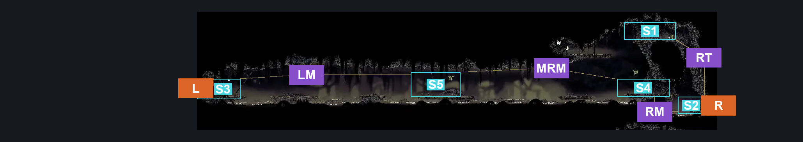
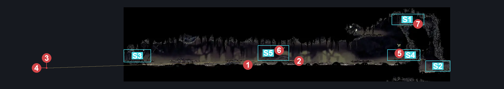
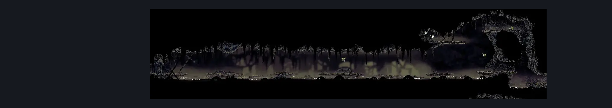

# Bilewater Upper Trap Gauntlet Hall (Shadow_12)

**Game ID:** Shadow_12

**Contributors:** Herchey, Hutyrix and John Madden

## Subrooms

| No. | Subroom | Annotated |
| --- | --- | --- |
| S1 | top floor | ✓ |
| S2 | right door | ✓ |
| S3 | left door | ✓ |
| S4 | mid rightmost | ✓ |
| S5 | mid | ✓ |

## Room Transitions

| Alias | Name | From subroom | Destination | Destination alias | Requirements | TODO | Verification | Annotated | Notes |
| --- | --- | --- | --- | --- | --- | --- | --- | --- | --- |
| R | right | right door | [Bilewater Vertical Sac Pogo Room (Shadow_19)](bilewater-vertical-sac-pogo-room.md) | UL | run OR clawline right OR sharpdart OR drifter's cloak OR faydown cloak OR swim | TODO | Verified | ✓ | Sharpdart requires 6 uses == 24 silk, so you'd need to farm the little shits to get across with ONLY this. ============== Add which enemy souls  you can farm the silk with, Pyxl 23/11 |
| L | left | left door | [Bilewater Groal Arena (Shadow_18)](bilewater-groal-arena.md) | R | faydown cloak OR ((ledge grab left OR cling grip left OR silk soar) AND (run OR clawline left OR sharpdart OR drifter's cloak OR swim)) | TODO | Verified | ✓ | Sharpdart requires 6 uses == 24 silk, so you'd need to farm the little shits to get across with ONLY this. ============== Add which enemy souls  you can farm the silk with, Pyxl 23/11 |

## Subroom Connections

| Alias | Name | Source | Destination | Requirements | TODO | Verification | Annotated | Notes |
| --- | --- | --- | --- | --- | --- | --- | --- | --- |
| RM | right to mid | right door | mid rightmost | ledge grab left OR faydown cloak OR cling grip left OR easy [hunter,wanderer] voltwater pogo x 1 |  | Verified | ✓ | I'm not doing this today. Voltvessel water pogo crusade here 17/11 |
| RM | right to mid | mid rightmost | right door | none |  | Verified | ✓ |  |
| RT | right to top | right door | top floor | silk soar |  | Verified | ✓ |  |
| RT | right to top | top floor | right door | none |  | Verified | ✓ |  |
| MRM | mid right to mid | mid rightmost | mid | swim OR run OR drifter's cloak OR faydown cloak OR clawline left x 2 |  | Verified | ✓ |  |
| MRM | mid right to mid | mid | mid rightmost | swim OR run OR drifter's cloak OR faydown cloak OR clawline right x 2 |  | Verified | ✓ |  |
| LM | left to mid | mid | left door | swim OR run OR clawline left x 3 OR faydown cloak OR swim OR drifter's cloak |  | Verified | ✓ |  |
| LM | left to mid | left door | mid | swim OR run OR clawline right x 3 OR sharpdart x 3 OR faydown cloak OR swim OR drifter's cloak |  | Verified | ✓ |  |

## Check Locations

| No. | Check | Subroom | Requirements | TODO | Verification | Location Type | Annotated | Notes |
| --- | --- | --- | --- | --- | --- | --- | --- | --- |
| 1 | Stilkin 1 | mid | none |  | Verified | enemy | ✓ | These fukrs can spawn nearly anywhere in this room. Placing in mid since I don't think they can spawn in the right door area. |
| 2 | Stilkin 2 | mid | none |  | Verified | enemy | ✓ | These fukrs can spawn nearly anywhere in this room. Placing in mid since I don't think they can spawn in the right door area. |
| 3 | Stilkin Trapper 1 | mid | invalid |  | Verified | enemy | ✓ | swampMuckmanTallInvades == true |
| 4 | Stilkin Trapper 2 | mid | invalid |  | Verified | enemy | ✓ | swampMuckmanTallInvades == true |
| 5 | Swamp Squit 1 | mid rightmost | none |  | Verified | enemy | ✓ |  |
| 6 | Swamp Squit 2 | mid | none |  | Verified | enemy | ✓ |  |
| 7 | Miremite 1 | top floor | none |  | Verified | enemy | ✓ |  |

## Notes

todo: rewrite this room, enemies required for sharpdart, stalls above water, top floor to mid rightmost drop

## Room Images

### Connections

### Checks

### Scene

