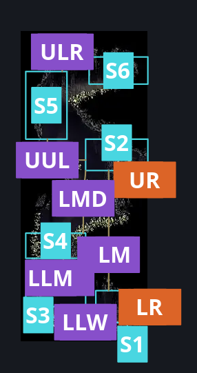
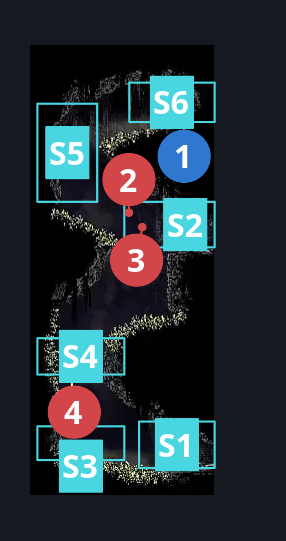
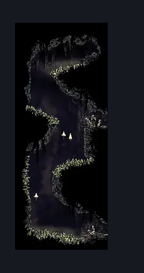

# Bilewater Upper West Column (Shadow_14)

**Game ID:** Shadow_14

**Contributors:** Herchey and his whole entire extended family

## Subrooms

| No. | Subroom | Annotated |
| --- | --- | --- |
| S1 | lower | ✓ |
| S2 | upper | ✓ |
| S3 | LL wall | ✓ |
| S4 | LM wall | ✓ |
| S5 | UL wall | ✓ |
| S6 | rose plat | ✓ |

## Room Transitions

| Alias | Name | From subroom | Destination | Destination alias | Requirements | TODO | Verification | Annotated | Notes |
| --- | --- | --- | --- | --- | --- | --- | --- | --- | --- |
| UR | upper right | upper | [Bilewater Upper Bloatroach Tower (Shadow_01)](bilewater-upper-bloatroach-tower.md) | LL | none |  | Verified | ✓ |  |
| LR | lower right | lower | [Bilewater Lower Bloatroach Tower (Shadow_02)](bilewater-lower-bloatroach-tower.md) | UL | none |  | Verified | ✓ |  |

## Subroom Connections

| Alias | Name | Source | Destination | Requirements | TODO | Verification | Annotated | Notes |
| --- | --- | --- | --- | --- | --- | --- | --- | --- |
| LM | low to up | upper | lower | drifter's OR  ((proficient movement OR Cling grip right) AND (faydown OR clawline right OR sharpdart OR dash right)) |  | Verified | ✓ | Clawline, sharpdart, dash are pretty annoying to hit without a cloak, so easy/medium skips |
| LLW | low to left wall | lower | LL wall | cling grip left AND (clawline left OR sharpdart OR dash left OR (faydown AND drifter's)) |  | Verified | ✓ |  |
| LLW | low to left wall | LL wall | lower | dash right OR clawline right OR sharpdart OR faydown OR drifter's OR easy beast pogo |  | Verified | ✓ |  |
| LLM | LL to LM walls | LL wall | LM wall | cling grip right |  | Verified | ✓ |  |
| LLM | LL to LM walls | LM wall | LL wall | cling grip left |  | Verified | ✓ |  |
| LMD | LM to door | LM wall | upper | cling grip right AND    ((proficient movement AND dash right AND clawline right) OR   (faydown AND (clawline right OR sharpdart OR dash right OR drifter's)   )) |  | Verified | ✓ |  |
| LMD | LM to door | upper | LM wall | cling grip right |  | Verified | ✓ |  |
| UUL | upper to ul | upper | UL wall | cling grip left AND  ((faydown cloak OR medium pogo off Mothleaf Lagnia) AND (clawline left OR sharpdart OR dash left OR drifter's)) |  | Verified | ✓ |  |
| UUL | upper to ul | UL wall | upper | dash right OR clawline right OR sharpdart OR easy beast pogo OR faydown OR drifter's |  | Verified | ✓ |  |
| ULR | UL to rose | UL wall | rose plat | clawline right OR sharpdart OR faydown OR (faydown AND (dash right OR drifter's)) OR  (drifter's AND (dash right AND (cling grip right OR ledge grab right))) |  | Verified | ✓ |  |
| ULR | UL to rose | rose plat | UL wall | drifter's OR clawline left OR sharpdart OR dash left OR (proficient movement AND scuttlebrace) |  | Verified | ✓ |  |

## Check Locations

| No. | Check | Subroom | Requirements | TODO | Verification | Location Type | Annotated | Notes |
| --- | --- | --- | --- | --- | --- | --- | --- | --- |
| 1 | Bilewater - Rosaries Above The Moths And Thorns | rose plat | none |  | Verified | resource | ✓ | Formerly: Bilewater - Rosary Cache #3 |
| 2 | Mothleaf Lagnia 1 | upper | none |  | Verified | enemy | ✓ |  |
| 3 | Mothleaf Lagnia 2 | upper | none |  | Verified | enemy | ✓ |  |
| 4 | Mothleaf Lagnia 3 | LL wall | none |  | Verified | enemy | ✓ |  |

## Room Images

### Connections

### Checks

### Scene

