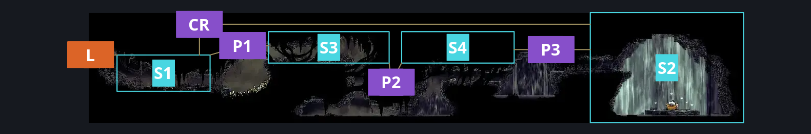
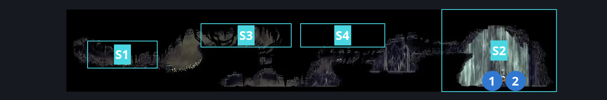
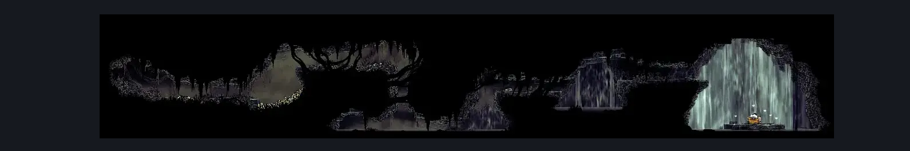

# Bilewater Waterfall (Shadow_24)

**Game ID:** Shadow_24

**Contributors:** PILKY, Herchey and the girl reading this

## Subrooms

| No. | Subroom | Annotated |
| --- | --- | --- |
| S1 | left exit | ✓ |
| S2 | trails end | ✓ |
| S3 | pilky subroom 1 | ✓ |
| S4 | pilky subroom 2 | ✓ |

## Room Transitions

| Alias | Name | From subroom | Destination | Destination alias | Requirements | TODO | Verification | Annotated | Notes |
| --- | --- | --- | --- | --- | --- | --- | --- | --- | --- |
| L | left | left exit | [Bilewater Vertical Sac Pogo Room (Shadow_19)](bilewater-vertical-sac-pogo-room.md) | UR | none |  | Verified | ✓ | blockade on other side of this door has no impact on this direction |

## Subroom Connections

| Alias | Name | Source | Destination | Requirements | TODO | Verification | Annotated | Notes |
| --- | --- | --- | --- | --- | --- | --- | --- | --- |
| CR | crossing | trails end | left exit | faydown cloak  AND swim  AND cling grip left  AND ( ledge grab left OR dash left OR clawline left OR sharpdart ) |  | Verified | ✓ | don't think you can get out without silk soar's height?  Yes you can. Use the wall on the other side of the room.  Or the left wall |
| P1 | pilky sequence 1 | left exit | pilky subroom 1 | ((faydown AND (cling grip right OR ledge grab right OR sprint right OR dash right OR clawline right OR sharpdart OR easy [shaman,beast] pogo OR easy [beast,architect,wanderer] charge OR easy [voltvessels,plasmium,flintslate,thread storm,cross stitch,rune rage, pale nails] stall OR easy bind stall)) OR (medium beast bind stall AND cling grip right AND (clawline right OR sharpdart)) OR (sprint right AND cling grip right AND medium shaman pogo) OR (hard shaman pogo AND hard pale nails stall x 3 AND (cling grip right OR ledge grab right))) |  | Verified | ✓ | I'm so sorry |
| P2 | pilky sequence 2 | pilky subroom 1 | pilky subroom 2 | (swim AND faydown AND (cling grip either OR (ledge grab right AND hard beast bind stall))) OR (faydown AND cling grip either AND (medium hunter voltwater pogo x 2 OR medium wanderer voltwater pogo x 4)) OR (clawline right x 2 AND faydown AND easy [flintslate, pale nails, rune rage, cross stitch, thread storm] stall AND (cling grip right OR (cling grip left AND medium beast bind stall))) OR (cling grip right AND (((clawline right x 2 AND dash right AND (easy [flintslate, plasmium, flea brew, pale nails, rune rage, cross stitch, thread storm] stall OR medium shaman pogo))) OR (clawline right x 3 AND (easy [flintslate, plasmium, flea brew, pale nails, rune rage, cross stitch, thread storm] stall x 2 OR medium shaman pogo)) OR (hard scuttleglide AND hard pale nails stall x 2))) OR ((cling grip either OR ledge grab right) AND (medium wanderer voltwater pogo x 4 OR medium hunter voltwater pogo x 3)) OR hard hunter voltwater pogo x 3 OR hard wanderer voltwater pogo x 5 |  | Verified | ✓ | I'm so sorry |
| P3 | pilky sequence 3 | pilky subroom 2 | trails end | ((swim AND (cling grip right OR (faydown AND (ledge grab right OR medium beast bind stall OR hard reserve bind stall)))) OR (sprint right AND (cling grip right OR ledge grab right OR drifters OR faydown OR dash right OR clawline right OR sharpdart OR easy beast pogo OR easy [beast,architect,wanderer] charge OR easy [voltvessels,plasmium,flea brew] stall OR medium [flintslate,silkshot original] stall)) OR (faydown AND (clawline right OR sharpdart OR ((ledge grab right OR cling grip right) AND cling grip left) OR easy [beast,shaman] pogo OR easy [beast,architect,wanderer] charge)) OR (cling grip left AND ((easy beast charge AND cling grip right) OR (medium shaman pogo AND (hard pale nails stall x 4 OR (hard pale nails stall x 3 AND (cling grip right OR ledge grab right)))))) OR (drifters AND (faydown OR cling grip left) AND (cling grip right OR ledge grab right)) OR easy hunter voltwater pogo OR easy wanderer voltwater pogo x 2) |  | Verified | ✓ | I'm so sorry |

## Check Locations

| No. | Check | Subroom | Requirements | TODO | Verification | Location Type | Annotated | Notes |
| --- | --- | --- | --- | --- | --- | --- | --- | --- |
| 1 | trails end wish granted | trails end | complete THE trails end wish promised |  | Verified | event | ✓ | cutscene needolin, not real needolin per Moriko - hero, 10/11 |
| 2 | Throwing Ring | trails end | complete trails end wish granted |  | Verified | collectible | ✓ | Dash, clawline, and sharpdart are a bit precise and require you to get nearly the most possible height out of first and second jumps |

## Notes

Compacted Pilky's logic to subrooms. It should be awesome now, as intended -Hutyrix, 11/24/26

## Room Images

### Connections

### Checks

### Scene

