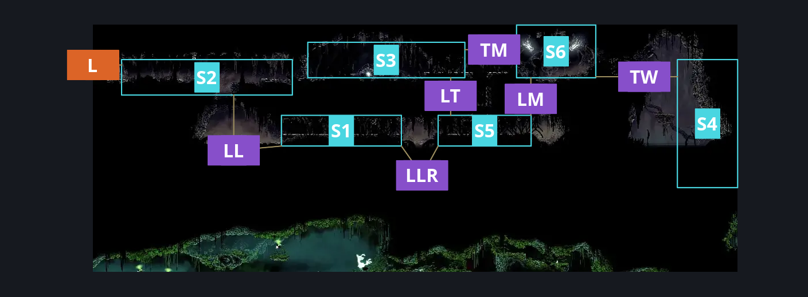
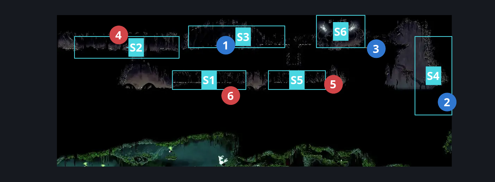
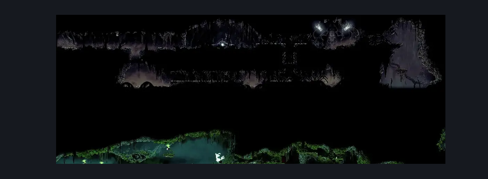

# Bilewater Weavenest Murglin (Shadow_Weavehome)

**Game ID:** Shadow_Weavehome

**Contributors:** Herchey and The Silent from StS 1 (not 2)

## Subrooms

| No. | Subroom | Annotated |
| --- | --- | --- |
| S1 | low hall left | ✓ |
| S2 | left hall | ✓ |
| S3 | tool room | ✓ |
| S4 | waterfall | ✓ |
| S5 | low hall right | ✓ |
| S6 | mechanical room | ✓ |

## Room Transitions

| Alias | Name | From subroom | Destination | Destination alias | Requirements | TODO | Verification | Annotated | Notes |
| --- | --- | --- | --- | --- | --- | --- | --- | --- | --- |
| L | left | left hall | [Bilewater East Column (Shadow_09)](bilewater-east-column.md) | R | needolin |  | Verified | ✓ |  |

## Subroom Connections

| Alias | Name | Source | Destination | Requirements | TODO | Verification | Annotated | Notes |
| --- | --- | --- | --- | --- | --- | --- | --- | --- |
| LL | left to low | left hall | low hall left | swim OR clawline right  OR drifter's cloak OR  (faydown AND dash right) |  | Verified | ✓ |  |
| LL | left to low | low hall left | left hall | invalid |  | Verified | ✓ |  |
| LT | low to tool | low hall right | tool room | cling grip left OR silk soar OR scuttlebrace |  | Verified | ✓ |  |
| LM | low to mech | low hall right | mechanical room | cling grip right OR silk soar OR scuttlebrace |  | Verified | ✓ |  |
| LM | low to mech | mechanical room | low hall right | none |  | Verified | ✓ |  |
| LT | low to tool | tool room | low hall right | none |  | Verified | ✓ |  |
| TW | mech to water | mechanical room | waterfall | complete silk room wall |  | Verified | ✓ |  |
| TW | mech to water | waterfall | mechanical room | (silk soar OR cling grip right) AND (faydown cloak OR (proficient movement AND ledge grab left)) |  | Verified | ✓ |  |
| LLR | low left to right | low hall left | low hall right | swim OR clawline right OR sharpdart OR drifter's OR scuttlebrace OR (dash right AND (proficient movement OR ledge grab right)) |  | Verified | ✓ |  |
| LLR | low left to right | low hall right | low hall left | swim OR clawline left OR sharpdart OR drifter's OR scuttlebrace OR (dash left AND (proficient movement OR ledge grab left)) |  | Verified | ✓ |  |
| TM | tool to mech | tool room | mechanical room | ledge grab right OR faydown OR run OR clawline right OR sharpdart OR scuttlebrace |  | Verified | ✓ |  |
| TM | tool to mech | mechanical room | tool room | ledge grab left OR faydown OR run OR clawline left OR sharpdart OR scuttlebrace |  | Verified | ✓ |  |

## Check Locations

| No. | Check | Subroom | Requirements | TODO | Verification | Location Type | Annotated | Notes |
| --- | --- | --- | --- | --- | --- | --- | --- | --- |
| 1 | Ruined Tool | tool room | none |  | Verified | collectible | ✓ |  |
| 2 | Bilewater - Weaver Workshop Scroll | waterfall | none |  | Verified | lore | ✓ | breakable wall |
| 3 | silk room wall | mechanical room | attack right |  | Verified | blockade | ✓ |  |
| 4 | Servitor Ignim 1 | left hall | none |  | Verified | enemy | ✓ |  |
| 5 | Weaver Servitor Broken 1 | low hall right | none |  | Verified | enemy | ✓ |  |
| 6 | Servitor Ignim 2 | low hall left | none |  | Verified | enemy | ✓ |  |

## Room Images

### Connections

### Checks

### Scene

