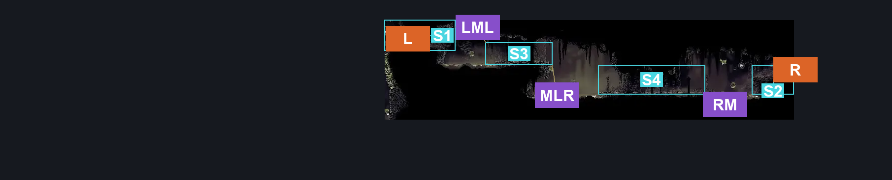
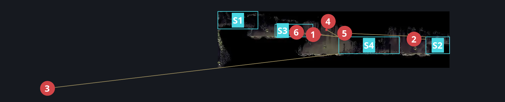
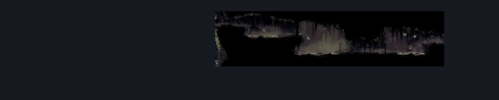

# Bilewater West Hall (Shadow_04b)

**Game ID:** Shadow_04b

**Contributors:** Herchey and the Tonight Show Band

## Subrooms

| No. | Subroom | Annotated |
| --- | --- | --- |
| S1 | left | ✓ |
| S2 | right | ✓ |
| S3 | mid left | ✓ |
| S4 | mid right | ✓ |

## Room Transitions

| Alias | Name | From subroom | Destination | Destination alias | Requirements | TODO | Verification | Annotated | Notes |
| --- | --- | --- | --- | --- | --- | --- | --- | --- | --- |
| L | left | left | [Bilewater Organ Entrance (Shadow_04)](bilewater-organ-entrance.md) | UR | none |  | Verified | ✓ |  |
| R | right | right | [Bilewater Lower Bloatroach Tower (Shadow_02)](bilewater-lower-bloatroach-tower.md) | LL | none |  | Verified | ✓ |  |

## Subroom Connections

| Alias | Name | Source | Destination | Requirements | TODO | Verification | Annotated | Notes |
| --- | --- | --- | --- | --- | --- | --- | --- | --- |
| LML | left to mid left | left | mid left | clawline right OR sharpdart OR dash right OR drifter's cloak OR faydown cloak OR swim OR ((run OR proficient movement) AND easy beast pogo) |  | Verified | ✓ |  |
| LML | left to mid left | mid left | left | clawline left OR easy beast pogo OR (sharpdart AND proficient movement) OR (dash left AND proficient movement) OR faydown cloak |  | Verified | ✓ |  |
| MLR | mid left to mid right | mid left | mid right | scuttlebrace OR clawline right OR sharpdart OR drifter's cloak OR faydown cloak OR dash right OR swim OR easy beast pogo |  | Verified | ✓ |  |
| MLR | mid left to mid right | mid right | mid left | faydown OR  (cling grip left AND (clawline left OR sharpdart OR (scuttlebrace AND proficient movement) OR drifter's cloak)) |  | Verified | ✓ |  |
| RM | right to mid | mid right | right | faydown cloak OR (easy [hunter, wanderer, witch, architect, shaman] pogo AND (ledge grab right OR clawline right OR sharpdart OR drifter's cloak)) OR (easy [beast, reaper] pogo) |  | Verified | ✓ |  |
| RM | right to mid | right | mid right | none |  | Verified | ✓ | Any pogo works here. |

## Check Locations

| No. | Check | Subroom | Requirements | TODO | Verification | Location Type | Annotated | Notes |
| --- | --- | --- | --- | --- | --- | --- | --- | --- |
| 1 | Swamp Squit 1 | mid right | none |  | Verified | enemy | ✓ |  |
| 2 | Swamp Squit 2 | right | none |  | Verified | enemy | ✓ |  |
| 3 | Stilkin 1 | mid right | none |  | Verified | enemy | ✓ |  |
| 4 | Swamp Squit 3 | mid right | none |  | Verified | enemy | ✓ |  |
| 5 | Swamp Squit 4 | right | none |  | Verified | enemy | ✓ |  |
| 6 | Stilkin 2 | mid right | none |  | Verified | enemy | ✓ |  |

## Room Images

### Connections

### Checks

### Scene

