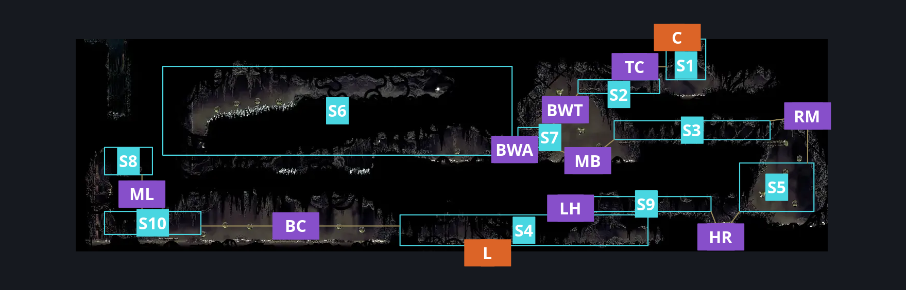
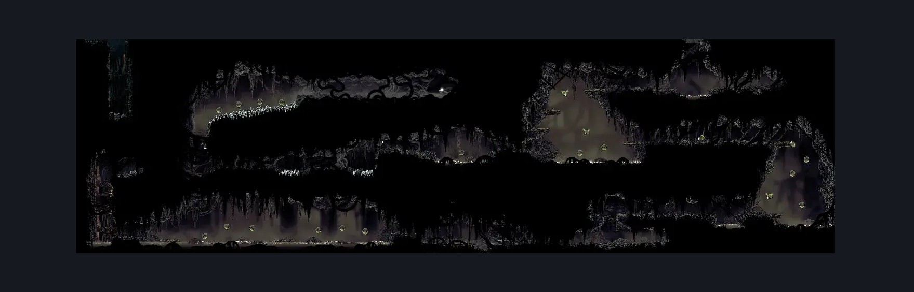

# Bilewater West Secret Rooms (Shadow_20)

**Game ID:** Shadow_20

**Contributors:** Hutyrix, Herchey, and someone devilishly twisted

## Subrooms

| No. | Subroom | Annotated |
| --- | --- | --- |
| S1 | ceiling exit | ✓ |
| S2 | top floor | ✓ |
| S3 | middle floor | ✓ |
| S4 | bottom floor | ✓ |
| S5 | right room | ✓ |
| S6 | bud hall | ✓ |
| S7 | bud wall plat | ✓ |
| S8 | locket | ✓ |
| S9 | hatch | ✓ |
| S10 | bottom locket | ✓ |

## Room Transitions

| Alias | Name | From subroom | Destination | Destination alias | Requirements | TODO | Verification | Annotated | Notes |
| --- | --- | --- | --- | --- | --- | --- | --- | --- | --- |
| L | lower | bottom floor | [Bilewater Organ Entrance (Shadow_04)](bilewater-organ-entrance.md) | C | none |  | Verified | ✓ |  |
| C | ceiling | ceiling exit | [Bilewater Citadel Exit (Shadow_22)](bilewater-citadel-exit.md) | B | (cling grip either AND faydown cloak AND medium enemy pogo off Swamp Squit) OR (drifters AND hard enemy pogo off Swamp Squit) OR (faydown AND cling grip either AND easy [hunter,wanderer] voltwater pogo x 1) OR (faydown AND hard [hunter,wanderer] voltwater pogo x 1) |  | Verified | ✓ | Requires an annoying enemy lure. Medium_skips. Should be one-way normally.  Voltvessel water pogo crusade was here 17/11 |

## Subroom Connections

| Alias | Name | Source | Destination | Requirements | TODO | Verification | Annotated | Notes |
| --- | --- | --- | --- | --- | --- | --- | --- | --- |
| TC | top to ceiling | top floor | ceiling exit | (cling grip either AND faydown cloak AND medium enemy pogo off Swamp Squit) OR (drifters AND hard enemy pogo off swamp squit) OR (faydown AND cling grip either AND medium [hunter,wanderer] voltwater pogo x 1) OR (faydown AND hard [hunter,wanderer] voltwater pogo x 1) |  | Verified | ✓ | Voltvessel water pogo crusade was here 17/11 |
| TC | top to ceiling | ceiling exit | top floor | none |  | Verified | ✓ | faydown cloak OR swim OR drifter's cloak OR clawline left OR sharpdart OR easy beast pogo ^ old syntax  Regardless if you have swim or not, the SilksongRandomzier mod respawns you on the left. It makes the room slightly easier |
| MB | mid to bud | middle floor | bud wall plat | none |  | Verified | ✓ | easy, even intended pogo off bile orbs   old syntax: swim OR dash left OR drifter's cloak OR medium pogo off swamp squit OR clawline left OR (faydown cloak AND (run OR sharpdart)) OR easy [hunter,beast,architect] pogo OR medium shaman pogo OR easy naked pogo |
| MB | mid to bud | bud wall plat | middle floor | clawline right x 1 OR dash right OR faydown OR drifters OR sharpdart OR ledge grab right OR easy pogo off swamp squit OR easy [hunter,reaper,beast,architect] pogo OR  medium [witch,shaman] pogo OR easy naked pogo |  | Verified | ✓ | quite easy with bile orbs relevant only for wanderer, incomplete but kinda useless  old syntax: clawline right OR (faydown cloak AND (swim OR drifter's cloak OR sharpdart)) |
| BWT | bud wall to top | bud wall plat | top floor | faydown cloak OR medium hunter voltwater pogo x 2 OR hard wanderer voltwater pogo x 2 OR  (cling grip left AND (clawline right x 1 OR dash right OR drifter's OR easy pogo off swamp squit OR sharpdart OR easy [hunter,beast,architect] pogo OR easy [thread storm,parry,rune rage,pale nails,flea brew,voltvessels,plasmium,flintslate] stall x 1)) OR  (silk soar x 2 AND (clawline right x 1 OR dash right OR drifter's OR sharpdart OR easy flea brew stall x 3 OR easy plasmium stall x 2 OR (ledge grab right AND medium flintslate stall x 3))) OR  ((ledge grab left OR cling grip left OR silk soar x 1 OR (run left AND clawline left x 1)) AND (((clawline right x 1 OR run right OR sharpdart x 1 OR flea brew jump OR easy [voltvessels,plasmium,flea brew] stall x 1 OR hard pale nails stall x 3) AND ledge grab right) OR (easy scuttlebrace AND (clawline right x 1 OR sharpdart))))  OR hard pogo off swamp squit OR (medium pogo off swamp squit AND drifters) |  | Verified | ✓ |  |
| BWT | bud wall to top | top floor | bud wall plat | none |  | Verified | ✓ | falling |
| RM | right to mid | right room | middle floor | faydown  OR (ledge grab both AND (easy [reaper,wanderer,shaman] pogo OR medium [hunter,beast,witch,architect] heal stall OR clawline left x 2))  OR (medium naked pogo AND ledge grab both AND (cling grip right OR dash left OR medium bind stall)) OR hard shaman pogo |  | Verified | ✓ | ((enemy pogo OR clawline x 5) AND (ledge grab OR cling grip)) OR (faydown cloak AND ((ledge grab OR cling grip) AND (silk soar OR enemy pogo)))  ^ old syntax. Could be useful when explosive bile orbs will be randomized, they were accounted like "enemy pogo" here if i'm understanding correctly |
| RM | right to mid | middle floor | right room | none |  | Verified | ✓ | falling |
| BWA | bud wall access | bud wall plat | bud hall | complete breakable wall to bud |  | Verified | ✓ |  |
| BWA | bud wall access | bud hall | bud wall plat | complete breakable wall to bud |  | Verified | ✓ |  |
| ML | memory locket | bottom locket | locket | (cling grip left OR (faydown AND (easy [hunter,reaper,wanderer,shaman] pogo OR medium [witch,architect] pogo OR hard beast pogo)) OR (proficient movement AND clawline right x 1 AND faydown AND ledge grab right (easier way for beast crests)) OR hard shaman pogo OR (hard reaper pogo AND (flea brew jump OR ledge grab right)) OR (cbt wanderer pogo AND hard flea brew stall x 2 AND ledge grab right))  OR (defeat THE Boss Phantom AND( (faydown AND (easy [hunter,reaper,wanderer,witch,architect,shaman] pogo OR medium beast pogo)) OR (clawline right x 3 AND (ledge grab right OR cling grip right)) OR easy [reaper,shaman] pogo OR medium architect pogo OR (easy wanderer pogo AND easy flea brew stall x 2 AND (ledge grab right OR cling grip right)) OR medium delvers drill stall x 4 )) |  | Verified | ✓ | I'll refine it before the end of this week -Hutyrix  Refined - 22/11  I feel like I used defeat syntax correctly |
| ML | memory locket | locket | bottom locket | proficient movement OR swim OR ledge grab right |  | Verified | ✓ | kinda free, useless logic |
| HR | hatch to right | hatch | right room | swim OR run right OR faydown OR drifters OR clawline right x 1 OR (medium witch pogo AND ledge grab right) |  | Verified | ✓ | can be refined |
| HR | hatch to right | right room | hatch | swim OR cling grip left OR run left OR faydown OR drifters OR clawline left x 1 |  | Verified | ✓ | can be refined asymetrical cling grip left syntax |
| LH | lower to hatch | bottom floor | hatch | complete lowerable hatch AND (faydown cloak OR silk soar OR scuttlebrace OR cling grip either) |  | Verified | ✓ |  |
| LH | lower to hatch | hatch | bottom floor | complete lowerable hatch |  | Verified | ✓ |  |
| BC | bottom connector | bottom floor | bottom locket | complete breakable wall to locket AND ( dash left OR clawline left x 2 OR sharpdart x 2 OR drifters OR faydown OR swim OR easy [hunter,reaper,beast,architect] pogo OR easy naked pogo OR flea brew jump  OR (easy witch pogo AND easy pale nails stall x 2 (leaving this, so cool)) OR (hard [witch,shaman] pogo) OR (easy [voltvessels,plasmium] stall x 2 OR medium flintslate stall x 3 OR medium [thread storm,parry,rune rage] stall x 2 OR hard pale nails stall x 2) OR hard damage boost x 4 OR (easy damage boost x 4 AND defeat THE Boss Phantom (having 1hp without steam is MUCH diffrent than having 1hp and having to do cycle based skip))) |  | Verified | ✓ | This can be 3x larger. Only relevant for witch and wanderer Wanderer gains approx. twice as less distance as witch.   old syntax for it (swim OR clawline left OR easy [hunter,beast,architect] pogo OR ((easy [wanderer,reaper,witch] pogo) AND (dash left OR faydown cloak OR drifter's cloak)))) |
| BC | bottom connector | bottom locket | bottom floor | complete breakable wall to locket |  | Verified | ✓ | useless logic |

## Check Locations

| No. | Check | Subroom | Requirements | TODO | Verification | Location Type | Annotated | Notes |
| --- | --- | --- | --- | --- | --- | --- | --- | --- |
| 1 | Bilewater - Memory Locket Annoyingly Nearby the Twisted Chud | locket | (cling grip left AND (swim OR clawline left OR easy [hunter,beast,architect] pogo OR ((easy [wanderer,reaper,witch] pogo) AND (dash left OR faydown cloak OR drifter's cloak))))  OR hard shaman pogo (possible even when exhaust organ is working. cinema) |  | Verified | collectible | ✓ | Formerly: Bilewater West - Memory Locket  Wanderer + Cling grip either + 4 masks damage boosts sounds fun  Event: Phantom Defeated changes logic for this particular check. Doubling it and giving to the next person |
| 2 | Bilewater - First Quick Rosaries In The Western Bilewater Rooms | bottom floor | none |  | Verified | collectible | ✓ | Formerly: Bilewater - Rosary Cache #6 |
| 3 | Bilewater - Other Quick Rosaries In The Western Bilewater Rooms | bottom floor | none |  | Verified | collectible | ✓ | Formerly: Bilewater - Rosary Cache #7 |
| 4 | Twisted Bud | bud hall | complete bud hall wall 3 |  | Verified | collectible | ✓ |  |
| 5 | lowerable hatch | hatch | none |  | Verified | blockade | ✓ | old syntax - attack left - but you can attack down |
| 6 | breakable wall to bud | bud wall plat | attack either |  | Verified | blockade | ✓ |  |
| 7 | bud hall wall 1 | bud hall | attack either AND (easy damage boost OR swim OR ledge grab left OR cling grip left OR dash left OR clawline left x 1 OR sharpdart x 1 OR flea brew jump OR faydown OR drifters OR easy wanderer voltwater pogo x 1 OR easy [hunter,beast,architect] pogo OR medium naked pogo) |  | Verified | blockade | ✓ | attack either AND complete breakable wall to bud AND (clawline left OR sharpdart OR swim OR enemy pogo OR dash left OR (proficient movement AND run left AND ledge grab left)) |
| 8 | bud hall wall 2 | bud hall | (attack either AND complete bud hall wall 1 AND ( cling grip either OR silk soar x 1 OR easy scuttlebrace OR (medium damage boost AND proficient movement AND medium pogo off miremite) OR (medium damage boost AND medium pogo off miremite AND medium naked pogo AND medium heal stall) OR (hard pogo off miremite AND hard naked pogo))) |  | Verified | blockade | ✓ | (((cling grip OR silk soar) AND (spike pogo OR enemy pogo OR clawline x 2)) OR (scuttlebrace AND (clawline x 3 OR spike pogo))) |
| 9 | bud hall wall 3 | bud hall | attack either AND complete bud hall wall 2 |  | Verified | blockade | ✓ |  |
| 10 | breakable wall to locket | bottom floor | attack either |  | Verified | blockade | ✓ |  |
| 11 | Swamp Squit 1 | top floor | none |  | Verified | enemy | ✓ |  |
| 12 | Swamp Squit 2 | right room | none |  | Verified | enemy | ✓ |  |
| 13 | Swamp Squit 3 | bud wall plat | none |  | Verified | enemy | ✓ |  |
| 14 | Swamp Squit 4 | right room | none |  | Verified | enemy | ✓ |  |
| 15 | Miremite 1 | bud hall | none |  | Verified | enemy | ✓ |  |
| 16 | Miremite 2 | bud hall | complete bud hall wall 2 |  | Verified | enemy | ✓ |  |
| 17 | Miremite 3 | middle floor | none |  | Verified | enemy | ✓ |  |

## Notes

MAJOR rework 22/11/26 - Hutyrix

## Room Images

### Connections

### Checks

### Scene

