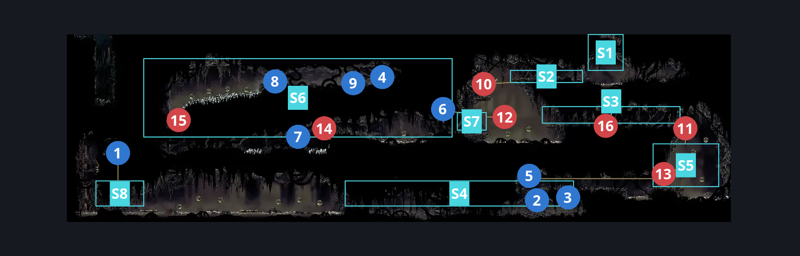

# Bilewater West Secret Rooms (Shadow_20)

**Game ID:** Shadow_20

**Contributors:** Herchey, Hutyrix and someone devilishly twisted

## Subrooms

| No. | Subroom | Annotated |
| --- | --- | --- |
| S1 | ceiling exit | ✓ |
| S2 | top floor | ✓ |
| S3 | middle floor | ✓ |
| S4 | bottom floor | ✓ |
| S5 | right room | ✓ |
| S6 | bud hall | ✓ |
| S7 | bud wall plat | ✓ |
| S8 | locket | ✓ |

## Room Transitions

| Alias | Name | From subroom | Destination | Destination alias | Requirements | TODO | Verification | Annotated | Notes |
| --- | --- | --- | --- | --- | --- | --- | --- | --- | --- |
| L | lower | bottom floor | [Bilewater Organ Entrance (Shadow_04)](bilewater-organ-entrance.md) | C | none |  | Verified | ✓ |  |
| C | ceiling | ceiling exit | [Bilewater Citadel Exit (Shadow_22)](bilewater-citadel-exit.md) | B | (cling grip either AND faydown cloak AND medium enemy pogo off Swamp Squit) OR (faydown AND cling grip either AND easy [hunter,wanderer] voltwater pogo x 1) OR (faydown AND hard [hunter,wanderer] voltwater pogo x 1) |  | Verified | ✓ | Requires an annoying enemy lure. Medium_skips. Should be one-way normally.  Voltvessel water pogo crusade was here 17/11 |

## Subroom Connections

| Alias | Name | Source | Destination | Requirements | TODO | Verification | Annotated | Notes |
| --- | --- | --- | --- | --- | --- | --- | --- | --- |
| TC | top to ceiling | top floor | ceiling exit | (cling grip either AND faydown cloak AND medium enemy pogo off Swamp Squit) OR (faydown AND cling grip either AND medium [hunter,wanderer] voltwater pogo x 1) OR (faydown AND hard [hunter,wanderer] voltwater pogo x 1) |  | Verified | ✓ | Voltvessel water pogo crusade was here 17/11 |
| TC | top to ceiling | ceiling exit | top floor | none |  | Verified | ✓ | faydown cloak OR swim OR drifter's cloak OR clawline left OR sharpdart OR easy beast pogo ^ old syntax  Regardless if you have swim or not, the SilksongRandomzier mod respawns you on the left. It makes the room slightly easier |
| LR | lower to right | bottom floor | right room | complete lowerable hatch AND (faydown cloak OR silk soar OR scuttlebrace OR cling grip either) |  | Verified | ✓ |  |
| LR | lower to right | right room | bottom floor | none | TODO | Verified | ✓ |  |
| MB | mid to bud | middle floor | bud wall plat | swim OR dash left OR drifter's cloak OR medium pogo off swamp squit OR clawline left OR (faydown cloak AND (run OR sharpdart)) OR easy [hunter,beast,architect] pogo OR medium shaman pogo OR easy naked pogo |  | Verified | ✓ |  |
| MB | mid to bud | bud wall plat | middle floor | clawline right OR (faydown cloak AND (swim OR drifter's cloak OR sharpdart)) |  | Verified | ✓ |  |
| BWT | bud wall to top | bud wall plat | top floor | faydown cloak  OR  (cling grip left AND (clawline right OR dash right OR drifter's))  OR (ledge grab left AND (ledge grab right OR cling grip right OR scuttlebrace) AND (clawline right OR sharpdart)) |  | Verified | ✓ |  |
| BWT | bud wall to top | top floor | bud wall plat | none |  | Verified | ✓ | falling |
| RM | right to mid | right room | middle floor | faydown  OR (ledge grab both AND (easy [reaper,wanderer,shaman] pogo OR medium [hunter,beast,witch,architect] heal stall OR clawline left x 2))  OR (medium naked pogo AND ledge grab both AND (cling grip right OR dash left OR medium bind stall)) OR hard shaman pogo |  | Verified | ✓ | ((enemy pogo OR clawline x 5) AND (ledge grab OR cling grip)) OR (faydown cloak AND ((ledge grab OR cling grip) AND (silk soar OR enemy pogo)))  ^ old syntax. Could be useful when explosive bile orbs will be randomized, they were accounted like "enemy pogo" here if i'm understanding correctly |
| RM | right to mid | middle floor | right room | none |  | Verified | ✓ | falling |
| BWA | bud wall access | bud wall plat | bud hall | complete breakable wall to bud |  | Verified | ✓ |  |
| BWA | bud wall access | bud hall | bud wall plat | complete breakable wall to bud |  | Verified | ✓ |  |
| ML | memory locket | bottom floor | locket | (cling grip left AND (swim OR clawline left OR easy [hunter,beast,architect] pogo OR ((easy [wanderer,reaper,witch] pogo) AND (dash left OR faydown cloak OR drifter's cloak))))  OR hard shaman pogo (possible even when exhaust organ is working. cinema) | TODO | Verified | ✓ | I'll refine it before the end of this week -Hutyrix |
| ML | memory locket | locket | bottom floor | swim OR ledge grab right OR proficient movement |  | Verified | ✓ |  |

## Check Locations

| No. | Check | Subroom | Requirements | TODO | Verification | Location Type | Annotated | Notes |
| --- | --- | --- | --- | --- | --- | --- | --- | --- |
| 1 | Bilewater - Memory Locket Annoyingly Nearby the Twisted Chud | locket | (cling grip left AND (swim OR clawline left OR easy [hunter,beast,architect] pogo OR ((easy [wanderer,reaper,witch] pogo) AND (dash left OR faydown cloak OR drifter's cloak))))  OR hard shaman pogo (possible even when exhaust organ is working. cinema) |  | Verified | collectible | ✓ | Formerly: Bilewater West - Memory Locket  Wanderer + Cling grip either + 4 masks damage boosts sounds fun  Event: Phantom Defeated changes logic for this particular check. Doubling it and giving to the next person |
| 2 | Bilewater - First Quick Rosaries In The Western Bilewater Rooms | bottom floor | none |  | Verified | collectible | ✓ | Formerly: Bilewater - Rosary Cache #6 |
| 3 | Bilewater - Other Quick Rosaries In The Western Bilewater Rooms | bottom floor | none |  | Verified | collectible | ✓ | Formerly: Bilewater - Rosary Cache #7 |
| 4 | Twisted Bud | bud hall | complete bud hall wall 3 |  | Verified | collectible | ✓ |  |
| 5 | lowerable hatch | right room | attack left |  | Verified | blockade | ✓ |  |
| 6 | breakable wall to bud | bud wall plat | attack left |  | Verified | blockade | ✓ |  |
| 7 | bud hall wall 1 | bud hall | attack left AND (easy damage boost OR swim OR ledge grab left OR cling grip left OR dash left OR clawline left x 1 OR sharpdart x 1 OR flea brew jump OR faydown OR drifters OR easy wanderer voltwater pogo x 1 OR easy [hunter,beast,architect] pogo) |  | Verified | blockade | ✓ | attack left AND complete breakable wall to bud AND (clawline left OR sharpdart OR swim OR enemy pogo OR dash left OR (proficient movement AND run left AND ledge grab left)) |
| 8 | bud hall wall 2 | bud hall | (attack right AND complete bud hall wall 1 AND ( cling grip either OR silk soar x 1 OR easy scuttlebrace OR (medium damage boost AND proficient movement AND medium pogo off miremite))) OR (hard pogo off miremite AND hard naked pogo) |  | Verified | blockade | ✓ | (((cling grip OR silk soar) AND (spike pogo OR enemy pogo OR clawline x 2)) OR (scuttlebrace AND (clawline x 3 OR spike pogo))) |
| 9 | bud hall wall 3 | bud hall | attack right AND complete bud hall wall 2 |  | Verified | blockade | ✓ |  |
| 10 | Swamp Squit 1 | top floor | none |  | Verified | enemy | ✓ |  |
| 11 | Swamp Squit 2 | right room | none |  | Verified | enemy | ✓ |  |
| 12 | Swamp Squit 3 | bud wall plat | none |  | Verified | enemy | ✓ |  |
| 13 | Swamp Squit 4 | right room | none |  | Verified | enemy | ✓ |  |
| 14 | Miremite 1 | bud hall | none |  | Verified | enemy | ✓ |  |
| 15 | Miremite 2 | bud hall | complete bud hall wall 2 |  | Verified | enemy | ✓ |  |
| 16 | Miremite 3 | middle floor | none |  | Verified | enemy | ✓ |  |

## Room Images

### Connections

### Checks

### Scene

