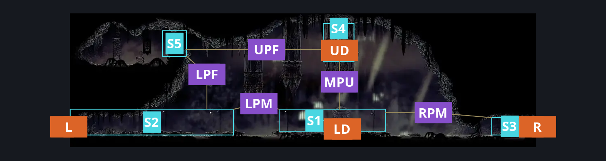
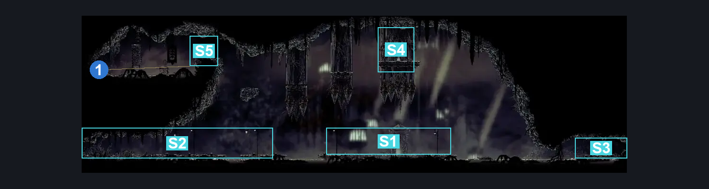
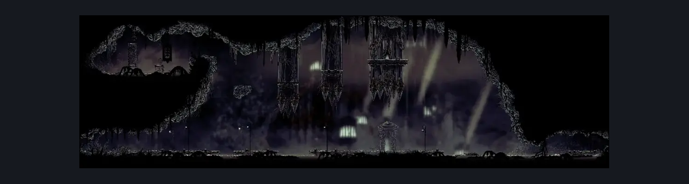

# Exhaust Organ Exterior (Dust_09)

**Game ID:** Dust_09

**Contributors:** Herchey and the Forgotten Contributor

## Subrooms

| No. | Subroom | Annotated |
| --- | --- | --- |
| S1 | middle platform | ✓ |
| S2 | left platform | ✓ |
| S3 | right platform | ✓ |
| S4 | upper door plat | ✓ |
| S5 | flea hall plat | ✓ |

## Room Transitions

| Alias | Name | From subroom | Destination | Destination alias | Requirements | TODO | Verification | Annotated | Notes |
| --- | --- | --- | --- | --- | --- | --- | --- | --- | --- |
| UD | up door | upper door plat | [Exhaust Organ Interior (Organ_01)](exhaust-organ-interior.md) | ML | none |  | Verified | ✓ |  |
| LD | low door | middle platform | [Exhaust Organ Interior (Organ_01)](exhaust-organ-interior.md) | LL | none |  | Verified | ✓ |  |
| L | left | left platform | [Sinner's Road Mist Maze Completed (Dust_Maze_08_completed)](../sinner-s-road/sinner-s-road-mist-maze-completed.md) | UR | none |  | Verified | ✓ |  |
| R | right | right platform | [Bilewater Organ Entrance (Shadow_04)](bilewater-organ-entrance.md) | L | none |  | Verified | ✓ |  |

## Subroom Connections

| Alias | Name | Source | Destination | Requirements | TODO | Verification | Annotated | Notes |
| --- | --- | --- | --- | --- | --- | --- | --- | --- |
| LPM | left plat to middle | left platform | middle platform | faydown cloak OR drifter's cloak OR run OR dash OR clawline OR sharpdart OR silk soar OR scuttlebrace OR swim |  | Verified | ✓ |  |
| LPM | left plat to middle | middle platform | left platform | faydown cloak OR drifter's cloak OR run OR dash OR clawline OR sharpdart OR silk soar OR scuttlebrace OR swim |  | Verified | ✓ |  |
| RPM | right plat to middle | right platform | middle platform | swim |  | Verified | ✓ |  |
| RPM | right plat to middle | middle platform | right platform | swim |  | Verified | ✓ |  |
| MPU | mid plat to upper | middle platform | upper door plat | silk soar |  | Verified | ✓ |  |
| MPU | mid plat to upper | upper door plat | middle platform | none |  | Verified | ✓ | falling |
| LPF | left plat to flea | left platform | flea hall plat | silk soar |  | Verified | ✓ |  |
| LPF | left plat to flea | flea hall plat | left platform | none |  | Verified | ✓ | falling |
| UPF | upper plat to flea | upper door plat | flea hall plat | (cling grip OR ledge grab) OR scuttlebrace |  | Verified | ✓ |  |
| UPF | upper plat to flea | flea hall plat | upper door plat | drifter's cloak OR faydown cloak OR run OR dash OR clawline OR sharpdart OR scuttlebrace |  | Verified | ✓ |  |

## Check Locations

| No. | Check | Subroom | Requirements | TODO | Verification | Location Type | Annotated | Notes |
| --- | --- | --- | --- | --- | --- | --- | --- | --- |
| 1 | Exhaust Organ - Flea Is Tired Of Organ Music | flea hall plat | (swim OR cling grip OR faydown cloak OR (silk soar AND (clawline OR ((drifter's cloak OR sharpdart) AND ledge grab)))) AND break vines left |  | Verified | collectible | ✓ | Formerly: Flea Rescue |

## Room Images

### Connections

### Checks

### Scene

