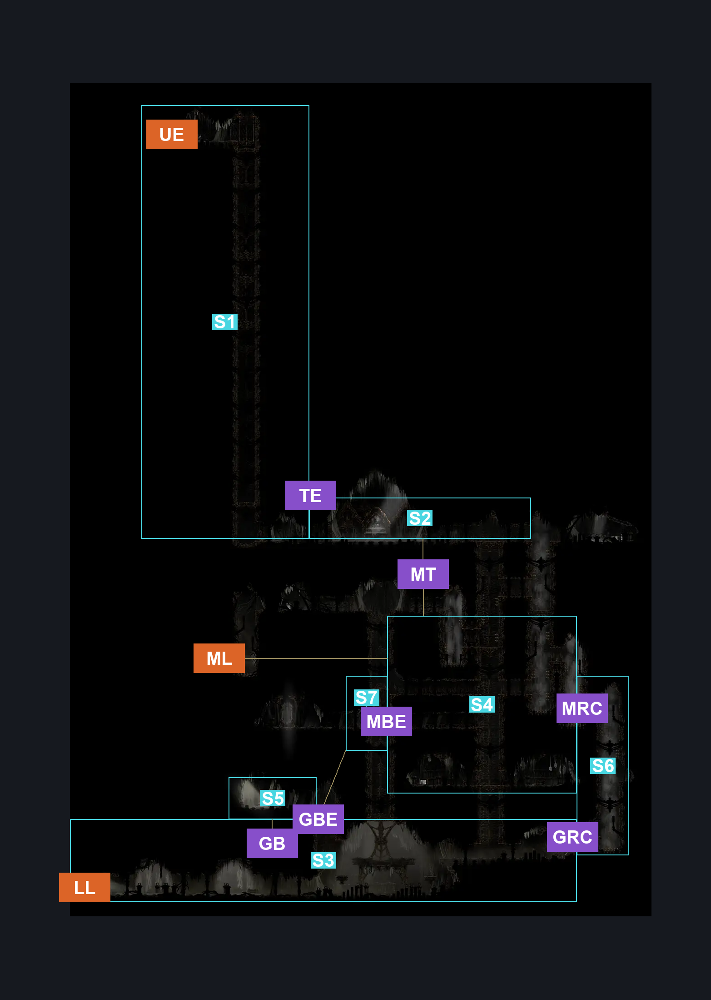
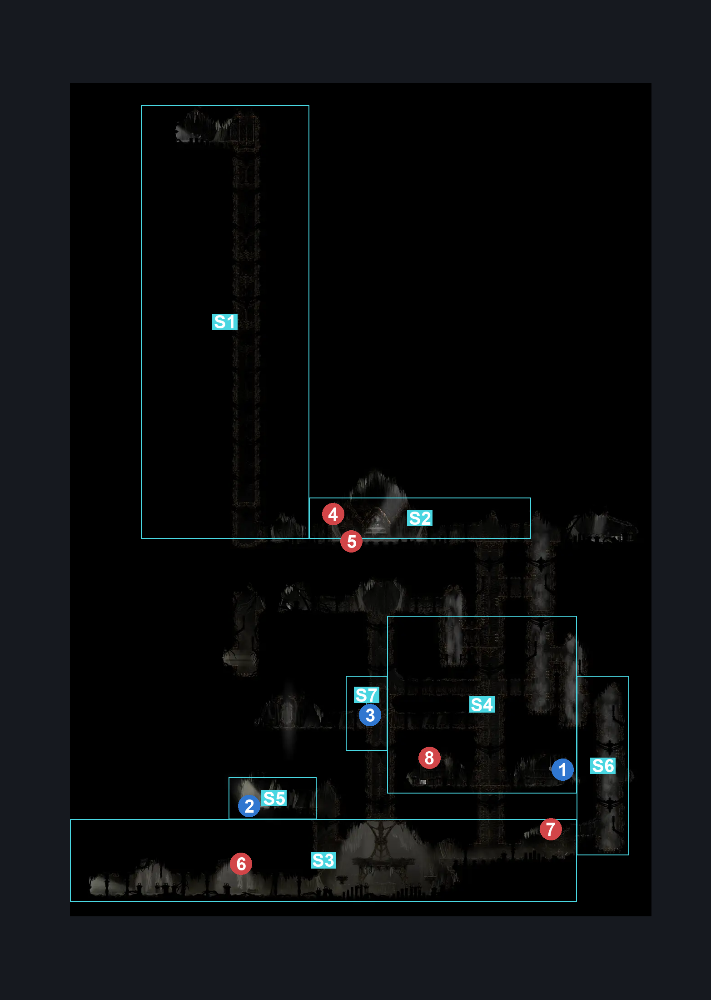
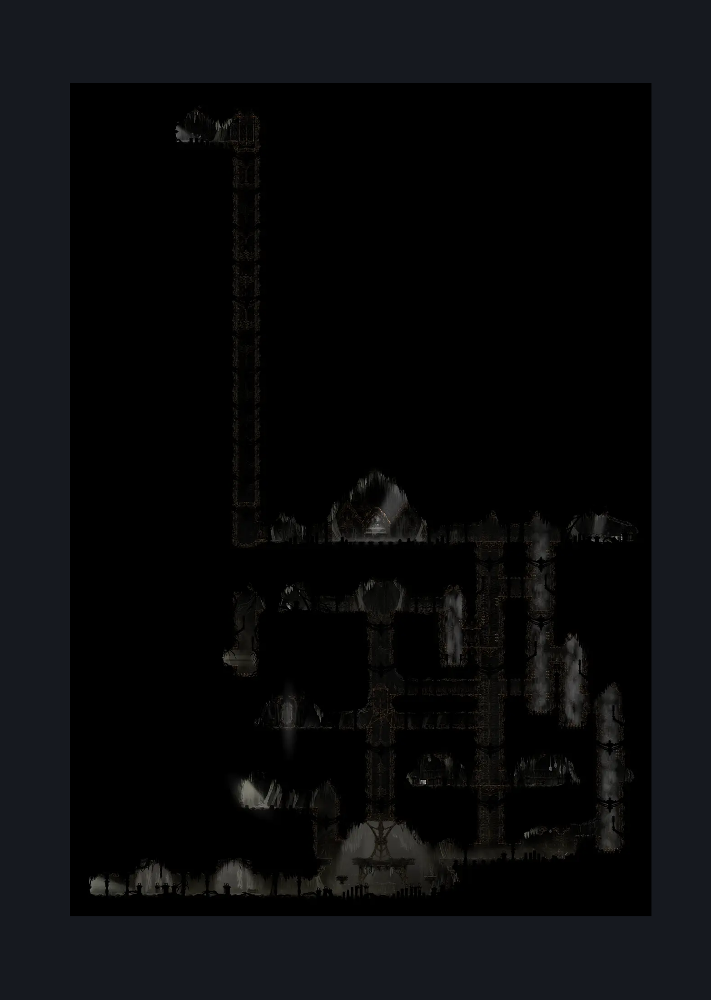

# Exhaust Organ Interior (Organ_01)

**Game ID:** Organ_01

**Contributors:** Herchey's cool "KING" hat with spikes on it

## Subrooms

| No. | Subroom | Annotated |
| --- | --- | --- |
| S1 | elevator | ✓ |
| S2 | top layer | ✓ |
| S3 | ground floor | ✓ |
| S4 | maze | ✓ |
| S5 | bench room | ✓ |
| S6 | right column | ✓ |
| S7 | broken elevator | ✓ |

## Room Transitions

| Alias | Name | From subroom | Destination | Destination alias | Requirements | TODO | Verification | Annotated | Notes |
| --- | --- | --- | --- | --- | --- | --- | --- | --- | --- |
| UE | Underworks Elevator | elevator | [Underworks Exhaust Organ Transit (Library_12)](../underworks/underworks-exhaust-organ-transit.md) | EV | none |  | Verified | ✓ |  |
| ML | mid left | maze | [Exhaust Organ Exterior (Dust_09)](exhaust-organ-exterior.md) | UD | none |  | Verified | ✓ |  |
| LL | low left | ground floor | [Exhaust Organ Exterior (Dust_09)](exhaust-organ-exterior.md) | LD | none |  | Verified | ✓ |  |

## Subroom Connections

| Alias | Name | Source | Destination | Requirements | TODO | Verification | Annotated | Notes |
| --- | --- | --- | --- | --- | --- | --- | --- | --- |
| TE | top to elevator | top layer | elevator | complete Boss: Phantom |  | Verified | ✓ |  |
| TE | top to elevator | elevator | top layer | complete Boss: Phantom |  | Verified | ✓ |  |
| GBE | ground to broken elevator | ground floor | broken elevator | (cling grip either AND complete Fix The Broken Elevator) OR (faydown cloak AND easy enemy pogo off Drapefly) OR silk soar |  | Verified | ✓ |  |
| GBE | ground to broken elevator | broken elevator | ground floor | complete Fix The Broken Elevator |  | Verified | ✓ |  |
| GRC | ground to right column | ground floor | right column | cling grip |  | Verified | ✓ |  |
| GRC | ground to right column | right column | ground floor | none |  | Verified | ✓ |  |
| MRC | maze to right column | maze | right column | cling grip AND faydown cloak |  | Verified | ✓ |  |
| MRC | maze to right column | right column | maze | cling grip both OR (cling grip right AND (spike pogo AND (easy [reaper, architect, shaman] pogo OR faydown cloak))) OR (cling grip left AND (proficient movement OR (spike pogo AND easy [hunter, reaper, wanderer, witch, architect, shaman] pogo))) |  | Verified | ✓ |  |
| MT | maze to top | maze | top layer | cling grip |  | Verified | ✓ |  |
| MT | maze to top | top layer | maze | cling grip |  | Verified | ✓ |  |
| GB | ground to bench room | ground floor | bench room | silk soar OR cling grip OR scuttlebrace |  | Verified | ✓ |  |
| GB | ground to bench room | bench room | ground floor | none |  | Verified | ✓ |  |
| MBE | maze to broken elevator | maze | broken elevator | complete Fix The Broken Elevator |  | Verified | ✓ |  |
| MBE | maze to broken elevator | broken elevator | maze | none |  | Verified | ✓ |  |

## Check Locations

| No. | Check | Subroom | Requirements | TODO | Verification | Location Type | Annotated | Notes |
| --- | --- | --- | --- | --- | --- | --- | --- | --- |
| 1 | Silk Grub Listening To Mozart In the Cocoon | maze | none |  | Verified | collectible | ✓ | Formerly: Silk Grub Large Cocoon |
| 2 | Backstage Organ Bench | bench room | silk soar OR cling grip |  | Verified | bench | ✓ | Formerly: Organ Bench |
| 3 | Fix The Broken Elevator | broken elevator | attack left OR attack up |  | Verified | blockade | ✓ |  |
| 4 | Boss: Phantom | top layer | ( dash OR run ) AND Combat Requirements |  | Verified | boss | ✓ |  |
| 5 | Phantom 1 | top layer | dash OR run |  | Verified | enemy | ✓ |  |
| 6 | Drapefly 1 | ground floor | none |  | Verified | enemy | ✓ |  |
| 7 | Drapefly 2 | ground floor | none |  | Verified | enemy | ✓ |  |
| 8 | Drapefly 3 | maze | none |  | Verified | enemy | ✓ |  |

## Room Images

### Connections

### Checks

### Scene

