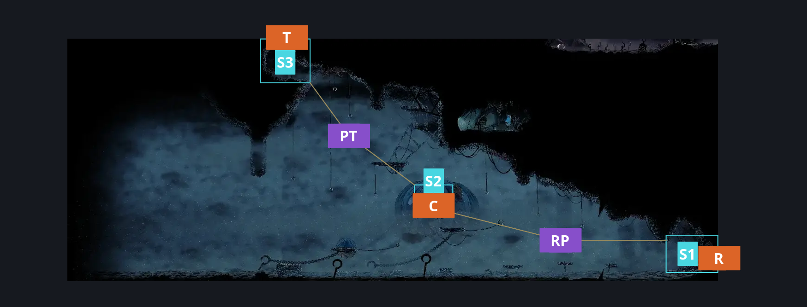
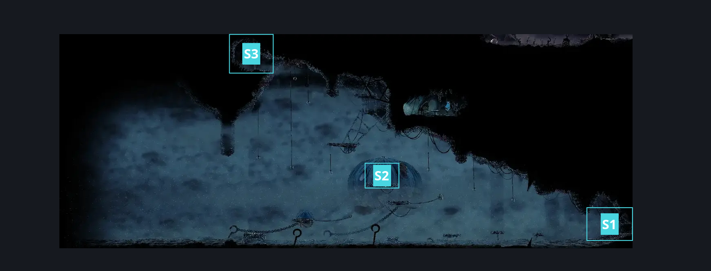
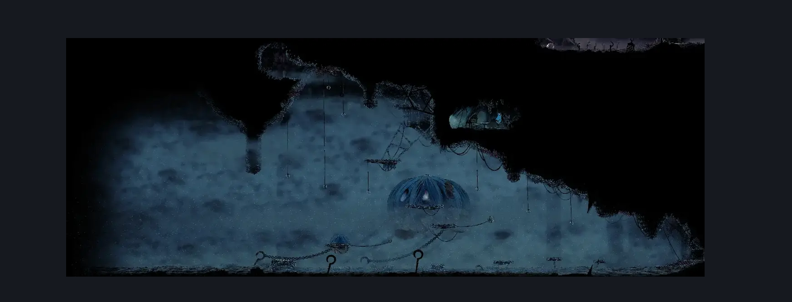

# Windy Pinstress Entrance (Coral_34)

**Game ID:** Coral_34

**Contributors:** skai, MayaXTG, Hutyrix, Pyxl

## Subrooms

| No. | Subroom | Annotated |
| --- | --- | --- |
| S1 | Right Entrance | ✓ |
| S2 | Pinstress | ✓ |
| S3 | Top Entrance | ✓ |

## Room Transitions

| Alias | Name | From subroom | Destination | Destination alias | Requirements | TODO | Verification | Annotated | Notes |
| --- | --- | --- | --- | --- | --- | --- | --- | --- | --- |
| C | door1 | Pinstress | [Windy Pinstress Room (Room_Pinstress)](windy-pinstress-room.md) | L | None |  | Verified | ✓ |  |
| R | right1 | Right Entrance | [Horizontal Room with Sand Pit (Coral_11b)](horizontal-room-with-sand-pit.md) | L | None |  | Verified | ✓ |  |
| T | top1 | Top Entrance | [Sands of Karak Entrance (Coral_25)](../sands-of-karak/sands-of-karak-entrance.md) | F | silk soar  OR cling grip left OR (faydown AND (cling grip right OR medium scuttlebrace)) |  | Verified | ✓ |  |

## Subroom Connections

| Alias | Name | Source | Destination | Requirements | TODO | Verification | Annotated | Notes |
| --- | --- | --- | --- | --- | --- | --- | --- | --- |
| RP | RightPinstress | Right Entrance | Pinstress | (Clawline both x 8 AND proficient movement (fifth clawline can be shoot onto the balloon)) OR (Clawline both AND silkhearts x 1)  OR Clawline both x 12  OR (clawline left x 4 AND drifters AND proficient movement (third clawline can be shoot onto baloon)) OR (Flea Brew jump AND ((Dash both AND Ledge Grab both) OR (Easy Beast Crest Pogo AND Ledge Grab both))) OR (Dash left AND (run right AND ledge grab both AND (drifters OR sharpdart))) OR ((Dash left OR clawline left x 7) AND clawline right x 3 AND ledge grab left) OR (run right AND clawline left x 8 AND drifters AND ledge grab right) OR (Faydown AND (drifters OR run left OR flea brew jump OR clawline left x 2 OR easy [beast,architect] pogo OR easy [voltvessels] stall x 3 OR medium [flintslate] stall x 4 OR sharpdart x 2)) OR (Faydown AND Ledge grab left AND ((medium [hunter] pogo) OR (medium [flintslate] stall x 4) OR easy [shaman] pogo)) OR (Dash both AND medium [Beast] Pogo (pogo balloon from underneath, then right)) OR ((Dash left OR clawline left x 5 OR faydown) AND (medium [Shaman] Pogo (pogo balloon from underneath, then up))) OR (run left AND clawline right AND silkhearts x 1 AND ledge grab left AND easy [voltvessels, flea brew, plasmium] stall x 3) OR (run both AND ledge grab both AND (drifters OR sharpdart) AND easy [voltvessels, flea brew, plasmium] stall x 3) OR (Silk Soar AND (Progressive Swift Step 2 left OR clawline left x 5))  OR (Silk Soar AND Faydown Cloak AND silkhearts x 1 AND ((hard [hunter,reaper,wanderer,witch] reserve bind stall) OR (medium [thread storm,cross stitch,pale nails] stall x 3))) OR medium shaman scuttle slide |  | Verified | ✓ | This is Skai's logic, not Maya's. don't blame me  okay, i'll do it ~Hutyrix you can blame me. |
| PT | PinstressTop | Pinstress | Top Entrance | (((Clawline both x 7 AND silkhearts x 1) OR (Clawline both x 12) OR (easy [beast] pogo AND Clawline both x 5 AND silkhearts x 1) OR (easy [beast] pogo AND Clawline both x 10)) AND (Cling Grip both OR medium Scuttlebrace)) OR (silk soar AND Silkhearts x 1 ) OR (cling grip left AND faydown AND clawline both x 6) OR (cling grip left AND drifters AND clawline left x 5) |  | Verified | ✓ | Pretty good can be better can be done with just silk soar |
| PT | PinstressTop | Top Entrance | Pinstress | silk soar OR drifters  OR dash right OR clawline right OR easy [hunter,beast,architect] pogo  OR (medium shaman pogo AND proficient movement (fall down, then pogo balloon)) OR (faydown cloak AND proficient movement (fall down, then pogo balloon)) OR sharpdart  OR easy [voltvessels,plasmium,flea brew] stall x 4 OR medium flea brew stall x 3 OR medium flintslate stall x 5 OR hard [pale nails, thread storm] stall x 5 OR hard cross stitch stall x 6 OR easy naked pogo |  | Verified | ✓ | First logic ever written in zerounit website by Hutyrix, 15/11/26 |
| RP | RightPinstress | Pinstress | Right Entrance | drifters  OR run right OR clawline right x 4 OR sharpdart x 4 OR medium flea brew stall x 4 OR (Faydown AND (easy [hunter,beast,architect] pogo OR medium [reaper,witch,shaman] pogo OR easy wanderer charge OR flea brew jump OR sharpdart OR clawline right x 1 OR easy [reaper,wanderer,witch] heal stall OR easy [voltvessels,flea brew, flintslate, thread storm, parry, rune rage, pale nails] stall)) OR (Silk soar AND (medium [voltvessels,plasmium] stall x 6 OR (medium voltvessels stall x 3 AND medium plasmium stall x 3))) OR (easy beast pogo AND (easy hazard respawn OR easy [flea brew,plasmium,voltvessels,parry,rune rage,air heal, flintslate,pale nails,thread storm] stall )) |  | Verified | ✓ | Hutyrix's logic, was none before (humble ER betatesters crying in the corner) |

## Check Locations

No check locations defined.

## Room Images

### Connections

### Checks

### Scene

