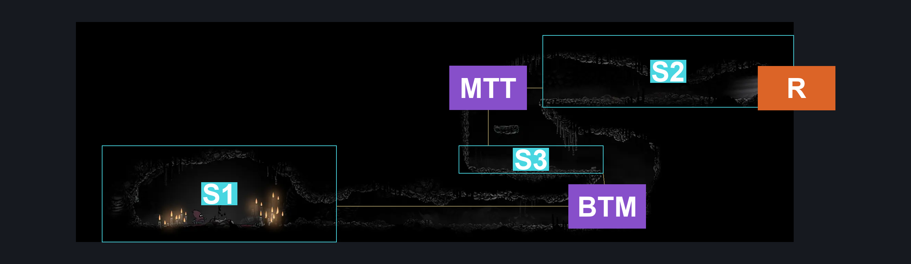
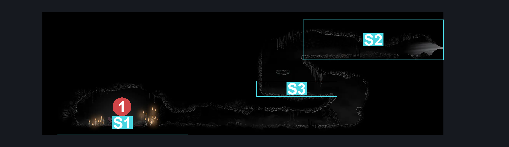
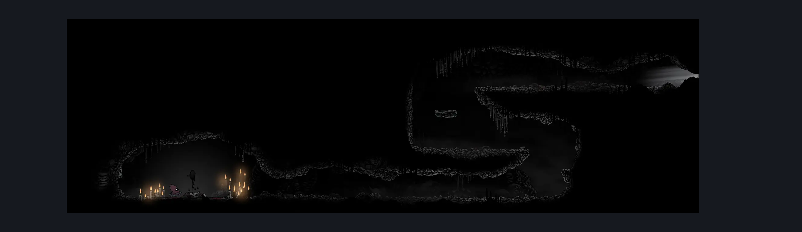

# Bonegrave Passage (Bone_Steel_Servant)

**Game ID:** Bone_Steel_Servant

**Contributors:** herounit

## Subrooms

| No. | Subroom | Annotated |
| --- | --- | --- |
| S1 | summoning circle | ✓ |
| S2 | right exit area | ✓ |
| S3 | middle platform | ✓ |

## Room Transitions

| Alias | Name | From subroom | Destination | Destination alias | Requirements | TODO | Verification | Annotated | Notes |
| --- | --- | --- | --- | --- | --- | --- | --- | --- | --- |
| R | right1 | right exit area | [Bonegrave (Bonegrave)](bonegrave.md) | LL | none |  | Verified | ✓ |  |

## Subroom Connections

| Alias | Name | Source | Destination | Requirements | TODO | Verification | Annotated | Notes |
| --- | --- | --- | --- | --- | --- | --- | --- | --- |
| BTM | bottom to middle | summoning circle | middle platform | silk soar  OR faydown OR easy shaman pogo OR easy scuttlebrace OR ( ( ledge grab right OR cling grip right ) AND ( ledge grab left OR cling grip left OR run OR dash left OR clawline left OR sharpdart OR drifters OR easy beast pogo OR architect needle right OR easy [ wanderer, reaper, architect ] charge OR flea brew OR easy [ heal, flintslate, flea brew, voltvessels, plasmium, thread storm, parry, rune rage, pale nails ] stall ) ) |  | Verified | ✓ | hero checked these stalls... for something that doesn't really matter because it is a reverse path - 11/2 |
| BTM | bottom to middle | middle platform | summoning circle | none (falling) |  | Verified | ✓ |  |
| MTT | middle to top | middle platform | right exit area | silk soar OR ledge grab either OR cling grip left OR faydown OR medium scuttlebrace (animation cancel by attacking on platform) |  | Verified | ✓ |  |
| MTT | middle to top | right exit area | middle platform | none (falling) |  | Verified | ✓ |  |

## Check Locations

| No. | Check | Subroom | Requirements | TODO | Verification | Location Type | Annotated | Notes |
| --- | --- | --- | --- | --- | --- | --- | --- | --- |
| 1 | summoned savior boss fight | summoning circle | complete THE a vassal lost wish promised AND at least 3 resting sites visited AND Combat Requirements |  | Verified | boss | ✓ | this requirements don't actually apply - in ER finding yourself here will let you fight them whenever - hero, 11/2 |

## Room Images

### Connections

### Checks

### Scene

