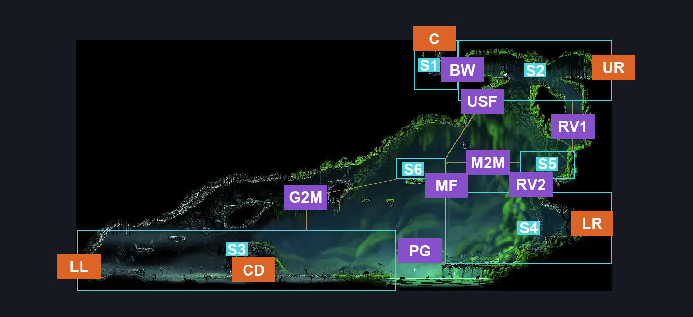
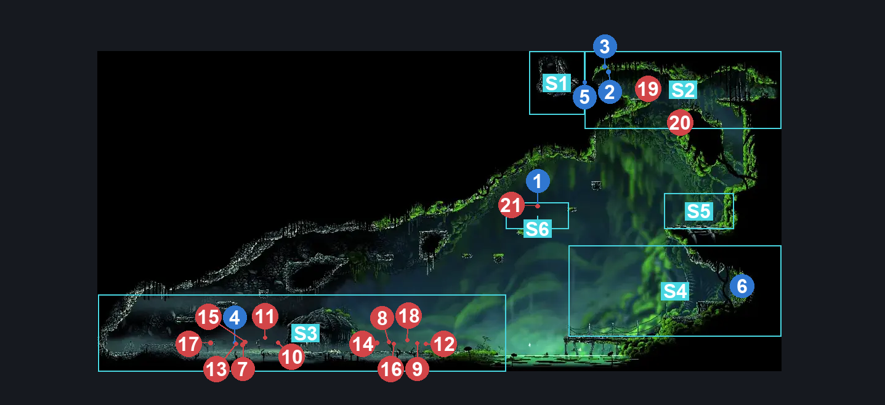
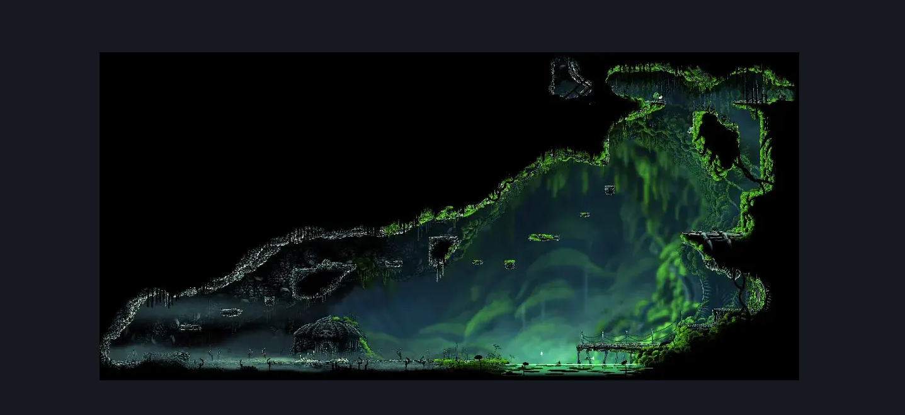

# Bonegrave (Bonegrave)

**Game ID:** Bonegrave

**Contributors:** herounit, super epicguy

## Subrooms

| No. | Subroom | Annotated |
| --- | --- | --- |
| S1 | upper left exit | ✓ |
| S2 | upper right exit | ✓ |
| S3 | graveyard | ✓ |
| S4 | door platform | ✓ |
| S5 | middle right platform | ✓ |
| S6 | mossberry platform | ✓ |

## Room Transitions

| Alias | Name | From subroom | Destination | Destination alias | Requirements | TODO | Verification | Annotated | Notes |
| --- | --- | --- | --- | --- | --- | --- | --- | --- | --- |
| UR | upper right | upper right exit | [Bone Bottom Town (Bonetown)](bone-bottom-town.md) | UL | none |  | Verified | ✓ |  |
| LR | lower right | door platform | [Bone Bottom Town (Bonetown)](bone-bottom-town.md) | LL | none |  | Verified | ✓ |  |
| C | ceiling | upper left exit | [Wormways Lower East (Crawl_07)](../wormways/wormways-lower-east.md) | F | silk soar OR cling grip left OR faydown OR easy scuttlebrace |  | Verified | ✓ |  |
| CD | chapel door | graveyard | [Chapel of the Wanderer (Chapel_Wanderer)](chapel-of-the-wanderer.md) | CD | none |  | Verified | ✓ | "wanderer's door override" is meant to cover any situation that would require the door to stay open, such as rosary cache rando |
| LL | lower left | graveyard | [Bonegrave Passage (Bone_Steel_Servant)](bonegrave-passage.md) | R | complete THE a vassal lost wish promised AND at least 3 resting sites visited |  | Verified | ✓ |  |

## Subroom Connections

| Alias | Name | Source | Destination | Requirements | TODO | Verification | Annotated | Notes |
| --- | --- | --- | --- | --- | --- | --- | --- | --- |
| RV1 | right vertical 1 | middle right platform | upper right exit | silk soar OR cling grip right OR easy scuttlebrace |  | Verified | ✓ |  |
| RV1 | right vertical 1 | upper right exit | middle right platform | none (falling) |  | Verified | ✓ |  |
| RV2 | right vertical 2 | door platform | middle right platform | silk soar |  | Verified | ✓ |  |
| RV2 | right vertical 2 | middle right platform | door platform | none (falling) |  | Verified | ✓ |  |
| BW | breakable wall | upper left exit | upper right exit | clear wormways access breakable wall |  | Verified | ✓ |  |
| BW | breakable wall | upper right exit | upper left exit | clear wormways access breakable wall |  | Verified | ✓ |  |
| PG | pond gap | door platform | graveyard | swim  OR run OR clawline left  OR drifters  OR silk soar  OR sharpdart  OR ( faydown AND ( ledge grab left OR easy beast pogo OR easy hunter pogo OR easy reaper pogo OR easy architect pogo OR easy shaman pogo ) ) |  | Verified | ✓ | A wide variety of stalls are likely to work with faydown here |
| PG | pond gap | graveyard | door platform | silk soar  OR clawline right  OR sharpdart OR ( ( ledge grab right OR cling grip right ) AND run AND dash right ) OR ( faydown AND ( run OR dash right ) ) OR ( swim AND ( ledge grab right OR cling grip right OR faydown ) ) |  | Verified | ✓ | A wide variety of stalls are likely to work here as well with ledge grab or faydown |
| MF | middle vertical 1 | door platform | mossberry platform | silk soar |  | Verified | ✓ |  |
| MF | middle vertical 1 | mossberry platform | door platform | none (falling) |  | Verified | ✓ |  |
| G2M | graveyard to mossberry | graveyard | mossberry platform | silk soar OR ledge grab right OR cling grip right OR faydown |  | Verified | ✓ |  |
| G2M | graveyard to mossberry | mossberry platform | graveyard | none (falling) |  | Verified | ✓ |  |
| M2M | mossberry to middle | mossberry platform | middle right platform | faydown  OR clawline right OR dash right OR easy scuttlebrace OR easy [ beast, hunter, architect ] pogo OR sharpdart  OR drifters |  | Verified | ✓ | there's likely a few possible skips with the aknid |
| M2M | mossberry to middle | middle right platform | mossberry platform | clawline left OR ( run AND dash left AND ( sharpdart OR ( ( ledge grab left OR cling grip left ) AND faydown ) ) ) |  | Verified | ✓ |  |
| USF | upper stall fall | upper right exit | mossberry platform | sharpdart  OR clawline left OR drifters  OR ( run AND dash left ) OR ( faydown AND ( run OR dash left ) ) |  | Verified | ✓ |  |

## Check Locations

| No. | Check | Subroom | Requirements | TODO | Verification | Location Type | Annotated | Notes |
| --- | --- | --- | --- | --- | --- | --- | --- | --- |
| 1 | boneyard mossberry | mossberry platform | none |  | Verified | collectible | ✓ |  |
| 2 | rosary cache bone bottom 6 | upper right exit | none |  | Verified | collectible | ✓ |  |
| 3 | rosary cache bone bottom 7 | upper right exit | none |  | Verified | collectible | ✓ |  |
| 4 | rosaries on grave | graveyard | none |  | Verified | collectible | ✓ | NOT RANDOMIZED AS OF v0.4.5 |
| 5 | wormways access breakable wall | upper left exit | break wall right |  | Verified | blockade | ✓ |  |
| 6 | vines holding door closed | door platform | break vines right |  | Verified | blockade | ✓ |  |
| 7 | Winged Pilgrim 1 | graveyard | prereq THE wanderer crest |  | Verified | enemy | ✓ | FSM Boolean flags: completedMemory_wanderer |
| 8 | Pilgrim Pouncer 1 | graveyard | prereq THE wanderer crest |  | Verified | enemy | ✓ | FSM Boolean flags: completedMemory_wanderer |
| 9 | Pilgrim Groveller 1 | graveyard | prereq THE wanderer crest |  | Verified | enemy | ✓ | FSM Boolean flags: completedMemory_wanderer |
| 10 | Elder Pilgrim 1 | graveyard | Black Thread World Spawn  AND prereq THE wanderer crest |  | Verified | enemy | ✓ | FSM Boolean flags: completedMemory_wanderer |
| 11 | Pilgrim Guide 1 | graveyard | prereq THE wanderer crest |  | Verified | enemy | ✓ | FSM Boolean flags: completedMemory_wanderer |
| 12 | Pilgrim Hornfly 1 | graveyard | prereq THE wanderer crest |  | Verified | enemy | ✓ | FSM Boolean flags: completedMemory_wanderer |
| 13 | Pilgrim Hornfly 2 | graveyard | prereq THE wanderer crest |  | Verified | enemy | ✓ | FSM Boolean flags: completedMemory_wanderer |
| 14 | Pilgrim Bellbearer 1 | graveyard | Black Thread World Spawn  AND prereq THE wanderer crest |  | Verified | enemy | ✓ | FSM Boolean flags: completedMemory_wanderer |
| 15 | Elder Pilgrim 2 | graveyard | prereq THE wanderer crest |  | Verified | enemy | ✓ | FSM Boolean flags: completedMemory_wanderer |
| 16 | Pilgrim Hornfly 3 | graveyard | prereq THE wanderer crest |  | Verified | enemy | ✓ | FSM Boolean flags: completedMemory_wanderer |
| 17 | Pilgrim Bellbearer 2 | graveyard | Black Thread World Spawn  AND prereq THE wanderer crest |  | Verified | enemy | ✓ | FSM Boolean flags: completedMemory_wanderer |
| 18 | Covetous Pilgrim 1 | graveyard | prereq THE wanderer crest |  | Verified | enemy | ✓ | FSM Boolean flags: completedMemory_wanderer |
| 19 | Overgrown Pilgrim 1 | upper right exit | None |  | Verified | enemy | ✓ |  |
| 20 | Aknid 1 | upper right exit | None |  | Verified | enemy | ✓ |  |
| 21 | Aknid 2 | mossberry platform | None |  | Verified | enemy | ✓ | Spawn conditions: bonegraveAspidBerryCollected=false |

## Room Images

### Connections

### Checks

### Scene

