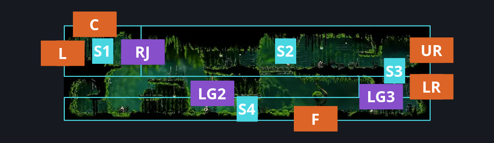
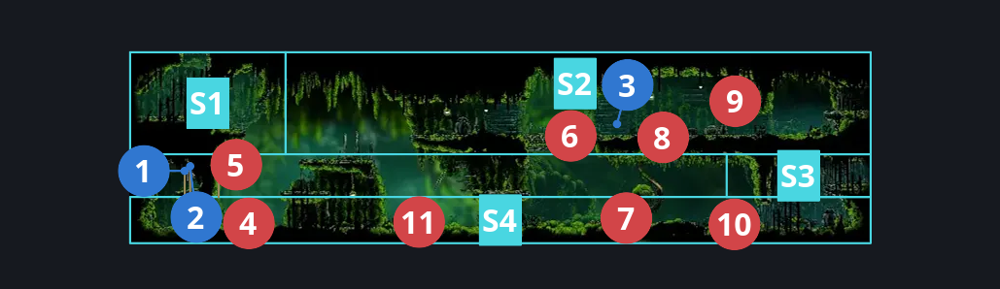
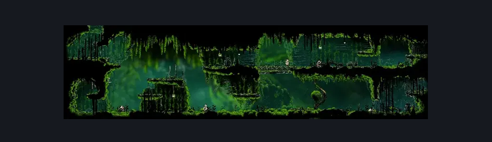

# Mosshome Lower (Bone_11)

**Game ID:** Bone_11

**Contributors:** herounit, hutyrix 

## Subrooms

| No. | Subroom | Annotated |
| --- | --- | --- |
| S1 | upper left exit | ✓ |
| S2 | upper right level | ✓ |
| S3 | lower right exit | ✓ |
| S4 | ground floor | ✓ |

## Room Transitions

| Alias | Name | From subroom | Destination | Destination alias | Requirements | TODO | Verification | Annotated | Notes |
| --- | --- | --- | --- | --- | --- | --- | --- | --- | --- |
| LR | lower right | lower right exit | [The Marrow Map Shop (Bone_04)](../the-marrow/the-marrow-map-shop.md) | LL | none |  | Verified | ✓ |  |
| UR | upper right | upper right level | [The Marrow Map Shop (Bone_04)](../the-marrow/the-marrow-map-shop.md) | UL | none |  | Verified | ✓ |  |
| L | left | upper left exit | [The Big Fall (Aspid_01)](the-big-fall.md) | LR | none |  | Verified | ✓ |  |
| C | ceiling | upper left exit | [Mosshome Middle (Mosstown_01)](mosshome-middle.md) | F | activate floor exit switch IN mosshome middle |  | Verified | ✓ |  |
| F | floor | ground floor | [Mosshome Basement (Bone_11b)](mosshome-basement.md) | C | activate pressure plate IN mosshome basement |  | Verified | ✓ |  |

## Subroom Connections

| Alias | Name | Source | Destination | Requirements | TODO | Verification | Annotated | Notes |
| --- | --- | --- | --- | --- | --- | --- | --- | --- |
| RJ | running jump | upper right level | upper left exit | run  OR ( dash left AND ( ledge grab left OR cling grip left ) ) OR faydown  OR silk soar  OR clawline left OR sharpdart  OR easy beast pogo  OR easy enemy pogo off aknid |  | Verified | ✓ |  |
| RJ | running jump | upper left exit | upper right level | none (falling) |  | Verified | ✓ |  |
| LG2 | ledge grab 2 | ground floor | upper right level | ledge grab either OR cling grip either OR faydown OR silk soar OR easy pogo off [ aknid, pilgrim pouncer, pilgrim groveller ] |  | Verified | ✓ |  |
| LG2 | ledge grab 2 | upper right level | ground floor | none (falling) |  | Verified | ✓ |  |
| LG3 | ledge grab 3 | ground floor | lower right exit | ledge grab right OR cling grip right OR faydown cloak OR silk soar |  | Verified | ✓ |  |
| LG3 | ledge grab 3 | lower right exit | ground floor | none (falling) |  | Verified | ✓ |  |

## Check Locations

| No. | Check | Subroom | Requirements | TODO | Verification | Location Type | Annotated | Notes |
| --- | --- | --- | --- | --- | --- | --- | --- | --- |
| 1 | rosary cache bone bottom 4 | ground floor | attack up OR attack right |  | Verified | collectible | ✓ | attack up and nothing else geez - Gallos |
| 2 | rosary cache bone bottom 5 | ground floor | ledge grab right OR cling grip either OR faydown cloak OR silk soar  OR easy shaman pogo OR easy scuttlebrace OR easy pogo off [ aknid, pilgrim pouncer, pilgrim groveller ] OR [hunter,reaper, witch, shaman] attack right OR [beast,architect] longclaw right OR easy [threefold pin, voltvessels, pimpillo, conchcutter, sting shard, longpin, curveclaw, cogwork wheel, throwing ring, silkshot original, silkshot twelfth architect] use OR hard rosary cannon use  OR easy plasmium stall  OR medium flea brew stall  OR easy [hunter,wanderer, reaper,beast, architect, witch, shaman] charge OR medium beast crest heal stall OR [witch,shaman] attack UP OR easy [thread storm,rune rage] use OR easy [pale nails, silkspear, silkshot forge daugther] use x 2 OR (elite ball knowledge AND architect attack left AND (((run left OR flea brew jump) AND ledge grab left) OR clawline left x 4)) |  | Verified | collectible | ✓ | no more fighting - Gallos  Why Longclaw EBK when longclaw can just be part of smart tool usage logic :( - Morch |
| 3 | Garmond and Zaza Act 3 Meeting Bone Bottom | upper right level | Act 3 |  | Verified | event | ✓ |  |
| 4 | Pilgrim Groveller 1 | ground floor | None |  | Verified | enemy | ✓ |  |
| 5 | Aknid 1 | ground floor | None |  | Verified | enemy | ✓ |  |
| 6 | Pilgrim Pouncer 1 | upper right level | None |  | Verified | enemy | ✓ |  |
| 7 | Pilgrim Groveller 2 | ground floor | None |  | Verified | enemy | ✓ | Spawn conditions: BonePlazaOpened=false |
| 8 | Pilgrim Groveller 3 | upper right level | None |  | Verified | enemy | ✓ | Spawn conditions: defeatedBellBeast=true |
| 9 | Pilgrim Groveller 4 | upper right level | None |  | Verified | enemy | ✓ | Spawn conditions: defeatedBellBeast=false |
| 10 | Pilgrim Groveller 5 | ground floor | None |  | Verified | enemy | ✓ | Spawn conditions: BonePlazaOpened=true |
| 11 | Pilgrim Pouncer 2 | ground floor | Normal World Spawn |  | Verified | enemy | ✓ |  |

## Room Images

### Connections

### Checks

### Scene

