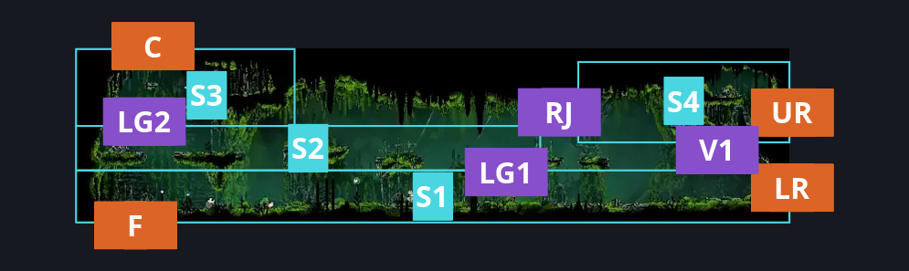
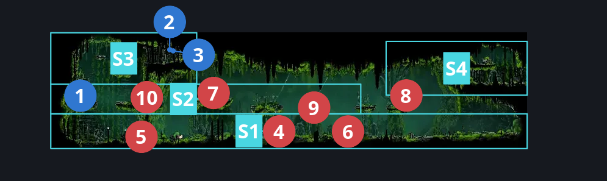
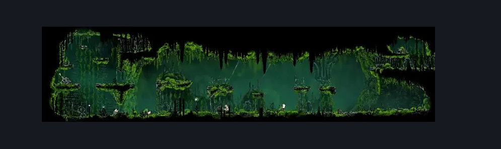

# Mosshome Middle (Mosstown_01)

**Game ID:** Mosstown_01

**Contributors:** herounit

## Subrooms

| No. | Subroom | Annotated |
| --- | --- | --- |
| S1 | ground floor | ✓ |
| S2 | middle left area | ✓ |
| S3 | upper left area | ✓ |
| S4 | upper right area | ✓ |

## Room Transitions

| Alias | Name | From subroom | Destination | Destination alias | Requirements | TODO | Verification | Annotated | Notes |
| --- | --- | --- | --- | --- | --- | --- | --- | --- | --- |
| LR | lower right | ground floor | [The Marrow Bellway (Bone_05)](../the-marrow/the-marrow-bellway.md) | L | none |  | Verified | ✓ |  |
| UR | upper right | upper right area | [Mosshome Side Room (Bone_05b)](mosshome-side-room.md) | L | none |  | Verified | ✓ |  |
| F | floor | ground floor | [Mosshome Lower (Bone_11)](mosshome-lower.md) | C | activate floor exit switch |  | Verified | ✓ |  |
| C | ceiling | upper left area | [Mosshome Upper (Mosstown_02)](mosshome-upper.md) | LF | none |  | Verified | ✓ |  |

## Subroom Connections

| Alias | Name | Source | Destination | Requirements | TODO | Verification | Annotated | Notes |
| --- | --- | --- | --- | --- | --- | --- | --- | --- |
| RJ | running jump | middle left area | upper right area | faydown cloak  OR ( ( ledge grab right OR cling grip right ) AND ( run OR sharpdart OR clawline right ) ) |  | Verified | ✓ |  |
| RJ | running jump | upper right area | middle left area | run  OR dash left OR clawline left OR faydown OR drifters OR sharpdart OR easy beast pogo OR easy scuttlebrace |  | Verified | ✓ |  |
| V1 | vertical 1 | ground floor | upper right area | silk soar |  | Verified | ✓ |  |
| V1 | vertical 1 | upper right area | ground floor | none (falling) |  | Verified | ✓ |  |
| LG1 | ledge grab 1 | ground floor | middle left area | ledge grab either  OR cling grip either OR faydown OR silk soar  OR easy scuttlebrace OR easy shaman pogo OR easy pogo off [ pilgrim pouncer ] OR medium pogo off [ pilgrim groveller, overgrown pilgrim ] |  | Verified | ✓ |  |
| LG1 | ledge grab 1 | middle left area | ground floor | none (falling) |  | Verified | ✓ |  |
| LG2 | ledge grab 2 | middle left area | upper left area | ledge grab both OR cling grip either OR faydown OR silk soar OR easy shaman pogo OR easy scuttlebrace OR ( medium pogo off [ overgrown pilgrim ] AND ( dash right OR clawline right OR sharpdart OR easy beast pogo ) ) |  | Verified | ✓ |  |
| LG2 | ledge grab 2 | upper left area | middle left area | none (falling) |  | Verified | ✓ |  |

## Check Locations

| No. | Check | Subroom | Requirements | TODO | Verification | Location Type | Annotated | Notes |
| --- | --- | --- | --- | --- | --- | --- | --- | --- |
| 1 | floor exit switch | middle left area | flip switch down |  | Verified | blockade | ✓ |  |
| 2 | rosary cache mosshome 1 | upper left area | none |  | Verified | collectible | ✓ |  |
| 3 | rosary cache mosshome 2 | upper left area | none |  | Verified | collectible | ✓ |  |
| 4 | Pilgrim Pouncer 1 | ground floor | None |  | Verified | enemy | ✓ |  |
| 5 | Pilgrim Groveller 1 | ground floor | None |  | Verified | enemy | ✓ |  |
| 6 | Overgrown Pilgrim 1 | ground floor | Normal World Spawn |  | Verified | enemy | ✓ |  |
| 7 | Overgrown Pilgrim 2 | middle left area | Normal World Spawn |  | Verified | enemy | ✓ |  |
| 8 | Aknid 1 | upper right area | Black Thread World Spawn |  | Verified | enemy | ✓ |  |
| 9 | Overgrown Pilgrim 3 | middle left area | Black Thread World Spawn |  | Verified | enemy | ✓ |  |
| 10 | Overgrown Pilgrim 4 | middle left area | Black Thread World Spawn |  | Verified | enemy | ✓ |  |

## Room Images

### Connections

### Checks

### Scene

