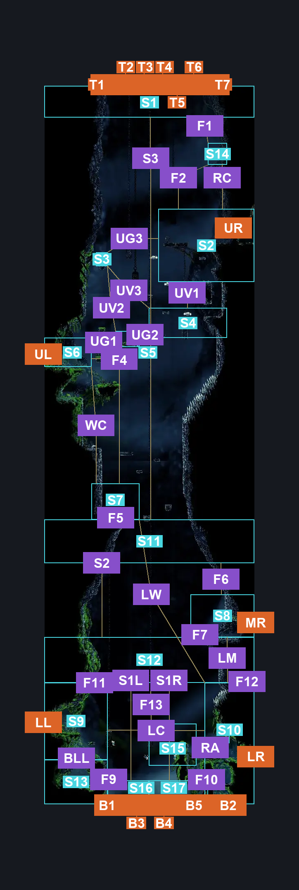
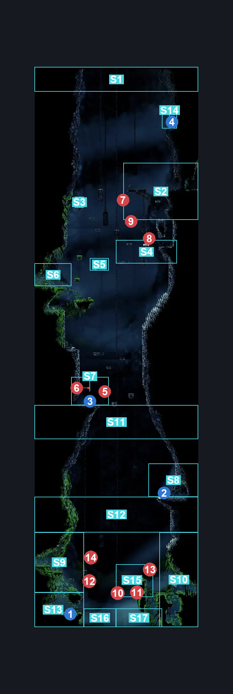
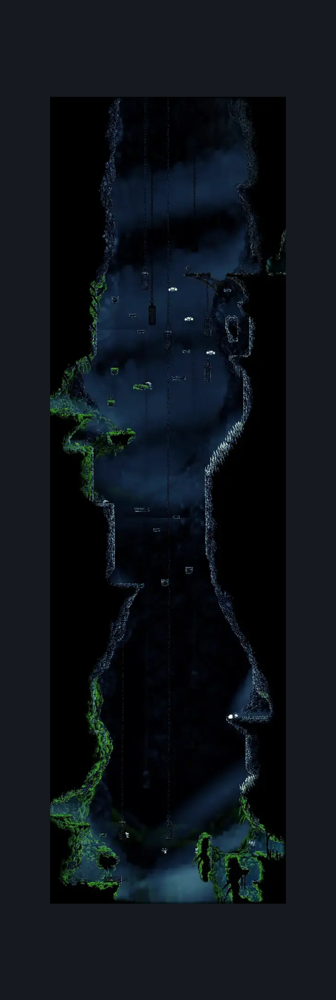

# The Big Fall (Aspid_01)

**Game ID:** Aspid_01

**Contributors:** herounit, Super EpicGuy

## Subrooms

| No. | Subroom | Annotated |
| --- | --- | --- |
| S1 | top area | ✓ |
| S2 | shellwood platform | ✓ |
| S3 | upper left solo platform | ✓ |
| S4 | upper chain passage | ✓ |
| S5 | upper corpse ledge | ✓ |
| S6 | wormways upper platform | ✓ |
| S7 | wish ledge | ✓ |
| S8 | mosshome upper platform | ✓ |
| S9 | wormways lower platform | ✓ |
| S10 | mosshome lower platform | ✓ |
| S11 | upper silk soar only zone | ✓ |
| S12 | lower silk soar only zone | ✓ |
| S13 | bottom left area | ✓ |
| S14 | resting site ledge | ✓ |
| S15 | right aknids | ✓ |
| S16 | bottom gap area left | ✓ |
| S17 | bottom gap area right | ✓ |

## Room Transitions

| Alias | Name | From subroom | Destination | Destination alias | Requirements | TODO | Verification | Annotated | Notes |
| --- | --- | --- | --- | --- | --- | --- | --- | --- | --- |
| T1 | top1 | top area | [Blasted Steps Map Edge (Coral_19)](../blasted-steps/blasted-steps-map-edge.md) | B1 | silk soar |  | Verified | ✓ | if lace starts her cutscene on you she cancels your silk soar and you fall back down without clearing the cutscene |
| T2 | top2 | top area | [Blasted Steps Map Edge (Coral_19)](../blasted-steps/blasted-steps-map-edge.md) | B2 | silk soar |  | Verified | ✓ |  |
| T3 | top3 | top area | [Blasted Steps Map Edge (Coral_19)](../blasted-steps/blasted-steps-map-edge.md) | B3 | silk soar |  | Verified | ✓ |  |
| T4 | top4 | top area | [Blasted Steps Map Edge (Coral_19)](../blasted-steps/blasted-steps-map-edge.md) | B4 | silk soar |  | Verified | ✓ |  |
| T5 | top5 | top area | [Blasted Steps Map Edge (Coral_19)](../blasted-steps/blasted-steps-map-edge.md) | B5 | silk soar |  | Verified | ✓ |  |
| T6 | top6 | top area | [Blasted Steps Map Edge (Coral_19)](../blasted-steps/blasted-steps-map-edge.md) | B6 | silk soar |  | Verified | ✓ |  |
| T7 | top7 | top area | [Blasted Steps Map Edge (Coral_19)](../blasted-steps/blasted-steps-map-edge.md) | B7 | silk soar |  | Verified | ✓ |  |
| UR | upper right | shellwood platform | [Shellwood Lower Toll bench (Shellwood_08c)](../shellwood/shellwood-lower-toll-bench.md) | L | none |  | Verified | ✓ |  |
| MR | middle right | mosshome upper platform | [Mosshome Upper (Mosstown_02)](mosshome-upper.md) | L | clear left exit breakable wall IN mosshome upper |  | Verified | ✓ |  |
| LR | lower right | mosshome lower platform | [Mosshome Lower (Bone_11)](mosshome-lower.md) | L | none |  | Verified | ✓ |  |
| UL | upper left | wormways upper platform | [Wormways Upper East (Crawl_01)](../wormways/wormways-upper-east.md) | R | none |  | Verified | ✓ |  |
| LL | lower left | wormways lower platform | [Wormways Craggler Hallway (Crawl_04)](../wormways/wormways-craggler-hallway.md) | R | none |  | Verified | ✓ |  |
| B1 | bot1 | bottom gap area left | [Bone Bottom Town (Bonetown)](bone-bottom-town.md) | T1 | none |  | Verified | ✓ |  |
| B2 | bot2 | mosshome lower platform | [Bone Bottom Town (Bonetown)](bone-bottom-town.md) | T2 | none |  | Verified | ✓ |  |
| B3 | bot3 | bottom gap area left | [Bone Bottom Town (Bonetown)](bone-bottom-town.md) | T3 | none |  | Verified | ✓ |  |
| B4 | bot4 | bottom gap area right | [Bone Bottom Town (Bonetown)](bone-bottom-town.md) | T4 | none |  | Verified | ✓ |  |
| B5 | bot5 | bottom gap area right | [Bone Bottom Town (Bonetown)](bone-bottom-town.md) | T5 | none |  | Verified | ✓ |  |

## Subroom Connections

| Alias | Name | Source | Destination | Requirements | TODO | Verification | Annotated | Notes |
| --- | --- | --- | --- | --- | --- | --- | --- | --- |
| F1 | top fall | top area | resting site ledge | none (falling) |  | Verified | ✓ |  |
| F2 | resting site fall | resting site ledge | shellwood platform | none (falling) |  | Verified | ✓ |  |
| F4 | upper left ledge fall | wormways upper platform | wish ledge | none (falling) |  | Verified | ✓ |  |
| F5 | wish ledge fall | wish ledge | upper silk soar only zone | none (falling) |  | Verified | ✓ |  |
| F6 | upper silk soar zone fall | upper silk soar only zone | mosshome upper platform | none (falling) |  | Verified | ✓ |  |
| F7 | middle right ledge fall | mosshome upper platform | lower silk soar only zone | none (falling) |  | Verified | ✓ |  |
| F9 | bottom left area fall | bottom left area | bottom gap area left | none (falling) |  | Verified | ✓ |  |
| F10 | lower right area fall | mosshome lower platform | bottom gap area right | none (falling) |  | Verified | ✓ |  |
| F11 | fall into lower left area | lower silk soar only zone | wormways lower platform | none (falling) |  | Verified | ✓ | forgetting these will shame generations of my family. good thing i'm not having kids. - hero, 10/22 |
| F12 | fall into lower right area | lower silk soar only zone | mosshome lower platform | none (falling) |  | Verified | ✓ | forgetting these will shame generations of my family. good thing i'm not having kids. - hero, 10/22 |
| F13 | fall into right aknids | lower silk soar only zone | right aknids | none (falling) |  | Verified | ✓ |  |
| S1L | bottom silk soar left | bottom gap area left | lower silk soar only zone | silk soar |  | Verified | ✓ |  |
| S1L | bottom silk soar left | lower silk soar only zone | bottom gap area left | none (falling) |  | Verified | ✓ |  |
| S1R | bottom silk soar right | bottom gap area right | lower silk soar only zone | silk soar |  | Verified | ✓ |  |
| S1R | bottom silk soar right | lower silk soar only zone | bottom gap area right | none (falling) |  | Verified | ✓ |  |
| S2 | lower zone silk soar | lower silk soar only zone | upper silk soar only zone | silk soar |  | Verified | ✓ |  |
| S3 | upper zone silk soar | upper silk soar only zone | top area | silk soar |  | Verified | ✓ |  |
| RC | resting site climb | shellwood platform | resting site ledge | silk soar OR ( cling grip right AND faydown ) |  | Verified | ✓ |  |
| WC | wish climb | wish ledge | wormways upper platform | silk soar  OR cling grip left OR ( easy scuttlebrace AND ( ledge grab left OR faydown ) ) |  | Verified | ✓ |  |
| LW | lower to wish climb | mosshome lower platform | wish ledge | silk soar  OR ( hard enemy pogo off aknid AND ( spike pogo AND proficient movement ) AND ( ( run AND ledge grab left ) OR dash left ) AND cling grip right AND faydown cloak AND drifters cloak AND clawline left ) |  | Verified | ✓ | Super EpicGuy has a clip of doing this skip from the lower right exit to the wish ledge. Insane.  Need to verify the directionals against the clip - hero, 11/2 |
| LM | lower to middle climb | mosshome lower platform | mosshome upper platform | silk soar  OR ( proficient movement AND hard enemy pogo off aknid AND spike pogo AND ( hard cocoon skip OR hard flintslate  stall OR hard flea brew stall OR hard plasmium stall ) AND cling grip right AND drifters )  OR ( proficient movement AND medium enemy pogo off aknid AND spike pogo AND cling grip right AND faydown cloak ) |  | Verified | ✓ |  |
| LC | lower crossing | wormways lower platform | mosshome lower platform | silk soar OR faydown OR medium scuttlebrace (due to risk of falling) OR ( ( ledge grab right OR cling grip right ) AND ( easy enemy pogo off aknid OR run OR dash right OR clawline right OR sharpdart x 2 OR drifters ) ) |  | Verified | ✓ |  |
| LC | lower crossing | mosshome lower platform | wormways lower platform | silk soar OR faydown OR medium scuttlebrace (due to risk of falling) OR easy enemy pogo off aknid OR run  OR dash left OR clawline left  OR sharpdart x 1 OR drifters |  | Verified | ✓ |  |
| BLL | bottom to lower left | bottom left area | wormways lower platform | ledge grab left OR cling grip either OR faydown cloak OR silk soar |  | Verified | ✓ |  |
| BLL | bottom to lower left | wormways lower platform | bottom left area | none (falling) |  | Verified | ✓ |  |
| RA | right aknid access | mosshome lower platform | right aknids | ledge grab left OR cling grip left OR silk soar |  | Verified | ✓ |  |
| UG1 | upper gap 1 | wormways upper platform | upper corpse ledge | ledge grab right OR cling grip right OR sharpdart OR clawline right OR faydown OR run OR dash right OR easy scuttlebrace |  | Verified | ✓ |  |
| UG1 | upper gap 1 | upper corpse ledge | wormways upper platform | none (falling) |  | Verified | ✓ |  |
| UG2 | upper gap 2 | upper corpse ledge | upper chain passage | run  OR dash right OR clawline right OR drifters OR faydown OR sharpdart OR easy scuttlebrace OR easy beast pogo OR easy [ wanderer, architect ] charge |  | Verified | ✓ |  |
| UG2 | upper gap 2 | upper chain passage | upper corpse ledge | none (jump) |  | Verified | ✓ |  |
| UV1 | upper vertical 1 | upper chain passage | shellwood platform | silk soar OR cling grip either OR easy scuttlebrace OR medium pogo off caranid OR ( ledge grab both AND dash right ) OR ( ( easy pogo off caranid OR ledge grab left ) AND ( clawline right OR sharpdart OR easy [ shaman, beast ] pogo ) ) |  | Verified | ✓ |  |
| UV1 | upper vertical 1 | shellwood platform | upper chain passage | none (falling) |  | Verified | ✓ |  |
| UV2 | upper vertical 2 | upper corpse ledge | upper left solo platform | cling grip left |  | Verified | ✓ |  |
| UV2 | upper vertical 2 | upper left solo platform | upper corpse ledge | none (falling) |  | Verified | ✓ |  |
| UG3 | upper gap 3 | upper left solo platform | shellwood platform | faydown OR ( cling grip right AND ( dash right OR clawline right OR sharpdart OR easy beast pogo ) ) |  | Verified | ✓ |  |
| UG3 | upper gap 3 | shellwood platform | upper left solo platform | run OR faydown OR clawline left OR dash left OR easy beast pogo |  | Verified | ✓ |  |
| UV3 | upper vertical 3 | upper chain passage | upper left solo platform | ledge grab left OR cling grip left OR faydown |  | Verified | ✓ |  |
| UV3 | upper vertical 3 | upper left solo platform | upper chain passage | none (falling) |  | Verified | ✓ |  |

## Check Locations

| No. | Check | Subroom | Requirements | TODO | Verification | Location Type | Annotated | Notes |
| --- | --- | --- | --- | --- | --- | --- | --- | --- |
| 1 | moss grotto rosary cache | bottom left area | none |  | Verified | collectible | ✓ |  |
| 2 | relic choral commandment moss grotto | mosshome upper platform | none |  | Verified | collectible | ✓ |  |
| 3 | my missing courier wish granted | wish ledge | complete my missing courier wish promised IN bellhart wish wall |  | Verified | event | ✓ |  |
| 4 | resting site bone bottom | resting site ledge | complete THE a vassal lost wish promised |  | Verified | event | ✓ |  |
| 5 | Caranid 1 | wish ledge | after THE My Missing Courier Wish Promised |  | Verified | enemy | ✓ | Spawn conditions: Save Courier Short accepted=true, Save Courier Short completed=false  defeating these enemies is part of the wish |
| 6 | Caranid 2 | wish ledge | after THE My Missing Courier Wish Promised |  | Verified | enemy | ✓ | Spawn conditions: Save Courier Short accepted=true, Save Courier Short completed=false  defeating these enemies is part of the wish |
| 7 | Caranid 3 | shellwood platform | None |  | Verified | enemy | ✓ |  |
| 8 | Caranid 4 | upper chain passage | None |  | Verified | enemy | ✓ |  |
| 9 | Caranid 5 | shellwood platform | None |  | Verified | enemy | ✓ |  |
| 10 | Aknid 1 | right aknids | None |  | Verified | enemy | ✓ |  |
| 11 | Aknid 2 | right aknids | Normal World Spawn |  | Verified | enemy | ✓ |  |
| 12 | Aknid 3 | wormways lower platform | Normal World Spawn |  | Verified | enemy | ✓ |  |
| 13 | Aknid 4 | right aknids | Black Thread World Spawn |  | Verified | enemy | ✓ |  |
| 14 | Aknid 5 | wormways lower platform | Black Thread World Spawn |  | Verified | enemy | ✓ |  |

## Room Images

### Connections

### Checks

### Scene

