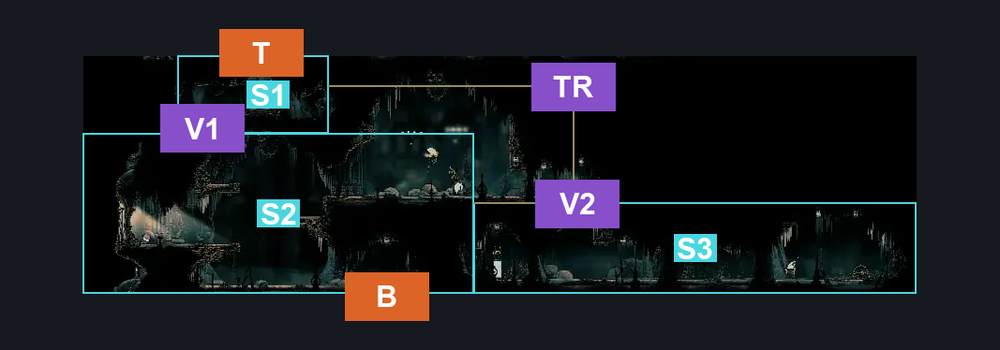
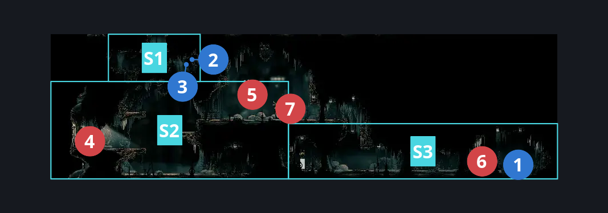
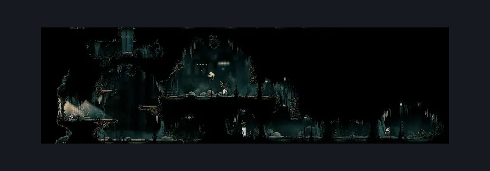

# Choral Chambers Above Ventrica (Song_03)

**Game ID:** Song_03

**Contributors:** samupo, Gallos

## Subrooms

| No. | Subroom | Annotated |
| --- | --- | --- |
| S1 | Top | ✓ |
| S2 | Bottom Left | ✓ |
| S3 | Bottom Right | ✓ |

## Room Transitions

| Alias | Name | From subroom | Destination | Destination alias | Requirements | TODO | Verification | Annotated | Notes |
| --- | --- | --- | --- | --- | --- | --- | --- | --- | --- |
| B | bot1 | Bottom Left | [Choral Chambers Ventrica Room (Song_01b)](choral-chambers-ventrica-room.md) | T | none |  | Verified | ✓ |  |
| T | top1 | Top | [Choral Chambers Outside Spa (Song_04)](choral-chambers-outside-spa.md) | B | Activate Choral Chambers Outside Spa - Switch IN Choral chambers outside spa |  | Verified | ✓ |  |

## Subroom Connections

| Alias | Name | Source | Destination | Requirements | TODO | Verification | Annotated | Notes |
| --- | --- | --- | --- | --- | --- | --- | --- | --- |
| V1 | Vertical | Bottom Left | Top | silk soar OR (ledge grab both AND easy pogo off Reed AND easy damage boost off Reed) OR ((easy shaman pogo OR ledge grab left OR faydown OR (have crest beast AND hard heal stall AND easy beast pogo)) AND easy scuttlebrace) OR (faydown cloak AND (easy pogo off Reed OR ledge grab either OR cling grip either)) OR (cling grip right AND (cling grip left OR (ledge grab left AND (easy shaman pogo OR easy pogo off Reed OR easy [heal,flea brew] stall )))) OR (cling grip left AND (medium plasmium stall x 3 OR drifter's OR sharpdart x 2 OR run OR ledge grab left OR ((dash right OR clawline right OR ledge grab right OR easy beast pogo) AND (easy [voltvessels, plasmium,flea brew] stall OR dash left OR easy pogo off Reed OR clawline left OR sharpdart)))) |  | Verified | ✓ |  |
| V1 | Vertical | Top | Bottom Left | none |  | Verified | ✓ | falling |
| V2 | Vertical2 | Bottom Left | Bottom Right | (cling grip right AND (ledge grab left OR cling grip left)) OR (cling grip left AND ledge grab right) OR faydown cloak OR silk soar |  | Verified | ✓ |  |
| V2 | Vertical2 | Bottom Right | Bottom Left | silk soar OR cling grip right OR (faydown cloak AND (easy pogo off Reed OR (ledge grab left AND easy pogo off Choristor))) OR ((easy scuttlebrace OR cling grip left) AND (faydown OR easy pogo off [Reed, Choristor])) |  | Verified | ✓ |  |
| TR | Top to right | Top | Bottom Right | none |  | Verified | ✓ |  |
| TR | Top to right | Bottom Right | Top | silk soar OR (cling grip right AND (easy pogo off Reed OR easy [heal,flea brew] stall OR faydown OR easy shaman pogo)) OR (faydown cloak AND (easy pogo off Reed OR cling grip left OR (ledge grab left AND easy pogo off Choristor))) OR (cling grip left AND easy pogo off [Reed, Choristor] AND (medium plasmium stall OR run OR (easy beast pogo AND (easy [voltvessels, plasmium,flea brew] stall OR dash left OR easy pogo off Reed OR clawline left OR sharpdart OR drifter's)))) OR (easy scuttlebrace AND (faydown OR easy shaman pogo OR easy pogo off [Reed, Choristor] OR easy flea brew stall OR (have crest beast AND easy heal stall))) |  | Verified | ✓ |  |

## Check Locations

| No. | Check | Subroom | Requirements | TODO | Verification | Location Type | Annotated | Notes |
| --- | --- | --- | --- | --- | --- | --- | --- | --- |
| 1 | Choral Chambers - Ventrica Attic hidden chest | Bottom Right | none |  | Verified | collectible | ✓ | rosary chest |
| 2 | Choral Chambers - Ventrica Attic old gains | Top | none |  | Verified | collectible | ✓ | rosary cache |
| 3 | Choral Chambers - Ventrica Attic treasury | Top | none |  | Verified | collectible | ✓ | rosary cache |
| 4 | Choir Pouncer 1 | Bottom Left | Normal World Spawn |  | Verified | enemy | ✓ |  |
| 5 | Reed 1 | Bottom Left | Normal World Spawn |  | Verified | enemy | ✓ | FSM Boolean flags: marionettesBurned, marionettesMet |
| 6 | Choristor 1 | Bottom Right | Normal World Spawn |  | Verified | enemy | ✓ |  |
| 7 | Envoy 1 | Bottom Left | Normal World Spawn |  | Verified | enemy | ✓ |  |

## Room Images

### Connections

### Checks

### Scene

