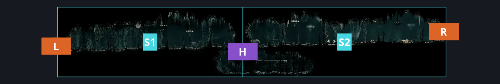
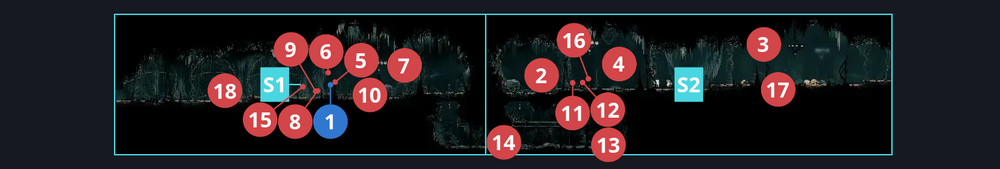
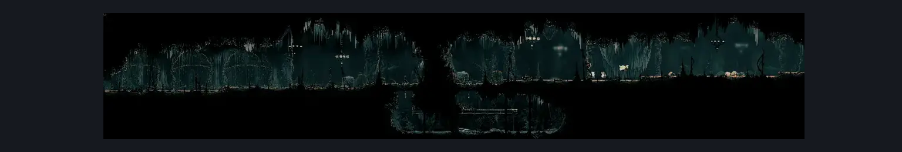

# Choral Chambers Below Spa (Song_02)

**Game ID:** Song_02

**Contributors:** samupo, Gallos

## Subrooms

| No. | Subroom | Annotated |
| --- | --- | --- |
| S1 | Left | ✓ |
| S2 | Right | ✓ |

## Room Transitions

| Alias | Name | From subroom | Destination | Destination alias | Requirements | TODO | Verification | Annotated | Notes |
| --- | --- | --- | --- | --- | --- | --- | --- | --- | --- |
| R | right1 | Right | [Choral Chambers Eastern Shaft (Song_05)](choral-chambers-eastern-shaft.md) | L1 | none |  | Verified | ✓ |  |
| L | left2 | Left | [Choral Chambers Ventrica Room (Song_01b)](choral-chambers-ventrica-room.md) | R | none |  | Verified | ✓ |  |

## Subroom Connections

| Alias | Name | Source | Destination | Requirements | TODO | Verification | Annotated | Notes |
| --- | --- | --- | --- | --- | --- | --- | --- | --- |
| H | Horizontal | Right | Left | cling grip either OR silk soar OR (easy shaman pogo AND easy pogo off [Envoy, Drapemite] AND faydown cloak) OR easy scuttlebrace |  | Verified | ✓ |  |
| H | Horizontal | Left | Right | ledge grab left OR faydown cloak OR silk soar OR (advanced knowledge AND easy shaman pogo) OR (easy pogo off Drapemite AND medium damage boost off Choir Bellbearer) OR easy scuttlebrace |  | Verified | ✓ |  |

## Check Locations

| No. | Check | Subroom | Requirements | TODO | Verification | Location Type | Annotated | Notes |
| --- | --- | --- | --- | --- | --- | --- | --- | --- |
| 1 | Second Sentinel Encounter | Left | Act 3 AND  complete THE Second Sentinel Activation |  | Verified | event | ✓ | Verified via enemy import.  Spawn conditions: songChevalierActiveInSong_02=true, songChevalierSeenInSong_02=false, songChevalierEncounterCooldown=false, songChevalierQuestReady=false FSM Boolean flags: encounteredSongChevalierBoss |
| 2 | Choir Bellbearer 1 | Right | Normal World Spawn AND ((prereq Lace Second Encounter IN choral chambers eastern shaft) OR (prereq Lace Second Encounter IN grand bellway shaft)) |  | Verified | enemy | ✓ |  |
| 3 | Choir Bellbearer 2 | Right | Black Thread World Spawn |  | Verified | enemy | ✓ |  |
| 4 | Choir Elder 1 | Right | Black Thread World Spawn |  | Verified | enemy | ✓ |  |
| 5 | Choir Flyer 1 | Left | Normal World Spawn AND ((prereq Lace Second Encounter IN choral chambers eastern shaft) OR (prereq Lace Second Encounter IN grand bellway shaft)) |  | Verified | enemy | ✓ |  |
| 6 | Choir Flyer 2 | Left | Black Thread World Spawn |  | Verified | enemy | ✓ | Spawn conditions: songChevalierActiveInSong_02=true, songChevalierSeenInSong_02=false, songChevalierEncounterCooldown=false, songChevalierQuestReady=false |
| 7 | Choir Flyer 3 | Left | Black Thread World Spawn |  | Verified | enemy | ✓ |  |
| 8 | Choir Hornhead 1 | Left | Normal World Spawn AND ((prereq Lace Second Encounter IN choral chambers eastern shaft) OR (prereq Lace Second Encounter IN grand bellway shaft)) |  | Verified | enemy | ✓ |  |
| 9 | Choir Hornhead 2 | Left | Black Thread World Spawn AND prereq Second Sentinel Encounter |  | Verified | enemy | ✓ | Spawn conditions: songChevalierActiveInSong_02=true, songChevalierSeenInSong_02=false, songChevalierEncounterCooldown=false, songChevalierQuestReady=false |
| 10 | Choir Hornhead 3 | Left | Black Thread World Spawn |  | Verified | enemy | ✓ |  |
| 11 | Choir Pouncer 1 | Right | Normal World Spawn AND ((prereq Lace Second Encounter IN choral chambers eastern shaft) OR (prereq Lace Second Encounter IN grand bellway shaft)) |  | Verified | enemy | ✓ |  |
| 12 | Choir Pouncer 2 | Right | Black Thread World Spawn |  | Verified | enemy | ✓ |  |
| 13 | Drapemite 1 | Right | Normal World Spawn |  | Verified | enemy | ✓ |  |
| 14 | Drapemite 2 | Right | Normal World Spawn |  | Verified | enemy | ✓ |  |
| 15 | Envoy 1 | Left | Normal World Spawn AND ((prereq Lace Second Encounter IN choral chambers eastern shaft) OR (prereq Lace Second Encounter IN grand bellway shaft)) |  | Verified | enemy | ✓ | FSM Boolean flags: marionettesBurned, marionettesMet |
| 16 | Envoy 2 | Right | Normal World Spawn AND ((prereq Lace Second Encounter IN choral chambers eastern shaft) OR (prereq Lace Second Encounter IN grand bellway shaft)) |  | Verified | enemy | ✓ | FSM Boolean flags: marionettesBurned, marionettesMet |
| 17 | Envoy 3 | Right | Black Thread World Spawn |  | Verified | enemy | ✓ |  |
| 18 | Envoy 4 | Left | Black Thread World Spawn |  | Verified | enemy | ✓ |  |

## Room Images

### Connections

### Checks

### Scene

