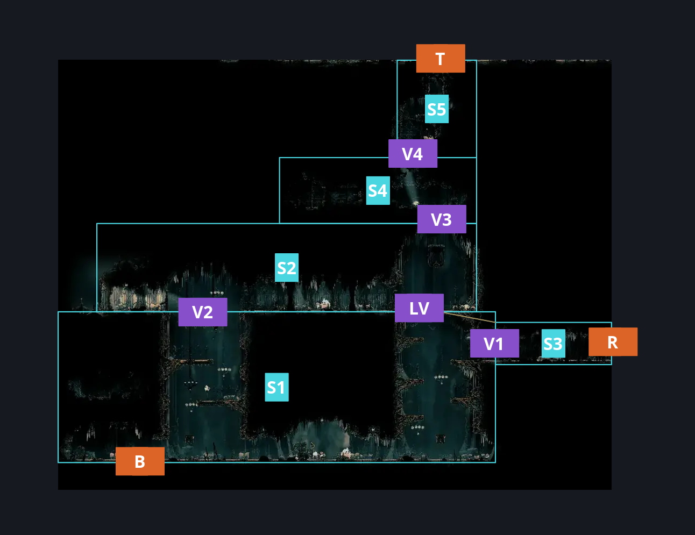
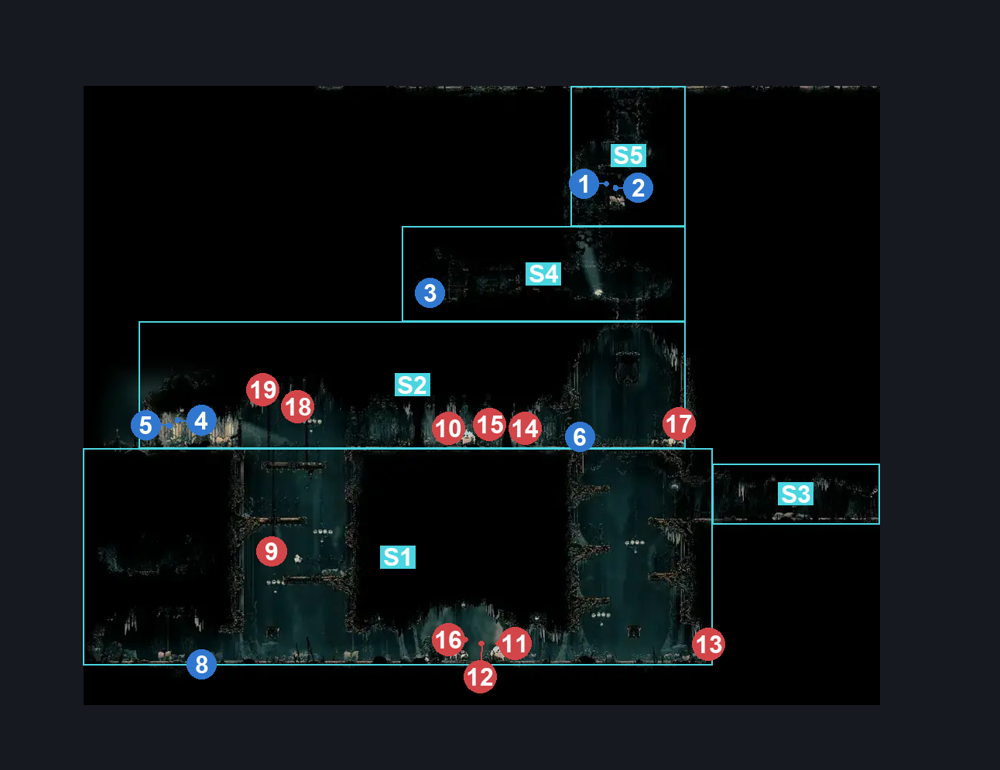
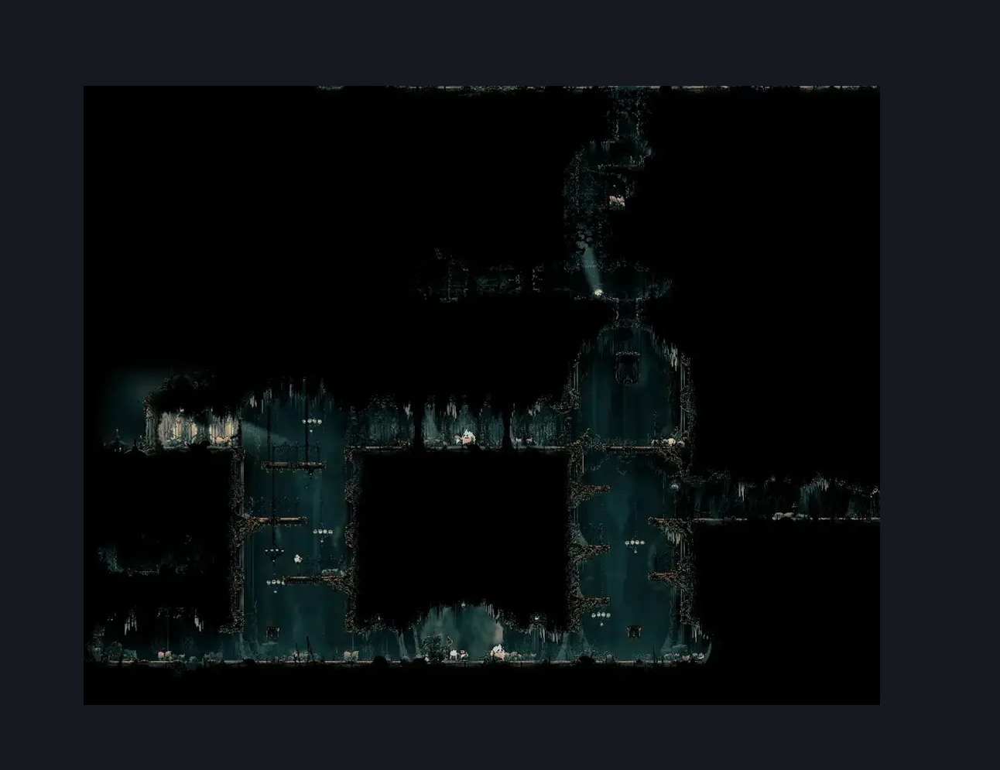

# Choral Chambers Below Ventrica (Song_01)

**Game ID:** Song_01

**Contributors:** samupo, Gallos

## Subrooms

| No. | Subroom | Annotated |
| --- | --- | --- |
| S1 | Bottom | ✓ |
| S2 | Middle | ✓ |
| S3 | Right Exit | ✓ |
| S4 | Pre Top | ✓ |
| S5 | Top | ✓ |

## Room Transitions

| Alias | Name | From subroom | Destination | Destination alias | Requirements | TODO | Verification | Annotated | Notes |
| --- | --- | --- | --- | --- | --- | --- | --- | --- | --- |
| B | bot1 | Bottom | [Grand Gate Maintenance Room (Song_01c)](../grand-gate/grand-gate-maintenance-room.md) | T | break wall down OR break wall up |  | Verified | ✓ |  |
| T | top1 | Top | [Choral Chambers Ventrica Room (Song_01b)](choral-chambers-ventrica-room.md) | B | cling grip either OR silk soar OR easy scuttlebrace |  | Verified | ✓ |  |
| R | right2 | Right Exit | [Choral Chambers Outisde Underworks (Under_07b)](choral-chambers-outisde-underworks.md) | L | none |  | Verified | ✓ |  |

## Subroom Connections

| Alias | Name | Source | Destination | Requirements | TODO | Verification | Annotated | Notes |
| --- | --- | --- | --- | --- | --- | --- | --- | --- |
| V1 | Bottom to Right Exit | Bottom | Right Exit | Silk soar OR faydown cloak OR easy scuttlebrace OR (run AND ledge grab left) OR (ledge grab both AND (drifter's cloak OR dash both)) OR ((easy pogo off [Choir Pouncer, Choir Hornhead, Envoy] OR ledge grab either OR cling grip either OR (Have crest beast AND hard heal stall AND hard plasmium stall)) AND ((clawline either AND sharpdart x 2)  OR sharpdart x 4 OR clawline both OR (flea brew AND easy [plasmium, voltvessels] stall) OR (easy beast pogo AND (easy [flea brew,thread storm, flintslate,rune rage] stall OR medium heal stall )))) OR (easy flea brew stall AND (ledge grab left OR cling grip left)) OR (ledge grab both AND Hard Shaman pogo) OR (dash right AND (ledge grab right OR cling grip right) AND (sharpdart x 2 OR clawline left)) OR (dash left AND (ledge grab left AND cling grip left) AND (sharpdart x 2 OR clawline right)) |  | Verified | ✓ |  |
| V1 | Bottom to Right Exit | Right Exit | Bottom | none |  | Verified | ✓ | falling |
| LV | Lever | Right Exit | Middle | activate Below Ventrica - Lever AND (silk soar OR faydown cloak OR (easy shaman pogo AND easy scuttlebrace) OR ((Flea brew OR sharp dart OR Dash left OR Run OR clawline left) AND cling grip left) OR (ledge grab left AND (easy scuttlebrace OR easy pogo off Choir Pouncer))) |  | Verified | ✓ |  |
| V2 | Bottom to Middle | Bottom | Middle | silk soar OR easy scuttlebrace OR cling grip both OR (cling grip right AND faydown cloak) OR ((faydown cloak OR (Have crest beast AND hard heal stall AND hard plasmium stall) OR (ledge grab both AND medium damage boost off Choir Flyer)) AND medium pogo off Choir Flyer) OR (ledge grab either AND faydown cloak AND easy pogo off Choir Flyer) |  | Verified | ✓ | can exactly hit the Choir flyer 4 times |
| V2 | Bottom to Middle | Middle | Bottom | none |  | Verified | ✓ | falling |
| V3 | Middle to Pre Top | Middle | Pre Top | silk soar OR ((easy pogo off [Choir Pouncer, Choir Hornhead, Envoy] OR faydown cloak) AND cling grip left) OR (cling grip right AND (faydown cloak OR drifter's cloak OR clawline left OR Dash left OR sharp dart)) OR (ledge grab either AND easy Shaman pogo AND easy pogo off Choir Flyer AND faydown cloak) OR (easy scuttlebrace AND ((easy pogo off [Choir Pouncer, Choir Hornhead, Envoy] AND (clawline right OR sharp dart OR cling grip left)) OR drifter's cloak OR faydown cloak OR (sharpdart OR clawline left OR cling grip right ))) |  | Verified | ✓ | need to aggro Choir Flyer for Shaman skip |
| V3 | Middle to Pre Top | Pre Top | Middle | none |  | Verified | ✓ | falling |
| V4 | Pre Top to Top | Pre Top | Top | cling grip either OR silk soar OR ((easy shaman pogo OR faydown cloak OR easy [rune rage,flea brew] stall) AND easy scuttlebrace) |  | Verified | ✓ |  |
| V4 | Pre Top to Top | Top | Pre Top | none |  | Verified | ✓ | falling |
| LV | Lever | Middle | Right Exit | activate Below Ventrica - Lever |  | Verified | ✓ | falling |

## Check Locations

| No. | Check | Subroom | Requirements | TODO | Verification | Location Type | Annotated | Notes |
| --- | --- | --- | --- | --- | --- | --- | --- | --- |
| 1 | Below Ventrica - worker's wage | Top | none |  | Verified | collectible | ✓ | rosary cache |
| 2 | Below Ventrica - worker's stolen funds | Top | none |  | Verified | collectible | ✓ | rosary cache |
| 3 | Below Ventrica - worker's remains | Pre Top | none |  | Verified | collectible | ✓ | shell cache |
| 4 | Below Ventrica - Window's repairing fees | Middle | none |  | Verified | collectible | ✓ | rosary cache |
| 5 | Below Ventrica - Window's cleaning fees | Middle | none |  | Verified | collectible | ✓ | rosary cache |
| 6 | Below Ventrica - Lever | Middle | none |  | Verified | switch | ✓ |  |
| 7 | Below Ventrica to Grand Gate | Bottom | Clear Breakable Floor Below Ventrica OR Clear Breakable Ceiling Gate Maintenance IN Grand Gate Maintenance Room |  | Verified | logic-point |  |  |
| 8 | Breakable Floor Below Ventrica | Bottom | attack down |  | Verified | blockade | ✓ |  |
| 9 | Choir Flyer 1 | Bottom | Normal World Spawn AND ((prereq Lace Second Encounter IN choral chambers eastern shaft) OR (prereq Lace Second Encounter IN grand bellway shaft)) |  | Verified | enemy | ✓ |  |
| 10 | Choir Hornhead 1 | Middle | Normal World Spawn AND ((prereq Lace Second Encounter IN choral chambers eastern shaft) OR (prereq Lace Second Encounter IN grand bellway shaft)) |  | Verified | enemy | ✓ |  |
| 11 | Choir Hornhead 2 | Bottom | Normal World Spawn AND ((prereq Lace Second Encounter IN choral chambers eastern shaft) OR (prereq Lace Second Encounter IN grand bellway shaft)) |  | Verified | enemy | ✓ |  |
| 12 | Choir Pouncer 1 | Bottom | Normal World Spawn AND ((prereq Lace Second Encounter IN choral chambers eastern shaft) OR (prereq Lace Second Encounter IN grand bellway shaft)) |  | Verified | enemy | ✓ |  |
| 13 | Choir Pouncer 2 | Bottom | Normal World Spawn AND ((prereq Lace Second Encounter IN choral chambers eastern shaft) OR (prereq Lace Second Encounter IN grand bellway shaft)) |  | Verified | enemy | ✓ |  |
| 14 | Choir Pouncer 3 | Middle | Normal World Spawn AND ((prereq Lace Second Encounter IN choral chambers eastern shaft) OR (prereq Lace Second Encounter IN grand bellway shaft)) |  | Verified | enemy | ✓ |  |
| 15 | Choristor 1 | Middle | Black Thread World Spawn |  | Verified | enemy | ✓ |  |
| 16 | Envoy 1 | Bottom | Normal World Spawn AND ((prereq Lace Second Encounter IN choral chambers eastern shaft) OR (prereq Lace Second Encounter IN grand bellway shaft)) |  | Verified | enemy | ✓ | FSM Boolean flags: marionettesBurned, marionettesMet |
| 17 | Envoy 2 | Middle | Normal World Spawn AND ((prereq Lace Second Encounter IN choral chambers eastern shaft) OR (prereq Lace Second Encounter IN grand bellway shaft)) |  | Verified | enemy | ✓ | FSM Boolean flags: marionettesBurned, marionettesMet |
| 18 | Reed 1 | Middle | Black Thread World Spawn |  | Verified | enemy | ✓ |  |
| 19 | Void Mass 1 | Middle | Black Thread World Spawn |  | Verified | enemy | ✓ |  |

## Room Images

### Connections

### Checks

### Scene

