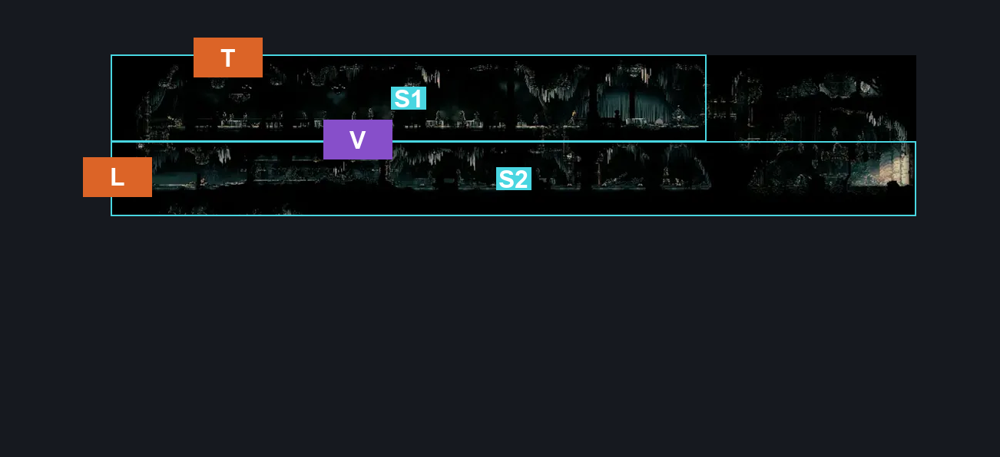
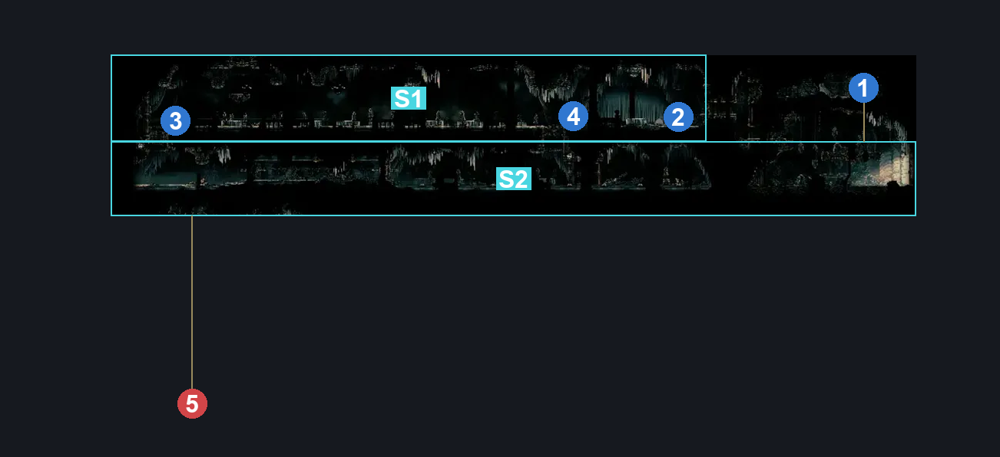
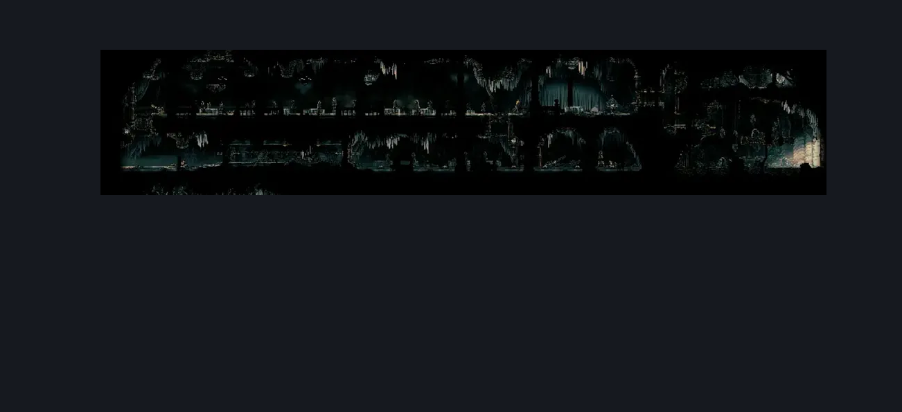

# Choral Chambers Dining Room (Song_09b)

**Game ID:** Song_09b

**Contributors:** samupo, Gallos

## Subrooms

| No. | Subroom | Annotated |
| --- | --- | --- |
| S1 | Diner | ✓ |
| S2 | Below Diner | ✓ |

## Room Transitions

| Alias | Name | From subroom | Destination | Destination alias | Requirements | TODO | Verification | Annotated | Notes |
| --- | --- | --- | --- | --- | --- | --- | --- | --- | --- |
| T | top1 | Diner | [Choral Chambers Over Dining (Song_09)](choral-chambers-over-dining.md) | B | ledge grab either OR faydown cloak OR silk soar OR cling grip either OR (proficient movement AND have crest beast AND hard heal stall AND easy plasmium stall) OR easy shaman pogo |  | Verified | ✓ |  |
| L | left1 | Below Diner | [Choral Chambers Flea Shaft (Song_11)](choral-chambers-flea-shaft.md) | S1R | none |  | Verified | ✓ |  |

## Subroom Connections

| Alias | Name | Source | Destination | Requirements | TODO | Verification | Annotated | Notes |
| --- | --- | --- | --- | --- | --- | --- | --- | --- |
| V | Vertical | Diner | Below Diner | Activate Dining room - Lever 1 OR Activate Dining room - Lever 2 |  | Verified | ✓ |  |
| V | Vertical | Below Diner | Diner | ((cling grip left OR silk soar) AND Activate Dining room - Lever 1) OR ((easy scuttlebrace OR cling grip right) AND Activate Dining room - Lever 2) |  | Verified | ✓ |  |

## Check Locations

| No. | Check | Subroom | Requirements | TODO | Verification | Location Type | Annotated | Notes |
| --- | --- | --- | --- | --- | --- | --- | --- | --- |
| 1 | Dining room - Silk eater | Below Diner | ledge grab either OR easy [Hunter, Wanderer, Reaper, Beast, Architect, Witch, Shaman] pogo OR cling grip either OR faydown cloak |  | Verified | collectible | ✓ |  |
| 2 | Great Taste of Pharloom Wish Promised | Diner | none |  | Verified | event | ✓ |  |
| 3 | Dining room - Lever 1 | Diner | none |  | Verified | switch | ✓ |  |
| 4 | Dining room - Lever 2 | Diner | none |  | Verified | switch | ✓ |  |
| 5 | Choir Pouncer 1 | Below Diner | Invalid |  | Verified | enemy | ✓ | Spawn conditions:  citadelWoken == false  not sure if you can ever reach this guy - reaching the citadel wakes it as far as I know. maybe room rando? - hero, 10/16 |

## Room Images

### Connections

### Checks

### Scene

