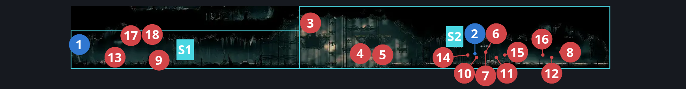
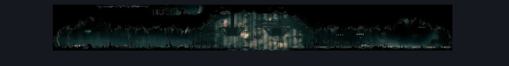

# Choral Chambers East to West (Song_27)

**Game ID:** Song_27

**Contributors:** samupo, Gallos

## Subrooms

| No. | Subroom | Annotated |
| --- | --- | --- |
| S1 | Left Side | ✓ |
| S2 | Right Side | ✓ |

## Room Transitions

| Alias | Name | From subroom | Destination | Destination alias | Requirements | TODO | Verification | Annotated | Notes |
| --- | --- | --- | --- | --- | --- | --- | --- | --- | --- |
| T | top1 | Left Side | [Choral Chambers Below Dining (Song_18)](choral-chambers-below-dining.md) | B | invalid |  | Verified | ✓ | One way, can't be used at all from this side even if you entered from it! |
| R | right1 | Right Side | [Grand Bellway Shaft (Song_20)](grand-bellway-shaft.md) | UL | none |  | Verified | ✓ |  |
| L | left1 | Left Side | [Choral Chambers Eastern Shaft (Song_05)](choral-chambers-eastern-shaft.md) | R2 | activate Lever East to West |  | Verified | ✓ |  |

## Subroom Connections

| Alias | Name | Source | Destination | Requirements | TODO | Verification | Annotated | Notes |
| --- | --- | --- | --- | --- | --- | --- | --- | --- |
| H | Horizontal | Left Side | Right Side | easy pogo off [cogworker, Choir flyer] OR clawline right OR ledge grab either OR faydown cloak OR spike pogo OR easy scuttlebrace OR dash right OR easy [plasmium,voltvessels,thread storm,rune rage] stall OR flea brew OR easy beast pogo OR sharpdart |  | Verified | ✓ |  |
| H | Horizontal | Right Side | Left Side | easy pogo off [cogworker, Choir flyer, Choir hornhead, Envoy] OR ledge grab either OR faydown cloak OR spike pogo OR easy scuttlebrace OR easy [beast,shaman] pogo OR easy [voltvessels, plasmium, flea brew] stall |  | Verified | ✓ |  |

## Check Locations

| No. | Check | Subroom | Requirements | TODO | Verification | Location Type | Annotated | Notes |
| --- | --- | --- | --- | --- | --- | --- | --- | --- |
| 1 | Lever East to West | Left Side | flip switch left |  | Verified | switch | ✓ |  |
| 2 | Second Sentinel Encounter | Right Side | complete THE Second Sentinel Activation |  | Verified | event | ✓ | Spawn conditions: songChevalierActiveInSong_27=true, songChevalierSeenInSong_27=false, songChevalierEncounterCooldown=false, songChevalierQuestReady=false FSM Boolean flags: encounteredSongChevalierBoss |
| 3 | Cogworker 1 | Right Side | Normal World Spawn |  | Verified | enemy | ✓ |  |
| 4 | Cogworker 2 | Right Side | Normal World Spawn |  | Verified | enemy | ✓ |  |
| 5 | Cogworker 3 | Right Side | Normal World Spawn |  | Verified | enemy | ✓ |  |
| 6 | Choir Flyer 1 | Right Side | prereq Second Sentinel Encounter |  | Verified | enemy | ✓ | Spawn conditions: songChevalierActiveInSong_27=true, songChevalierSeenInSong_27=false, songChevalierEncounterCooldown=false, songChevalierQuestReady=false |
| 7 | Choir Flyer 2 | Right Side | Normal World Spawn |  | Verified | enemy | ✓ |  |
| 8 | Choir Flyer 3 | Right Side | Normal World Spawn |  | Verified | enemy | ✓ |  |
| 9 | Choir Flyer 4 | Left Side | Normal World Spawn |  | Verified | enemy | ✓ |  |
| 10 | Choir Hornhead 1 | Right Side | prereq Second Sentinel Encounter |  | Verified | enemy | ✓ | Spawn conditions: songChevalierActiveInSong_27=true, songChevalierSeenInSong_27=false, songChevalierEncounterCooldown=false, songChevalierQuestReady=false |
| 11 | Choir Hornhead 2 | Right Side | Normal World Spawn |  | Verified | enemy | ✓ |  |
| 12 | Choir Hornhead 3 | Right Side | Normal World Spawn |  | Verified | enemy | ✓ |  |
| 13 | Choir Pouncer 1 | Left Side | Normal World Spawn |  | Verified | enemy | ✓ |  |
| 14 | Envoy 1 | Right Side | prereq Second Sentinel Encounter |  | Verified | enemy | ✓ | Spawn conditions: songChevalierActiveInSong_27=true, songChevalierSeenInSong_27=false, songChevalierEncounterCooldown=false, songChevalierQuestReady=false |
| 15 | Envoy 2 | Right Side | Normal World Spawn |  | Verified | enemy | ✓ | FSM Boolean flags: marionettesBurned, marionettesMet |
| 16 | Envoy 3 | Right Side | Normal World Spawn |  | Verified | enemy | ✓ | FSM Boolean flags: marionettesBurned, marionettesMet |
| 17 | Reed 1 | Left Side | Black Thread World Spawn |  | Verified | enemy | ✓ |  |
| 18 | Void Mass 1 | Left Side | Black Thread World Spawn |  | Verified | enemy | ✓ |  |

## Notes

Door on the east can be only opened from the west

## Room Images

### Connections

### Checks

### Scene

