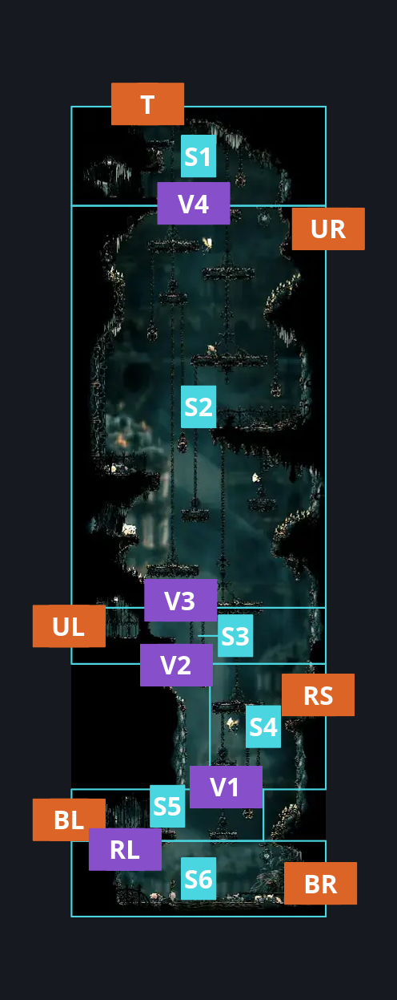
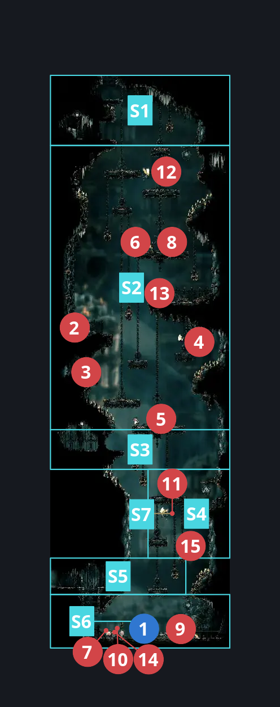
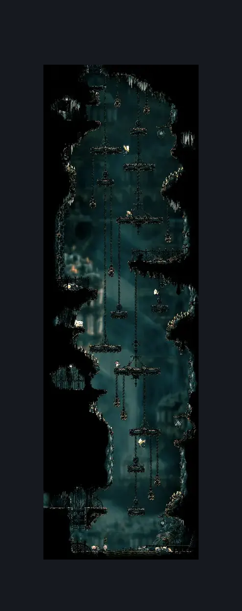

# Grand Bellway Shaft (Song_20)

**Game ID:** Song_20

**Contributors:** samupo,Gallos

## Subrooms

| No. | Subroom | Annotated |
| --- | --- | --- |
| S1 | Top | ✓ |
| S2 | Upper | ✓ |
| S3 | Middle | ✓ |
| S4 | Right Stage | ✓ |
| S5 | Bottom Left | ✓ |
| S6 | Bottom Right | ✓ |

## Room Transitions

| Alias | Name | From subroom | Destination | Destination alias | Requirements | TODO | Verification | Annotated | Notes |
| --- | --- | --- | --- | --- | --- | --- | --- | --- | --- |
| UL | left1 | Middle | [Choral Chambers East to West (Song_27)](choral-chambers-east-to-west.md) | R | none |  | Verified | ✓ |  |
| T | top1 | Top | [Rotating Tunnel (Song_20b)](rotating-tunnel.md) | B | none |  | Verified | ✓ |  |
| UR | right4 | Upper | [Grand Bellway Library (Library_03)](../whispering-vaults/grand-bellway-library.md) | L | none |  | Verified | ✓ |  |
| RS | right5 | Right Stage | [Trobbio (Library_13)](../whispering-vaults/trobbio.md) | L | none |  | Verified | ✓ |  |
| BR | right6 | Bottom Right | [Grand Bellway (Bellway_City)](grand-bellway.md) | L | none |  | Verified | ✓ |  |
| BL | left2 | Bottom Left | [Grand Bellway Side Room (Song_24)](grand-bellway-side-room.md) | R | none |  | Verified | ✓ |  |

## Subroom Connections

| Alias | Name | Source | Destination | Requirements | TODO | Verification | Annotated | Notes |
| --- | --- | --- | --- | --- | --- | --- | --- | --- |
| RL | Bottom Right to Bottom Left | Bottom Right | Bottom Left | silk soar OR cling grip left OR (cling grip right AND (easy pogo off [Choristor, Envoy] OR faydown cloak OR easy [flea brew,air heal] stall OR easy shaman pogo)) OR (ledge grab either AND hard pogo off Choristor AND (easy Shaman pogo OR hard Reaper pogo OR (hard [Hunter, Beast, Witch, Wanderer, Architect] pogo))) OR easy scuttlebrace OR (faydown AND easy pogo off CHoristor) |  | Verified | ✓ |  |
| RL | Bottom Right to Bottom Left | Bottom Left | Bottom Right | none |  | Verified | ✓ | falling |
| V1 | Bottom Left to Right Stage | Bottom Left | Right Stage | silk soar OR cling grip either OR ((ledge grab right OR clawline right OR sharpdart OR easy scuttlebrace OR easy shaman pogo OR easy [air heal, flea brew, plasmium, voltvessels, thread storm, cross stitch, rune rage, pale nails, flintslate] stall OR silkspear OR proficient movement) AND faydown cloak) OR easy pogo off Reed OR (medium scuttlebrace AND (easy [shaman, reaper] pogo OR (easy air heal stall AND easy [Wanderer, Witch, Architect, hunter] pogo))) |  | Verified | ✓ |  |
| V1 | Bottom Left to Right Stage | Right Stage | Bottom Left | none |  | Verified | ✓ | falling |
| V2 | Right Stage to Upper Left | Right Stage | Middle | easy [Hunter, Reaper, Wanderer, Shaman, Beast] pogo OR ledge grab left OR easy scuttlebrace OR dash left OR clawline left OR sharpdart OR easy [air heal, flea brew, plasmium, voltvessels, thread storm, cross stitch, rune rage, pale nails, flintslate] stall OR silk soar OR faydown |  | Verified | ✓ |  |
| V2 | Right Stage to Upper Left | Middle | Right Stage | none |  | Verified | ✓ | falling |
| V3 | Upper Left to Upper Right | Middle | Upper | (easy scuttlebrace AND easy shaman pogo) OR silk soar OR ((ledge grab left OR easy scuttlebrace OR easy shaman pogo) AND easy pogo off Choir pouncer AND easy pogo off Choir Elder AND easy pogo off [Choir Flyer, Reed]) OR faydown cloak OR (cling grip both AND (easy scuttlebrace OR dash right OR clawline right OR sharpdart OR run)) OR (easy scuttlebrace AND easy pogo off Choir pouncer AND easy pogo off [Choir Elder,Reed, Choir Flyer, Choir bellbearer]) |  | Verified | ✓ |  |
| V3 | Upper Left to Upper Right | Upper | Middle | none |  | Verified | ✓ | falling |
| V4 | Upper Right to Top | Upper | Top | ledge grab left OR silk soar OR clawline left OR faydown cloak OR easy pogo off Reed OR sharpdart OR easy scuttlebrace OR easy damage boost off Choir Bellbearer |  | Verified | ✓ |  |
| V4 | Upper Right to Top | Top | Upper | none |  | Verified | ✓ | falling |

## Check Locations

| No. | Check | Subroom | Requirements | TODO | Verification | Location Type | Annotated | Notes |
| --- | --- | --- | --- | --- | --- | --- | --- | --- |
| 1 | Lace Second Encounter | Bottom Right | none |  | Verified | event | ✓ |  |
| 2 | Choir Bellbearer 1 | Upper | Normal World Spawn |  | Verified | enemy | ✓ |  |
| 3 | Choir Elder 1 | Upper | Normal World Spawn |  | Verified | enemy | ✓ |  |
| 4 | Choir Flyer 1 | Upper | Normal World Spawn |  | Verified | enemy | ✓ |  |
| 5 | Choir Pouncer 1 | Upper | Normal World Spawn |  | Verified | enemy | ✓ |  |
| 6 | Choristor 1 | Upper | Normal World Spawn |  | Verified | enemy | ✓ |  |
| 7 | Choristor 2 | Bottom Right | activate Bellshrine Enclave - lever IN bellshrine-enclave |  | Verified | enemy | ✓ | Spawn conditions: bellShrineEnclave=true |
| 8 | Choristor 3 | Upper | Black Thread World Spawn |  | Verified | enemy | ✓ |  |
| 9 | Envoy 1 | Bottom Right | Normal World Spawn |  | Verified | enemy | ✓ | Spawn conditions: laceMeetCitadel=false |
| 10 | Envoy 2 | Bottom Right | activate Bellshrine Enclave - lever IN bellshrine-enclave |  | Verified | enemy | ✓ | Spawn conditions: bellShrineEnclave=true |
| 11 | Reed 1 | Right Stage | Normal World Spawn |  | Verified | enemy | ✓ |  |
| 12 | Reed 2 | Upper | Normal World Spawn |  | Verified | enemy | ✓ |  |
| 13 | Reed 3 | Upper | Normal World Spawn |  | Verified | enemy | ✓ |  |
| 14 | Reed 4 | Bottom Right | Normal World Spawn |  | Verified | enemy | ✓ | Spawn conditions: laceMeetCitadel=false |
| 15 | Reed 5 | Right Stage | Black Thread World Spawn |  | Verified | enemy | ✓ |  |

## Room Images

### Connections

### Checks

### Scene

