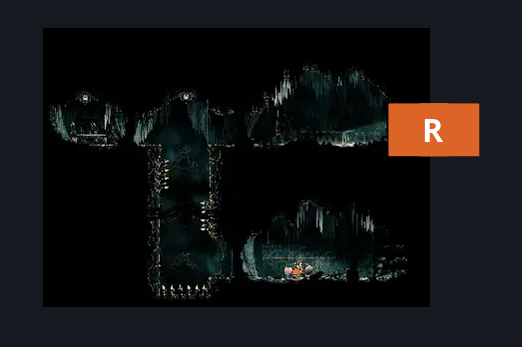
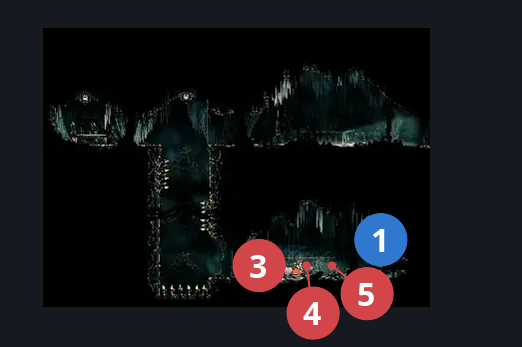
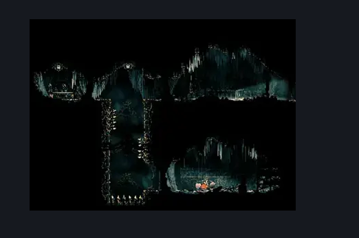

# Grand Bellway Side Room (Song_24)

**Game ID:** Song_24

**Contributors:** samupo,Gallos

## Subrooms

No subrooms defined.

## Room Transitions

| Alias | Name | From subroom | Destination | Destination alias | Requirements | TODO | Verification | Annotated | Notes |
| --- | --- | --- | --- | --- | --- | --- | --- | --- | --- |
| R | right1 |  | [Grand Bellway Shaft (Song_20)](grand-bellway-shaft.md) | BL | none |  | Verified | ✓ |  |

## Subroom Connections

No subroom connections defined.

## Check Locations

| No. | Check | Subroom | Requirements | TODO | Verification | Location Type | Annotated | Notes |
| --- | --- | --- | --- | --- | --- | --- | --- | --- |
| 1 | Grand Bellway - Silk eater |  | none |  | Verified | collectible | ✓ |  |
| 2 | Second Sentinel Encounter Side room |  | Act 3  AND complete THE Second Sentinel Activation |  | Verified | event |  |  |
| 3 | Choristor 1 |  | Normal World Spawn |  | Verified | enemy | ✓ |  |
| 4 | Snitchfly 1 |  | Normal World Spawn |  | Verified | enemy | ✓ | Spawn conditions: defeatedCogworkDancers=true, hasHarpoonDash=true, bellShrineEnclave=true |
| 5 | Snitchfly 2 |  | Normal World Spawn |  | Verified | enemy | ✓ | Spawn conditions: defeatedCogworkDancers=true, hasHarpoonDash=true, bellShrineEnclave=true |

## Room Images

### Connections

### Checks

### Scene

