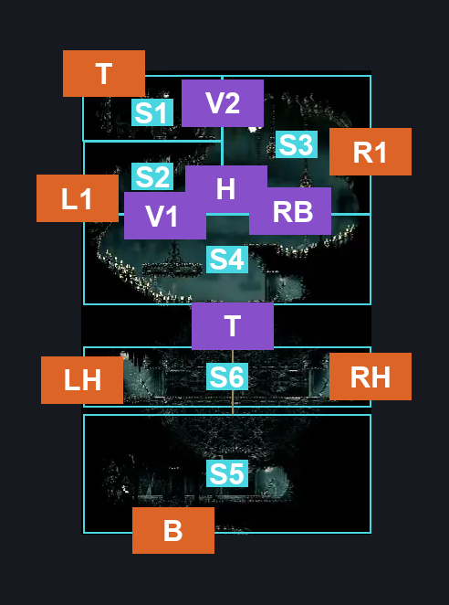
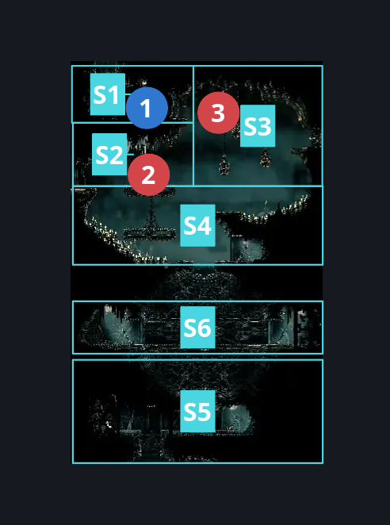
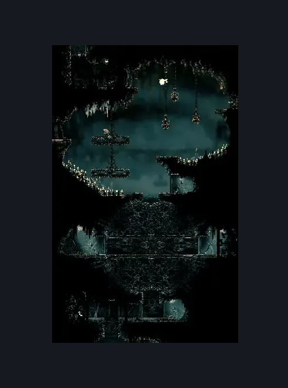

# Rotating Tunnel (Song_20b)

**Game ID:** Song_20b

**Contributors:** samupo, Gallos

## Subrooms

| No. | Subroom | Annotated |
| --- | --- | --- |
| S1 | Top Platform | ✓ |
| S2 | CentralArea Left | ✓ |
| S3 | CentralArea Right | ✓ |
| S4 | Lower Central | ✓ |
| S5 | Bottom Area | ✓ |
| S6 | Horizontal Tunnel | ✓ |

## Room Transitions

| Alias | Name | From subroom | Destination | Destination alias | Requirements | TODO | Verification | Annotated | Notes |
| --- | --- | --- | --- | --- | --- | --- | --- | --- | --- |
| T | top1 | Top Platform | [Memorium Entrance Tunnel (Song_25)](memorium-entrance-tunnel.md) | B | easy pogo off Reed OR cling grip either OR silk soar OR faydown OR easy scuttlebrace |  | Verified | ✓ |  |
| L1 | left2 | CentralArea Left | [Songclave Silk Shop (Song_29)](songclave-silk-shop.md) | R | none |  | Verified | ✓ |  |
| R1 | right2 | CentralArea Right | [Songclave Steam Tunnel (Library_02)](../whispering-vaults/songclave-steam-tunnel.md) | TL | none |  | Verified | ✓ |  |
| B | bot1 | Bottom Area | [Grand Bellway Shaft (Song_20)](grand-bellway-shaft.md) | T | none |  | Verified | ✓ |  |
| RH | right3 | Horizontal Tunnel | [Songclave Steam Tunnel (Library_02)](../whispering-vaults/songclave-steam-tunnel.md) | BL | none |  | Verified | ✓ | both sides have levers making the tunnel horizontal |
| LH | left4 | Horizontal Tunnel | [Cogwork Core East Choral Entrance (Cog_06)](../cogwork-core/cogwork-core-east-choral-entrance.md) | R | none |  | Verified | ✓ | both sides have levers making the tunnel horizontal |

## Subroom Connections

| Alias | Name | Source | Destination | Requirements | TODO | Verification | Annotated | Notes |
| --- | --- | --- | --- | --- | --- | --- | --- | --- |
| T | Tunnel | Bottom Area | Lower Central | silk soar OR cling grip either OR easy scuttlebrace |  | Verified | ✓ | both sides have levers making the tunnel vertical |
| T | Tunnel | Lower Central | Bottom Area | none |  | Verified | ✓ | falling, both sides have levers making the tunnel vertical |
| V1 | Vertical | Lower Central | CentralArea Left | ((spike pogo OR flea brew OR easy heal stall) AND (ledge grab left OR cling grip left)) OR faydown OR (easy shaman pogo AND spike pogo) OR easy scuttlebrace OR easy plasmium stall OR silk soar OR (flea brew AND medium voltvessels stall) |  | Verified | ✓ |  |
| V1 | Vertical | CentralArea Left | Lower Central | none |  | Verified | ✓ | falling |
| RB | Right to bottom | CentralArea Right | Lower Central | none |  | Verified | ✓ | falling, both sides have levers making the tunnel vertical |
| H | Left and Right | CentralArea Left | CentralArea Right | none |  | Verified | ✓ |  |
| H | Left and Right | CentralArea Right | CentralArea Left | drifter's cloak OR ledge grab left OR scuttlebrace OR dash left OR cling grip left OR clawline left OR sharpdart OR easy [hunter, beast,witch,architect, shaman] pogo OR easy pogo off [Reed, Choir Bellbearer] OR faydown cloak |  | Verified | ✓ |  |
| V2 | Vertical2 | CentralArea Right | Top Platform | activate Rotating Tunnel - top lever AND (easy [Beast,Shaman] pogo OR silk soar OR easy pogo off [Choir bellbearer, Reed] OR easy scuttlebrace OR faydown OR drifter's OR sharpdart OR clawline left OR (dash left AND (ledge grab left OR cling grip left))) |  | Verified | ✓ |  |
| V2 | Vertical2 | Top Platform | CentralArea Right | activate Rotating Tunnel - top lever |  | Verified | ✓ | falling |

## Check Locations

| No. | Check | Subroom | Requirements | TODO | Verification | Location Type | Annotated | Notes |
| --- | --- | --- | --- | --- | --- | --- | --- | --- |
| 1 | Rotating Tunnel - top lever | Top Platform | none |  | Verified | switch | ✓ |  |
| 2 | Reed | CentralArea Left | Normal world spawn |  | Verified | enemy | ✓ |  |
| 3 | Choir Bellbearer | CentralArea Right | Normal world spawn |  | Verified | enemy | ✓ |  |

## Room Images

### Connections

### Checks

### Scene

