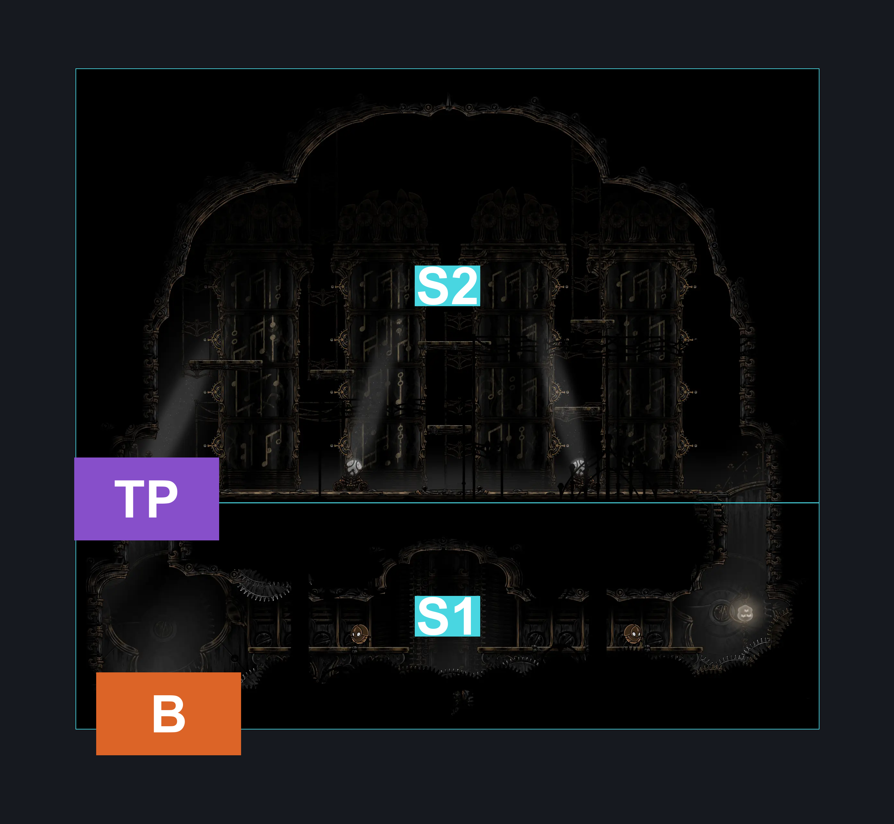
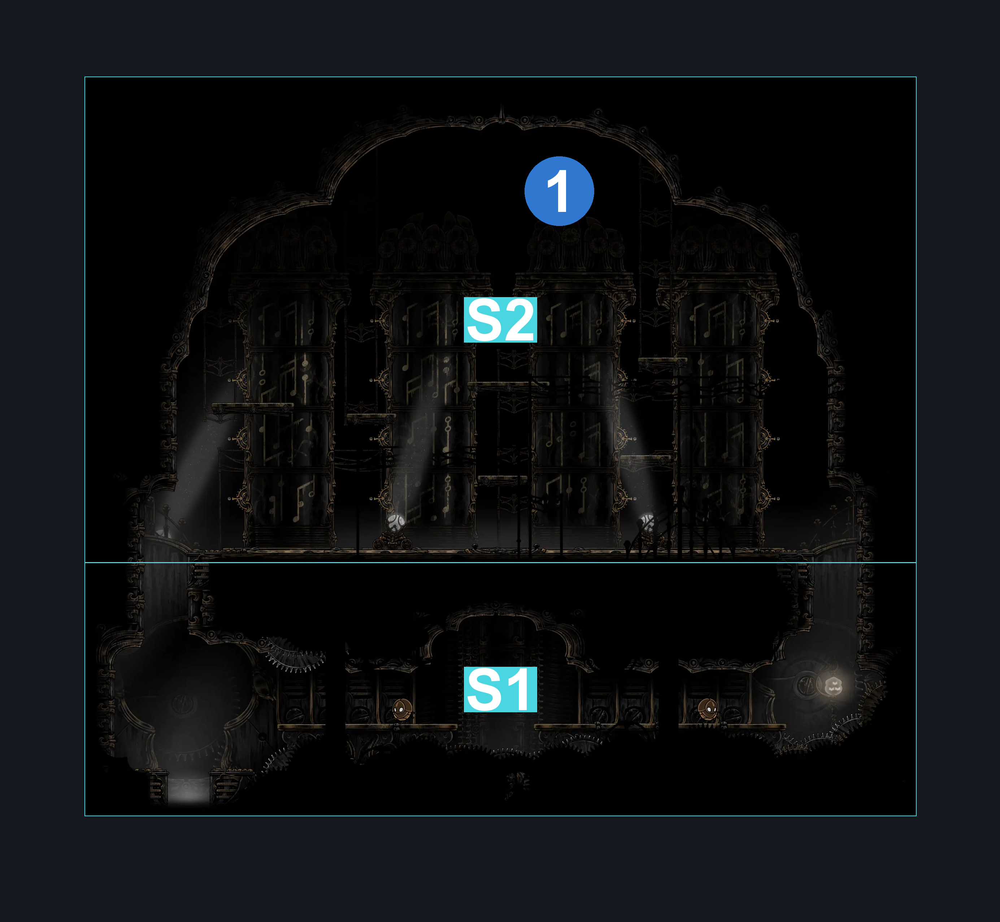
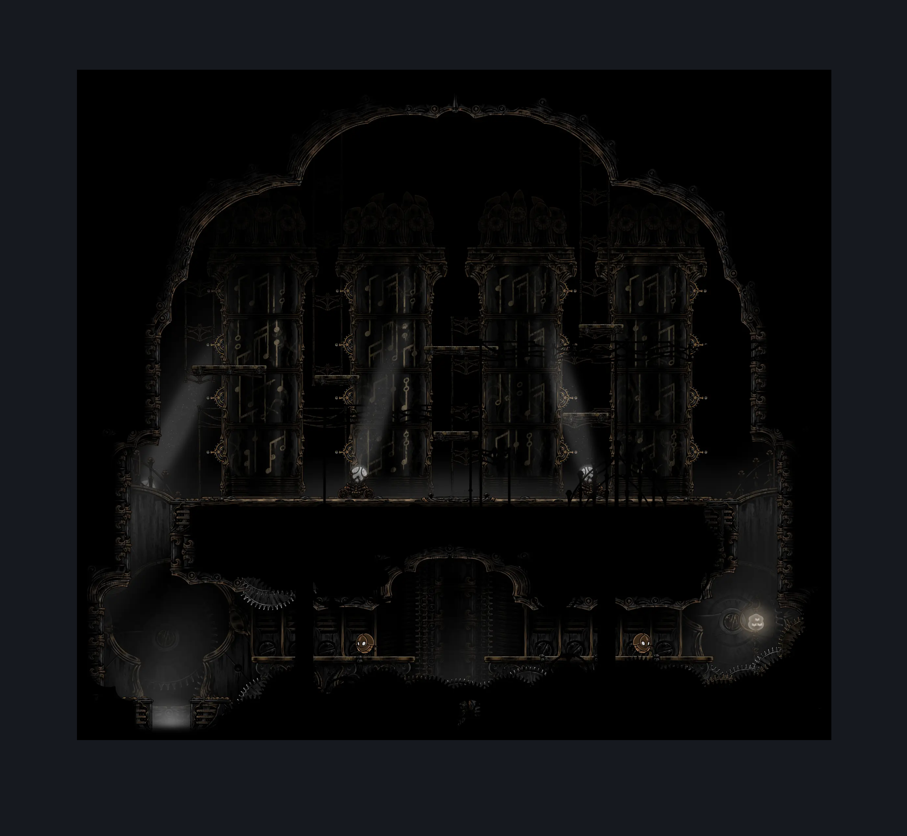

# Cogwork Core Architect's Melody (Cog_09)

**Game ID:** Cog_09

**Contributors:** Rebel

## Subrooms

| No. | Subroom | Annotated |
| --- | --- | --- |
| S1 | Bottom | ✓ |
| S2 | Melody Puzzle | ✓ |

## Room Transitions

| Alias | Name | From subroom | Destination | Destination alias | Requirements | TODO | Verification | Annotated | Notes |
| --- | --- | --- | --- | --- | --- | --- | --- | --- | --- |
| B | bot1 | Bottom | [Cogwork Core North Main (Cog_08)](cogwork-core-north-main.md) | T | Nothing. |  | Verified | ✓ |  |

## Subroom Connections

| Alias | Name | Source | Destination | Requirements | TODO | Verification | Annotated | Notes |
| --- | --- | --- | --- | --- | --- | --- | --- | --- |
| TP | To Puzzle | Bottom | Melody Puzzle | Silk Soar OR Cling Grip OR (Faydown Cloak AND Scuttlebrace) |  | Verified | ✓ |  |
| TP | To Puzzle | Melody Puzzle | Bottom | Nothing. (Fall) |  | Verified | ✓ |  |

## Check Locations

| No. | Check | Subroom | Requirements | TODO | Verification | Location Type | Annotated | Notes |
| --- | --- | --- | --- | --- | --- | --- | --- | --- |
| 1 | Cogwork Core: Architect's Melody | Melody Puzzle | Nothing (?) |  | Verified | event | ✓ | ??????????????????????? |
| 2 | import enemies |  |  | TODO | Needs verification |  |  |  |

## Room Images

### Connections

### Checks

### Scene

