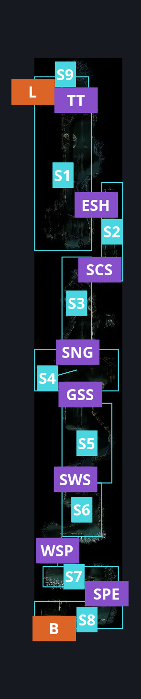
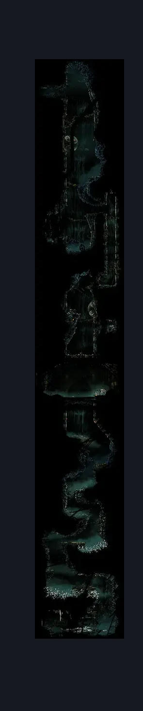

# Cogwork Core Breakable Walls (Cog_10_Destroyed)

**Game ID:** Cog_10_Destroyed

**Contributors:** Rebel, Gallos

## Subrooms

| No. | Subroom | Annotated |
| --- | --- | --- |
| S1 | Top Entrance | ✓ |
| S2 | Steam Shaft | ✓ |
| S3 | Center Shaft | ✓ |
| S4 | Northern Gauntlet | ✓ |
| S5 | Southern Shaft | ✓ |
| S6 | Breakable Wall Shaft | ✓ |
| S7 | Spike Platform | ✓ |
| S8 | Bottom Entrance | ✓ |

## Room Transitions

| Alias | Name | From subroom | Destination | Destination alias | Requirements | TODO | Verification | Annotated | Notes |
| --- | --- | --- | --- | --- | --- | --- | --- | --- | --- |
| B | bot1 | Bottom Entrance | [Memorium Entrance Tunnel (Song_25)](../choral-chambers/memorium-entrance-tunnel.md) | TL | Nothing. |  | Verified | ✓ |  |
| L | left1 | Top Entrance | [Cogwork Core Architect's Melody (Act 3) (Cog_09_Destroyed)](cogwork-core-architect-s-melody-act-3.md) | R | Nothing. |  | Verified | ✓ |  |

## Subroom Connections

| Alias | Name | Source | Destination | Requirements | TODO | Verification | Annotated | Notes |
| --- | --- | --- | --- | --- | --- | --- | --- | --- |
| ESH | Top Entrance-Steam Shaft | Top Entrance | Steam Shaft | (Attack Right AND (Dash OR Drifter's Cloak OR Faydown Cloak OR Sharpdart OR Clawline OR Scuttlebrace OR Cling Grip)) |  | Verified | ✓ |  |
| ESH | Top Entrance-Steam Shaft | Steam Shaft | Top Entrance | (Attack Left AND (Silk Soar OR (Faydown Cloak AND (Scuttlebrace OR (Ledge Grab AND Clawline AND Cling Grip))))) |  | Verified | ✓ |  |
| SCS | Steam Shaft-Center Shaft | Steam Shaft | Center Shaft | Attack Left |  | Verified | ✓ |  |
| SCS | Steam Shaft-Center Shaft | Center Shaft | Steam Shaft | (Attack Right AND (Silk Soar OR Cling Grip OR (Scuttlebrace AND Faydown Cloak))) |  | Verified | ✓ |  |
| SNG | Center Shaft-Northern Gauntlet | Center Shaft | Northern Gauntlet | Activate Cogwork Core: Break Wall #5 |  | Verified | ✓ |  |
| SNG | Center Shaft-Northern Gauntlet | Northern Gauntlet | Center Shaft | Activate Cogwork Core: Break Wall #5 AND Silk Soar AND Faydown Cloak |  | Verified | ✓ |  |
| GSS | Northern Gauntlet-Southern Shaft | Northern Gauntlet | Southern Shaft | Complete Cogwork Core: Gauntlet #3 |  | Verified | ✓ |  |
| GSS | Northern Gauntlet-Southern Shaft | Southern Shaft | Northern Gauntlet | (Complete Cogwork Core: Gauntlet #3 AND (Silk Soar OR (Cling Grip AND Faydown Cloak))) |  | Verified | ✓ |  |
| SWS | Southern Shaft-Wall Shaft | Southern Shaft | Breakable Wall Shaft | Attack Right |  | Verified | ✓ |  |
| SWS | Southern Shaft-Wall Shaft | Breakable Wall Shaft | Southern Shaft | (Attack Left AND (Cling Grip OR Faydown Cloak)) |  | Verified | ✓ |  |
| WSP | Breakable Wall Shaft-Spike Platform | Breakable Wall Shaft | Spike Platform | Attack Left |  | Verified | ✓ |  |
| WSP | Breakable Wall Shaft-Spike Platform | Spike Platform | Breakable Wall Shaft | (Attack Right AND (Dash OR Faydown Cloak OR Drifter's Cloak OR Cling Grip OR Sharpdart OR Clawline OR Scuttlebrace OR Ledge Grab)) |  | Verified | ✓ |  |
| SPE | Spike Platform-Bottom Entrance | Spike Platform | Bottom Entrance | Nothing. (Fall) |  | Verified | ✓ |  |
| SPE | Spike Platform-Bottom Entrance | Bottom Entrance | Spike Platform | (Scuttlebrace AND (Spike Pogo OR Dash)) OR Cling Grip OR (Faydown Cloak AND (Spike Pogo OR Clawline)) |  | Verified | ✓ |  |

## Check Locations

| No. | Check | Subroom | Requirements | TODO | Verification | Location Type | Annotated | Notes |
| --- | --- | --- | --- | --- | --- | --- | --- | --- |
| 1 | Cogwork Core: Break Wall #5 | Center Shaft | Break Wall Down |  | Verified | blockade | ✓ | Can't be broken from the bottom. |
| 2 | Cogwork Core: Gauntlet #3 | Northern Gauntlet | Combat Requirements |  | Verified | gauntlet |  |  |
| 3 | import enemies |  |  | TODO | Needs verification |  |  |  |

## Room Images

### Connections

### Checks

### Scene

