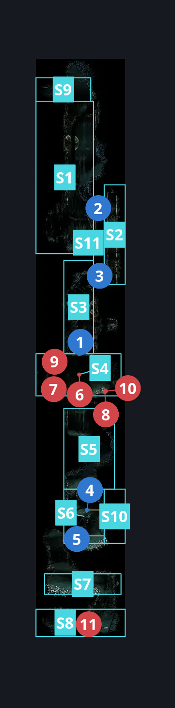

# Cogwork Core Breakable Walls (Cog_10_Destroyed)

**Game ID:** Cog_10_Destroyed

**Contributors:** Rebel, Gallos

## Subrooms

| No. | Subroom | Annotated |
| --- | --- | --- |
| S1 | Top left shaft | ✓ |
| S2 | Steam Shaft | ✓ |
| S3 | Center Shaft | ✓ |
| S4 | Northern Gauntlet | ✓ |
| S5 | Southern Shaft | ✓ |
| S6 | Breakable Wall Shaft | ✓ |
| S7 | Spike Platform | ✓ |
| S8 | Bottom Entrance | ✓ |
| S9 | Top entrance | ✓ |

## Room Transitions

| Alias | Name | From subroom | Destination | Destination alias | Requirements | TODO | Verification | Annotated | Notes |
| --- | --- | --- | --- | --- | --- | --- | --- | --- | --- |
| B | bot1 | Bottom Entrance | [Memorium Entrance Tunnel (Song_25)](../choral-chambers/memorium-entrance-tunnel.md) | TL | Nothing. |  | Verified | ✓ |  |
| L | left1 | Top left shaft | [Cogwork Core Architect's Melody (Act 3) (Cog_09_Destroyed)](cogwork-core-architect-s-melody-act-3.md) | R | Nothing. |  | Verified | ✓ |  |

## Subroom Connections

| Alias | Name | Source | Destination | Requirements | TODO | Verification | Annotated | Notes |
| --- | --- | --- | --- | --- | --- | --- | --- | --- |
| ESH | Top Entrance-Steam Shaft | Top left shaft | Steam Shaft | (clear Cogwork Core - vapor shaft wall AND (Dash right OR Drifter's Cloak OR Faydown Cloak OR Sharpdart OR Clawline right OR easy Scuttlebrace OR easy [beast,hunter] pogo OR easy naked pogo OR easy [flea brew,plasmium, voltvessels,parry,flintslate,rune rage,air heal, thread storm] stall)) |  | Verified | ✓ |  |
| ESH | Top Entrance-Steam Shaft | Steam Shaft | Top left shaft | clear Cogwork Core - vapor shaft wall AND (Silk Soar OR cling grip either OR easy scuttlebrace) |  | Verified | ✓ |  |
| SCS | Steam Shaft-Center Shaft | Steam Shaft | Center Shaft | clear Cogwork Core - vapor shaft wall 2 |  | Verified | ✓ |  |
| SCS | Steam Shaft-Center Shaft | Center Shaft | Steam Shaft | clear Cogwork Core - vapor shaft wall 2 AND (easy Silk Soar cancel x 3 OR (cling grip both AND (faydown OR easy [wanderer, reaper] pogo)) OR (cling grip right AND easy shaman pogo)) |  | Verified | ✓ |  |
| SNG | Center Shaft-Northern Gauntlet | Center Shaft | Northern Gauntlet | clear Cogwork Core - act 3 gauntlet wall |  | Verified | ✓ |  |
| SNG | Center Shaft-Northern Gauntlet | Northern Gauntlet | Center Shaft | (clear Cogwork Core - act 3 gauntlet wall AND (Silk Soar OR (Faydown AND cling grip right AND (medium beast heal stall OR flea brew))) AND defeat Cogwork Core: Gauntlet #3) OR (elite ball knowledge AND (Silk Soar OR (Faydown AND cling grip right AND (medium beast heal stall OR flea brew))) AND defeat Cogwork Core: Gauntlet #3) |  | Verified | ✓ |  |
| GSS | Northern Gauntlet-Southern Shaft | Northern Gauntlet | Southern Shaft | defeat Cogwork Core: Gauntlet #3 |  | Verified | ✓ |  |
| GSS | Northern Gauntlet-Southern Shaft | Southern Shaft | Northern Gauntlet | (defeat Cogwork Core: Gauntlet #3 AND (Silk Soar OR (Cling Grip either AND Faydown Cloak))) OR (((silk soar AND  	 Silk Hearts x 1) OR (faydown AND cling grip either)) AND attack up AND elite ball knowledge) |  | Verified | ✓ |  |
| SWS | Southern Shaft-Wall Shaft | Southern Shaft | Breakable Wall Shaft | none |  | Verified | ✓ |  |
| SWS | Southern Shaft-Wall Shaft | Breakable Wall Shaft | Southern Shaft | clear Cogwork Core - Wall that gives vision AND clear Cogwork Core - Wall that gives vision 2 AND (faydown OR cling grip right OR easy scuttlebrace) |  | Verified | ✓ |  |
| WSP | Breakable Wall Shaft-Spike Platform | Breakable Wall Shaft | Spike Platform | clear Cogwork Core - Wall that gives vision AND clear Cogwork Core - Wall that gives vision 2 AND (dash left OR spike pogo OR easy naked pogo) |  | Verified | ✓ |  |
| WSP | Breakable Wall Shaft-Spike Platform | Spike Platform | Breakable Wall Shaft | clear Cogwork Core - Wall that gives vision AND clear Cogwork Core - Wall that gives vision 2 AND (ledge grab left OR faydown OR easy scuttlebrace OR cling grip left OR (easy hazard respawn AND silk soar)) |  | Verified | ✓ |  |
| SPE | Spike Platform-Bottom Entrance | Spike Platform | Bottom Entrance | Nothing. (Fall) |  | Verified | ✓ |  |
| SPE | Spike Platform-Bottom Entrance | Bottom Entrance | Spike Platform | easy shaman pogo OR cling grip right OR faydown OR (easy scuttlebrace AND spike pogo) OR easy silk soar cancel |  | Verified | ✓ |  |
| TT | entrance to shaft left | Top entrance | Top left shaft | none |  | Verified | ✓ |  |
| TT | entrance to shaft left | Top left shaft | Top entrance | easy silk soar cancel x 2 OR (faydown AND (cling grip either OR easy scuttlebrace) AND spike pogo) |  | Verified | ✓ |  |

## Check Locations

| No. | Check | Subroom | Requirements | TODO | Verification | Location Type | Annotated | Notes |
| --- | --- | --- | --- | --- | --- | --- | --- | --- |
| 1 | Cogwork Core - act 3 gauntlet wall | Center Shaft | Break Wall Down |  | Verified | blockade | ✓ | Can't be broken from the bottom. |
| 2 | Cogwork Core - vapor shaft wall | Top left shaft | break wall either |  | Verified | blockade | ✓ |  |
| 3 | Cogwork Core - vapor shaft wall 2 | Steam Shaft | break wall either |  | Verified | blockade | ✓ |  |
| 4 | Cogwork Core - Wall that gives vision | Breakable Wall Shaft | break wall either |  | Verified | blockade | ✓ |  |
| 5 | Cogwork Core - Wall that gives vision 2 | Breakable Wall Shaft | break wall either |  | Verified | blockade | ✓ |  |
| 6 | Cogwork Core: Gauntlet #3 | Northern Gauntlet | Combat Requirements |  | Verified | gauntlet | ✓ |  |
| 7 | Underworker Cogwork Core - Gauntlet | Northern Gauntlet | none |  | Verified | enemy | ✓ |  |
| 8 | Underpoke Cogwork Core - Gauntlet | Northern Gauntlet | none |  | Verified | enemy | ✓ |  |
| 9 | Undercrank Cogwork Core -Gauntlet | Northern Gauntlet | none |  | Verified | enemy | ✓ |  |
| 10 | Underloft Cogwork Core - Gauntlet | Northern Gauntlet | none |  | Verified | enemy | ✓ |  |
| 11 | Drapemite 1 | Bottom Entrance | none |  | Verified | enemy | ✓ |  |

## Room Images

### Connections

### Checks

### Scene

