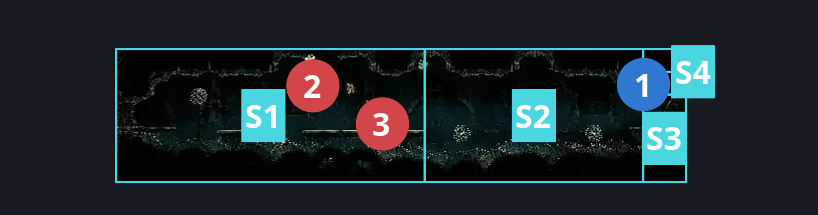
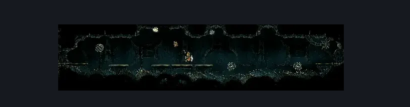

# Cogwork Core East Choral Entrance (Cog_06)

**Game ID:** Cog_06

**Contributors:** Rebel, Gallos

## Subrooms

| No. | Subroom | Annotated |
| --- | --- | --- |
| S1 | Left Side | ✓ |
| S2 | Right Side | ✓ |
| S3 | Right exit | ✓ |
| S4 | switch cuck corner | ✓ |

## Room Transitions

| Alias | Name | From subroom | Destination | Destination alias | Requirements | TODO | Verification | Annotated | Notes |
| --- | --- | --- | --- | --- | --- | --- | --- | --- | --- |
| R | right1 | Right exit | [Rotating Tunnel (Song_20b)](../choral-chambers/rotating-tunnel.md) | LH | none |  | Verified | ✓ |  |
| L | left2 | Left Side | [Cogwork Core South Main (Cog_04)](cogwork-core-south-main.md) | MR | Nothing |  | Verified | ✓ |  |

## Subroom Connections

| Alias | Name | Source | Destination | Requirements | TODO | Verification | Annotated | Notes |
| --- | --- | --- | --- | --- | --- | --- | --- | --- |
| J | Jump | Left Side | Right Side | Spike Pogo OR (Clawline right AND (Drifter's Cloak OR Faydown Cloak OR (Faydown Cloak AND run AND (Drifter's Cloak OR Spike Pogo)))) |  | Verified | ✓ |  |
| J | Jump | Right Side | Left Side | Spike Pogo OR (Clawline left AND (Drifter's Cloak OR Faydown Cloak OR (Faydown Cloak AND run AND (Drifter's Cloak OR Spike Pogo)))) |  | Verified | ✓ |  |
| E | exit | Right Side | Right exit | activate Cogwork Core Right Entrance Door Switch |  | Verified | ✓ |  |
| E | exit | Right exit | Right Side | activate Cogwork Core Right Entrance Door Switch |  | Verified | ✓ |  |
| CCE | exit snipe | Right exit | switch cuck corner | easy voltvessels use OR easy sting shard use x 4 OR shaman longclaw left |  | Verified | ✓ |  |
| CCR | right snipe | Right Side | switch cuck corner | attack up |  | Verified | ✓ |  |

## Check Locations

| No. | Check | Subroom | Requirements | TODO | Verification | Location Type | Annotated | Notes |
| --- | --- | --- | --- | --- | --- | --- | --- | --- |
| 1 | Cogwork Core Right Entrance Door Switch | switch cuck corner | none |  | Verified | switch | ✓ |  |
| 2 | Cogworker 1 | Left Side | none |  | Verified | enemy | ✓ |  |
| 3 | Cogwork Defender 1 | Left Side | none |  | Verified | enemy | ✓ |  |

## Room Images

### Connections

### Checks

### Scene

