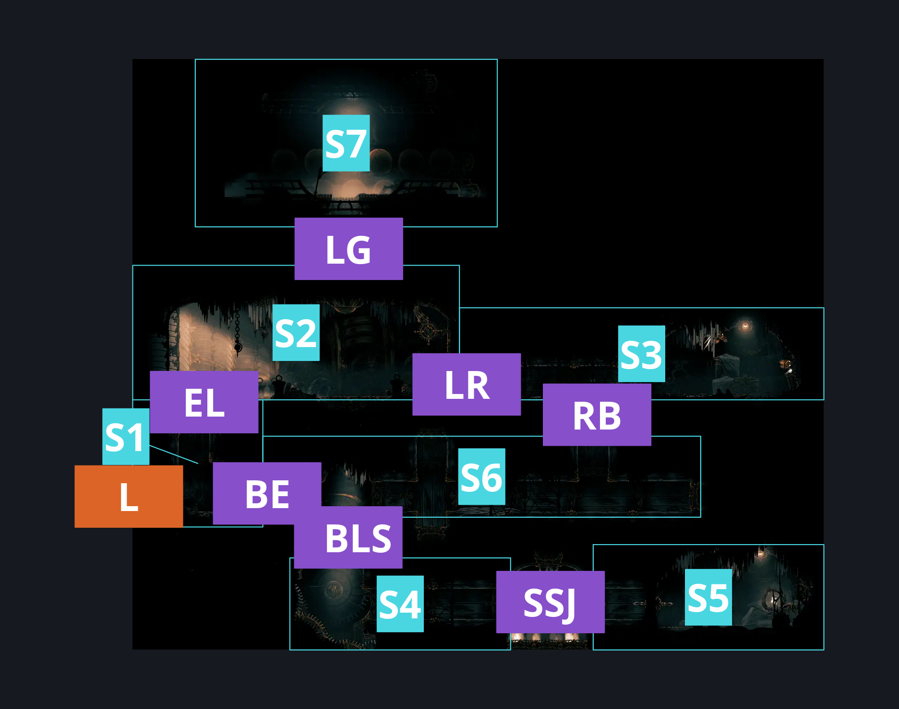
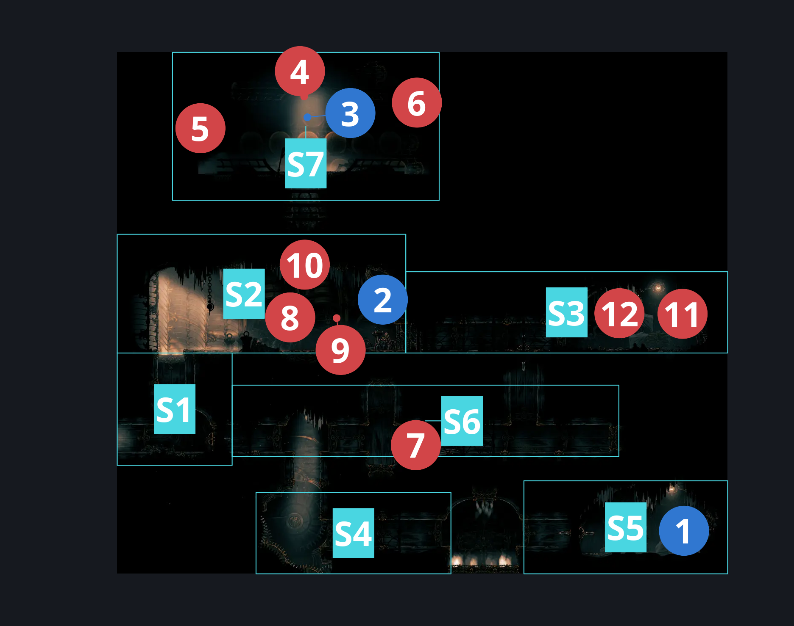
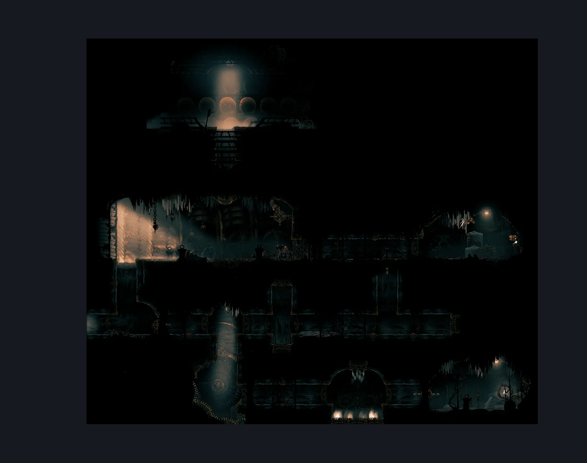

# Cogwork Core East Silk Spool & Gauntlet (Cog_07)

**Game ID:** Cog_07

**Contributors:** Rebel, Gallos

## Subrooms

| No. | Subroom | Annotated |
| --- | --- | --- |
| S1 | Entrance | ✓ |
| S2 | Left Room | ✓ |
| S3 | Right Room | ✓ |
| S4 | Silk Spool Jump Left | ✓ |
| S5 | Silk Spool Jump Right | ✓ |
| S6 | Bottom Room | ✓ |
| S7 | Arena | ✓ |

## Room Transitions

| Alias | Name | From subroom | Destination | Destination alias | Requirements | TODO | Verification | Annotated | Notes |
| --- | --- | --- | --- | --- | --- | --- | --- | --- | --- |
| L | left1 | Entrance | [Cogwork Core South Main (Cog_04)](cogwork-core-south-main.md) | BR | Nothing. |  | Verified | ✓ |  |

## Subroom Connections

| Alias | Name | Source | Destination | Requirements | TODO | Verification | Annotated | Notes |
| --- | --- | --- | --- | --- | --- | --- | --- | --- |
| EL | Entrance-Left | Entrance | Left Room | Silk Soar OR Cling Grip either OR easy Scuttlebrace |  | Verified | ✓ |  |
| LR | Left-Right | Left Room | Right Room | Activate Cogwork Core: Flip Switch #2 |  | Verified | ✓ |  |
| RB | Right-Bottom | Right Room | Bottom Room | Nothing. (Fall) |  | Verified | ✓ |  |
| BLS | Bottom-Spool Left | Bottom Room | Silk Spool Jump Left | Nothing. (Fall) |  | Verified | ✓ |  |
| SSJ | Silk Spool Jump | Silk Spool Jump Left | Silk Spool Jump Right | Dash right OR Sprint OR Clawline right OR Sharpdart OR medium Scuttlebrace OR medium beast pogo OR medium architect charge |  | Verified | ✓ | hehe, funny dragonball reference. |
| SSJ | Silk Spool Jump | Silk Spool Jump Right | Silk Spool Jump Left | Dash left OR Sprint OR Clawline left OR Sharpdart OR medium Scuttlebrace OR medium beast pogo OR medium architect charge |  | Verified | ✓ |  |
| BLS | Bottom-Spool Left | Silk Spool Jump Left | Bottom Room | easy Scuttlebrace OR Cling Grip right OR (faydown AND cling grip left) |  | Verified | ✓ |  |
| BE | Bottom-Entrance | Bottom Room | Entrance | hit switch left |  | Verified | ✓ |  |
| BE | Bottom-Entrance | Entrance | Bottom Room | Invalid |  | Verified | ✓ |  |
| EL | Entrance-Left | Left Room | Entrance | Nothing. (Fall) |  | Verified | ✓ |  |
| LR | Left-Right | Right Room | Left Room | Activate Cogwork Core: Flip Switch #2 |  | Verified | ✓ |  |
| RB | Right-Bottom | Bottom Room | Right Room | Silk Soar OR Cling Grip either OR easy Scuttlebrace |  | Verified | ✓ |  |
| LG | Left-Gauntlet | Left Room | Arena | Silk Soar AND ACT 3 |  | Verified | ✓ |  |
| LG | Left-Gauntlet | Arena | Left Room | Complete Cogwork Core: Gauntlet #2 AND ACT 3 |  | Verified | ✓ |  |

## Check Locations

| No. | Check | Subroom | Requirements | TODO | Verification | Location Type | Annotated | Notes |
| --- | --- | --- | --- | --- | --- | --- | --- | --- |
| 1 | Cogwork Core: Silk Spool #1 | Silk Spool Jump Right | Nothing. |  | Verified | collectible | ✓ |  |
| 2 | Cogwork Core: Flip Switch #2 | Left Room | attack up |  | Verified | switch | ✓ | interacting with this switch causes a mini-boss type enemy to spawn |
| 3 | Cogwork Core: Pristine Core | Arena | Complete Cogwork Core: Gauntlet #2 |  | Verified | collectible | ✓ |  |
| 4 | Cogwork Core: Gauntlet #2 | Arena | Combat Requirements |  | Verified | gauntlet | ✓ |  |
| 5 | Cogwork Clapper 1 | Arena | ACT 3 |  | Verified | enemy | ✓ |  |
| 6 | Cogwork Clapper 2 | Arena | ACT 3 |  | Verified | enemy | ✓ |  |
| 7 | Drapemite 1 | Bottom Room | none |  | Verified | enemy | ✓ |  |
| 8 | Cogworker 1 | Left Room | defeat Cogwork Clapper falling |  | Verified | enemy | ✓ | FSM Boolean flags: cog7_automatonDestroyed, cog7_automatonRepairing |
| 9 | Cogworker 2 | Left Room | defeat Cogwork Clapper falling |  | Verified | enemy | ✓ | FSM Boolean flags: cog7_automatonDestroyed, cog7_automatonRepairing |
| 10 | Cogwork Clapper falling | Left Room | Normal World Spawn |  | Verified | enemy | ✓ | Spawn conditions: cog7_automaton_defeated=false FSM Boolean flags: cog7_automatonDestroyed, cog7_automatonRepairing |
| 11 | Cogworker 3 | Right Room | Normal World Spawn |  | Verified | enemy | ✓ |  |
| 12 | Cogworker 4 | Right Room | Normal World Spawn |  | Verified | enemy | ✓ |  |

## Room Images

### Connections

### Checks

### Scene

