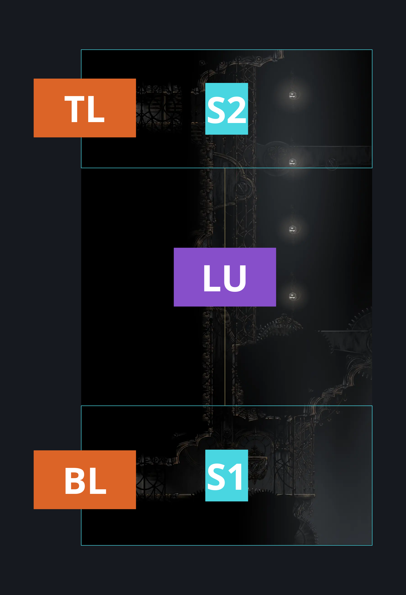
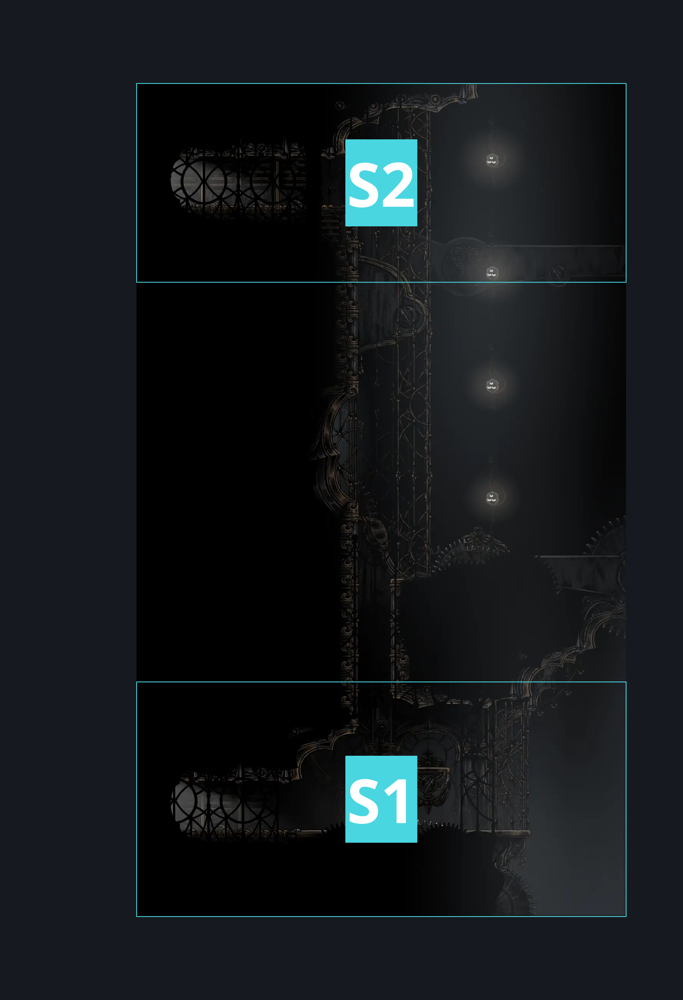
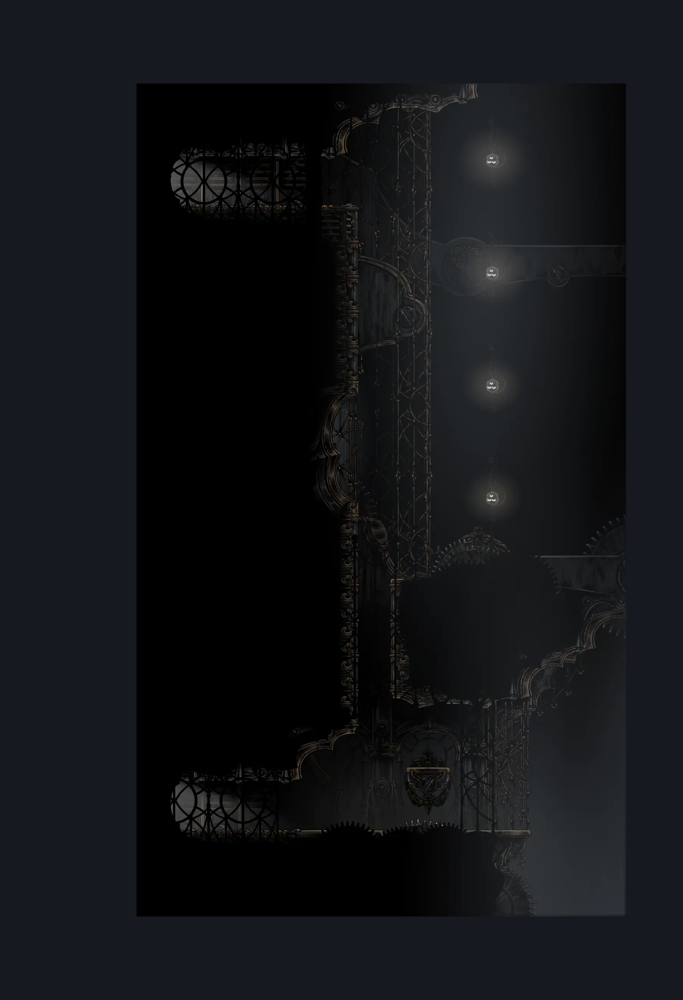

# Cogwork Core Main Connection (Cog_Pass)

**Game ID:** Cog_Pass

**Contributors:** Hutyrix

## Subrooms

| No. | Subroom | Annotated |
| --- | --- | --- |
| S1 | Lower Entrance | ✓ |
| S2 | Upper Entrance | ✓ |

## Room Transitions

| Alias | Name | From subroom | Destination | Destination alias | Requirements | TODO | Verification | Annotated | Notes |
| --- | --- | --- | --- | --- | --- | --- | --- | --- | --- |
| BL | left2 | Lower Entrance | [Cogwork Core South Main (Cog_04)](cogwork-core-south-main.md) | DR | Nothing. |  | Verified | ✓ |  |
| TL | left1 | Upper Entrance | [Cog Dancers (Cog_Dancers)](cog-dancers.md) | D | Nothing. |  | Verified | ✓ |  |

## Subroom Connections

| Alias | Name | Source | Destination | Requirements | TODO | Verification | Annotated | Notes |
| --- | --- | --- | --- | --- | --- | --- | --- | --- |
| LU | Lower-Upper | Lower Entrance | Upper Entrance | Silk Soar OR Cling Grip either OR easy Scuttlebrace |  | Verified |  |  |
| LU | Lower-Upper | Upper Entrance | Lower Entrance | Nothing. (Fall) |  | Verified |  |  |

## Check Locations

No check locations defined.

## Notes

Gallosdaimonas was wondering can you scuttle there, it's easy, and with that, all logic here is mapped ~Hutyrix

## Room Images

### Connections

### Checks

### Scene

