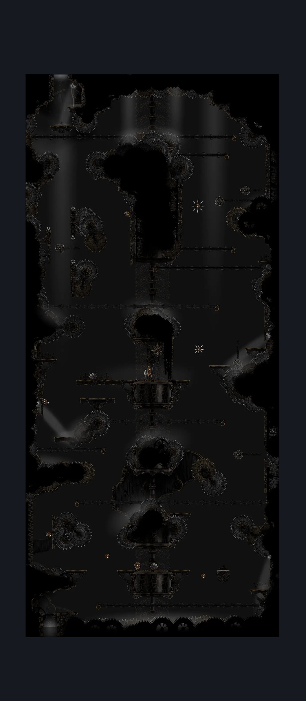

# Cogwork Core North Main (Cog_08)

**Game ID:** Cog_08

**Contributors:** Rebel, Gallos

## Subrooms

| No. | Subroom | Annotated |
| --- | --- | --- |
| S1 | Lower Entrance | ✓ |
| S2 | Upper Entrance | ✓ |
| S3 | First safe platform | ✓ |
| S4 | Second safe platform | ✓ |
| S5 | third safe platform | ✓ |
| S6 | fourth safe platform | ✓ |

## Room Transitions

| Alias | Name | From subroom | Destination | Destination alias | Requirements | TODO | Verification | Annotated | Notes |
| --- | --- | --- | --- | --- | --- | --- | --- | --- | --- |
| B | bot1 | Lower Entrance | [Cog Dancers (Cog_Dancers)](cog-dancers.md) | T | activate Cog dancers - clawline mechanism 2 IN cog dancers |  | Verified | ✓ |  |
| T | top1 | Upper Entrance | [Cogwork Core Architect's Melody (Cog_09)](cogwork-core-architect-s-melody.md) | B | Nothing |  | Verified | ✓ |  |

## Subroom Connections

| Alias | Name | Source | Destination | Requirements | TODO | Verification | Annotated | Notes |
| --- | --- | --- | --- | --- | --- | --- | --- | --- |
| LF | lower <> First | Lower Entrance | First safe platform | ((clawline right OR (medium [reaper, architect,shaman] pogo AND spike pogo)) AND (ledge grab right OR cling grip right) AND (clawline left OR sharpdart OR ledge grab left OR easy beast pogo OR easy [flea brew, voltvessels,plasmium ] stall OR easy shaman scuttle slide)) OR (proficient movement AND medium shaman pogo) OR (faydown AND spike pogo) |  | Verified | ✓ |  |
| LF | lower <> First | First safe platform | Lower Entrance | spike pogo OR easy naked pogo |  | Verified | ✓ |  |
| FS | first <> second | First safe platform | Second safe platform | easy [beast,reaper, shaman] pogo  OR (faydown AND spike pogo) OR (spike pogo AND cling grip either AND (dash left OR clawline left OR sharpdart)) OR (hard Silk Soar Cancel AND (clawline left OR dash left OR sharpdart)) |  | Verified | ✓ |  |
| FS | first <> second | Second safe platform | First safe platform | none |  | Verified | ✓ |  |
| ST | second <> third | Second safe platform | third safe platform | (easy shaman pogo AND spike pogo AND (faydown OR clawline left OR (clawline right AND (ledge grab left OR proficient movement)) OR (medium shaman scuttle slide AND proficient movement))) OR (medium [wanderer, reaper] pogo AND spike pogo AND faydown) OR (clawline both AND cling grip both) OR (clawline either AND spike pogo AND faydown) OR (easy Silk Soar Cancel AND elite ball knowledge) |  | Verified | ✓ |  |
| V1 | fourth to first | fourth safe platform | First safe platform | none |  | Verified | ✓ |  |
| V2 | fourth to second | fourth safe platform | Second safe platform | activate Cogwork Core: North switch AND (spike pogo OR proficient movement OR drifters) |  | Verified | ✓ |  |
| TF | third to fourth | third safe platform | fourth safe platform | spike pogo AND (easy shaman pogo OR ledge grab right OR cling grip right OR faydown OR (silk soar AND elite ball knowledge ) OR (cling grip left AND (dash right OR clawline right OR sharpdart))) |  | Verified | ✓ |  |
| TF | third to fourth | fourth safe platform | third safe platform | none |  | Verified | ✓ |  |

## Check Locations

| No. | Check | Subroom | Requirements | TODO | Verification | Location Type | Annotated | Notes |
| --- | --- | --- | --- | --- | --- | --- | --- | --- |
| 1 | Cogwork Core: North switch | fourth safe platform | attack up |  | Verified | switch | ✓ |  |
| 2 | Cogwork Crawler 1 | third safe platform | none |  | Verified | enemy | ✓ |  |
| 3 | Cogwork Crawler 2 |  |  |  |  | enemy | ✓ |  |
| 4 | Cogwork Crawler 3 | First safe platform | none |  | Verified | enemy | ✓ |  |
| 5 | Cogwork Cleanser 1 | First safe platform | none |  | Verified | enemy | ✓ |  |
| 6 | Cogwork Spine 1 |  |  |  |  | enemy | ✓ |  |
| 7 | Cogwork Spine 2 | First safe platform | none |  | Verified | enemy | ✓ |  |
| 8 | Cogwork Defender 1 | fourth safe platform | none |  | Verified | enemy | ✓ |  |
| 9 | Cogwork Spine 3 | fourth safe platform | none |  | Verified | enemy | ✓ |  |
| 10 | Cogwork Choirbug 1 | First safe platform | none |  | Verified | enemy | ✓ |  |
| 11 | Cogwork Cleanser 2 | fourth safe platform | none |  | Verified | enemy | ✓ |  |
| 12 | Cogwork Spine 4 | First safe platform | none |  | Verified | enemy | ✓ |  |

## Notes

enemies will be done later; this is just to fix the current logic connections.

## Room Images

### Connections

### Checks

### Scene

