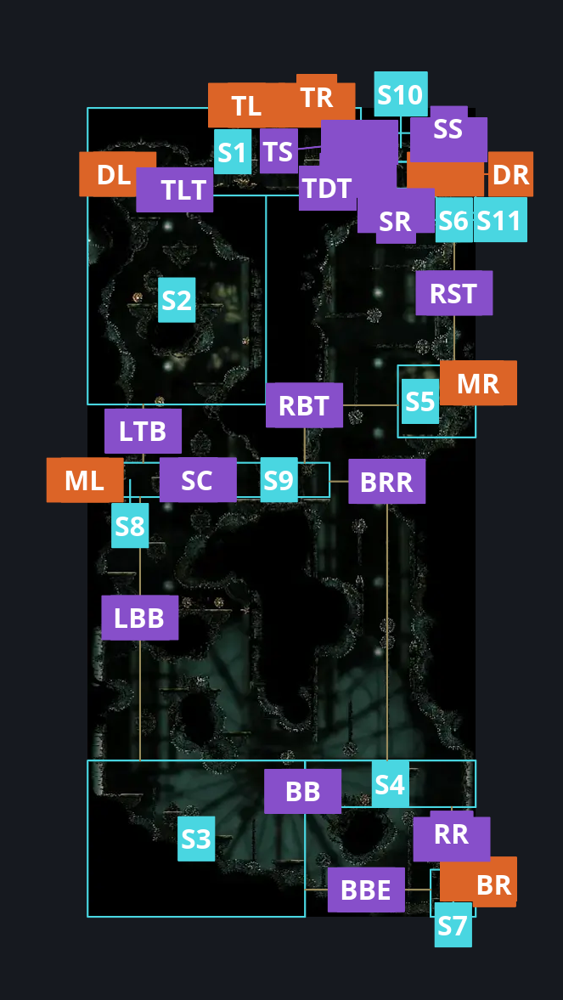
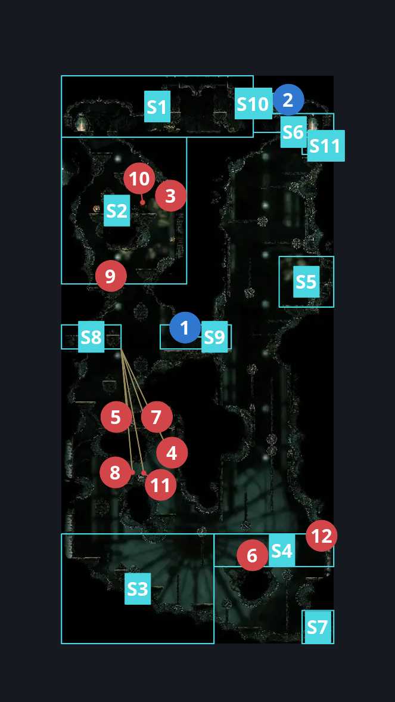
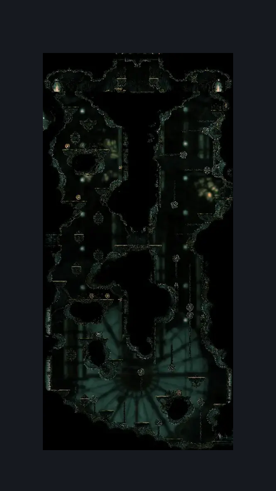

# Cogwork Core South Main (Cog_04)

**Game ID:** Cog_04

**Contributors:** Rebel, Gallos

## Subrooms

| No. | Subroom | Annotated |
| --- | --- | --- |
| S1 | Top Entrance | ✓ |
| S2 | Left Shaft Top Side | ✓ |
| S3 | Bottom left | ✓ |
| S4 | Bottom right | ✓ |
| S5 | Right Shaft Top Side | ✓ |
| S6 | Top Right Door | ✓ |
| S7 | Bottom Right Entrance | ✓ |
| S8 | Left Shaft Bottom Side | ✓ |
| S9 | Shaft Shortcut | ✓ |
| S10 | switch snipe | ✓ |
| S11 | sniping platform | ✓ |

## Room Transitions

| Alias | Name | From subroom | Destination | Destination alias | Requirements | TODO | Verification | Annotated | Notes |
| --- | --- | --- | --- | --- | --- | --- | --- | --- | --- |
| BR | right3 | Bottom Right Entrance | [Cogwork Core East Silk Spool & Gauntlet (Cog_07)](cogwork-core-east-silk-spool-gauntlet.md) | L | Nothing. |  | Verified | ✓ |  |
| ML | left2 | Left Shaft Bottom Side | [Cogwork Core West Gauntlet (Cog_05)](cogwork-core-west-gauntlet.md) | R | Nothing. |  | Verified | ✓ |  |
| DL | door1 | Top Entrance | [Cogwork Core Bench & Map (Cog_Bench)](cogwork-core-bench-map.md) | L | Nothing. |  | Verified | ✓ |  |
| DR | door2 | Top Right Door | [Cogwork Core Main Connection (Cog_Pass)](cogwork-core-main-connection.md) | BL | Nothing. |  | Verified | ✓ |  |
| MR | right2 | Right Shaft Top Side | [Cogwork Core East Choral Entrance (Cog_06)](cogwork-core-east-choral-entrance.md) | L | Nothing. |  | Verified | ✓ |  |
| TL | top1 | Top Entrance | [Cog Dancers (Cog_Dancers)](cog-dancers.md) | B1 | Cling Grip either OR easy Scuttlebrace OR Silk Soar OR Faydown Cloak OR easy shaman pogo |  | Verified | ✓ |  |
| TR | top2 | Top Entrance | [Cog Dancers (Cog_Dancers)](cog-dancers.md) | B2 | Cling Grip either OR easy Scuttlebrace OR Silk Soar OR Faydown Cloak OR easy shaman pogo |  | Verified | ✓ |  |

## Subroom Connections

| Alias | Name | Source | Destination | Requirements | TODO | Verification | Annotated | Notes |
| --- | --- | --- | --- | --- | --- | --- | --- | --- |
| TLT | Top-Left Top | Top Entrance | Left Shaft Top Side | Nothing. (Fall) |  | Verified | ✓ |  |
| TLT | Top-Left Top | Left Shaft Top Side | Top Entrance | ((Ledge Grab either  OR cling grip left OR silk soar OR easy [flea brew,plasmium, voltvessels, air heal, rune rage] stall OR easy beast charge) AND spike pogo AND proficient movement) OR ((faydown OR cling grip right OR easy scuttlebrace OR easy [reaper,architect,shaman] pogo OR (easy wanderer pogo AND (ledge grab either OR cling grip left))) AND spike pogo) |  | Verified | ✓ |  |
| LTB | Left Top-Left Bottom | Left Shaft Top Side | Left Shaft Bottom Side | Nothing. (Fall) |  | Verified | ✓ |  |
| LTB | Left Top-Left Bottom | Left Shaft Bottom Side | Left Shaft Top Side | silk soar x 2 OR faydown OR ((ledge grab right OR cling grip right) AND (easy shaman pogo OR ledge grab left OR cling grip left OR easy pogo off cogwork choirbug OR medium damage boost off cogwork choirbug OR easy beast charge OR easy [flea brew,air heal,plasmium,voltvessels,rune rage] stall)) |  | Verified | ✓ |  |
| SC | Shortcut | Left Shaft Bottom Side | Shaft Shortcut | activate Cogwork Core: under dancers switch 1 |  | Verified | ✓ |  |
| SC | Shortcut | Shaft Shortcut | Left Shaft Bottom Side | activate Cogwork Core: under dancers switch 1 AND (spike pogo OR silk soar OR faydown OR ledge grab left OR cling grip left) |  | Verified | ✓ |  |
| LBB | Left Bottom-Bottom | Left Shaft Bottom Side | Bottom left | Nothing. (Fall) |  | Verified | ✓ |  |
| LBB | Left Bottom-Bottom | Bottom left | Left Shaft Bottom Side | (easy shaman pogo OR cling grip left OR faydown OR silk soar x 3) AND spike pogo |  | Verified | ✓ |  |
| BBE | Bottom-Bottom Exit | Bottom left | Bottom Right Entrance | Spike Pogo OR Clawline right OR Sharpdart OR Sprint OR Dash right OR Drifter's Cloak OR Faydown Cloak |  | Verified | ✓ |  |
| BBE | Bottom-Bottom Exit | Bottom Right Entrance | Bottom left | Spike Pogo OR Clawline  left OR Sharpdart OR Sprint OR Dash left OR Drifter's Cloak OR Faydown Cloak |  | Verified | ✓ |  |
| BB | bottom left <> right | Bottom left | Bottom right | (silk soar AND Elite ball knowledge) OR spike pogo OR clawline right x 2 OR (run AND dash right AND (ledge grab right OR faydown)) |  | Verified | ✓ |  |
| BB | bottom left <> right | Bottom right | Bottom left | none |  | Verified | ✓ |  |
| RR | right <> right entrance | Bottom right | Bottom Right Entrance | spike pogo OR dash right OR easy naked pogo |  | Verified | ✓ |  |
| RR | right <> right entrance | Bottom Right Entrance | Bottom right | easy [wanderer,reaper,shaman] pogo |  | Verified | ✓ |  |
| BRR | Bottom-Right Bottom Shaft | Bottom right | Shaft Shortcut | (hard shaman pogo AND proficient movement AND (hard pale nails stall x 2 OR hard shaman scuttle slide OR easy pogo off cogwork choirbug OR ledge grab right OR cling grip right)) OR (medium [wanderer,reaper] pogo AND faydown) OR (cling grip both AND (faydown OR spike pogo OR clawline both x 2 OR (dash both AND drifters))) OR (clawline both AND faydown AND proficient movement) OR (silk soar AND elite ball knowledge) OR (proficient movement AND hard [hunter,architect,beast,witch] pogo AND faydown) |  | Verified | ✓ |  |
| BRR | Bottom-Right Bottom Shaft | Shaft Shortcut | Bottom right | none |  | Verified | ✓ | git gud |
| RBT | Right Bottom-Right Top | Shaft Shortcut | Right Shaft Top Side | spike pogo AND (faydown OR ledge grab right OR cling grip right OR easy [flea brew,plasmium,voltvessels] stall OR easy beast charge) |  | Verified | ✓ |  |
| RBT | Right Bottom-Right Top | Right Shaft Top Side | Shaft Shortcut | spike pogo OR run OR easy naked pogo |  | Verified | ✓ |  |
| RST | Right Top-Top Door | Right Shaft Top Side | sniping platform | ((spike pogo OR cling grip right) AND faydown) OR (medium shaman pogo AND proficient movement) OR (silk soar AND elite ball knowledge) |  | Verified | ✓ |  |
| RST | Right Top-Top Door | sniping platform | Right Shaft Top Side | Nothing. (Fall) |  | Verified | ✓ |  |
| TDT | Right Top Door-Top | Top Right Door | Top Entrance | activate Cogwork Core: under dancers switch 2 |  | Verified | ✓ |  |
| TDT | Right Top Door-Top | Top Entrance | Top Right Door | activate Cogwork Core: under dancers switch 2 |  | Verified | ✓ |  |
| SR | snipe <> DR | sniping platform | Top Right Door | faydown OR ledge grab either OR cling grip either OR (hard pale nails stall AND easy shaman pogo) |  | Verified | ✓ |  |
| SR | snipe <> DR | Top Right Door | sniping platform | none |  | Verified | ✓ |  |
| TS | door to switch | Top Right Door | switch snipe | attack up |  | Verified | ✓ |  |
| SS | snipe to switch | sniping platform | switch snipe | (elite ball knowledge AND (shaman attack up OR easy pimpillo use x 4 OR hard sting shard use x 4)) OR easy voltvessels use |  | Verified | ✓ |  |

## Check Locations

| No. | Check | Subroom | Requirements | TODO | Verification | Location Type | Annotated | Notes |
| --- | --- | --- | --- | --- | --- | --- | --- | --- |
| 1 | Cogwork Core: under dancers switch 1 | Shaft Shortcut | Flip Switch Left |  | Verified | switch | ✓ |  |
| 2 | Cogwork Core: under dancers switch 2 | switch snipe | Nothing. |  | Verified | switch | ✓ |  |
| 3 | Cogwork Crawler 1 | Left Shaft Top Side | Normal World Spawn |  | Verified | enemy | ✓ |  |
| 4 | Cogwork Crawler 2 | Left Shaft Bottom Side | Normal World Spawn |  | Verified | enemy | ✓ |  |
| 5 | Cogwork Choirbug 1 | Left Shaft Bottom Side | Normal World Spawn |  | Verified | enemy | ✓ |  |
| 6 | Cogwork Choirbug 2 | Bottom right | Normal World Spawn |  | Verified | enemy | ✓ |  |
| 7 | Cogwork Choirbug 3 | Left Shaft Bottom Side | Normal World Spawn |  | Verified | enemy | ✓ |  |
| 8 | Cogwork Cleanser 1 | Left Shaft Bottom Side | Normal World Spawn |  | Verified | enemy | ✓ |  |
| 9 | Cogwork Choirbug 4 | Left Shaft Top Side | Normal World Spawn |  | Verified | enemy | ✓ |  |
| 10 | Cogwork Choirbug 5 | Left Shaft Top Side | Normal World Spawn |  | Verified | enemy | ✓ |  |
| 11 | Cogwork Cleanser 2 | Left Shaft Bottom Side | Black Thread World Spawn |  | Verified | enemy | ✓ |  |
| 12 | Void Mass 1 | Bottom right | Black Thread World Spawn |  | Verified | enemy | ✓ |  |

## Room Images

### Connections

### Checks

### Scene

