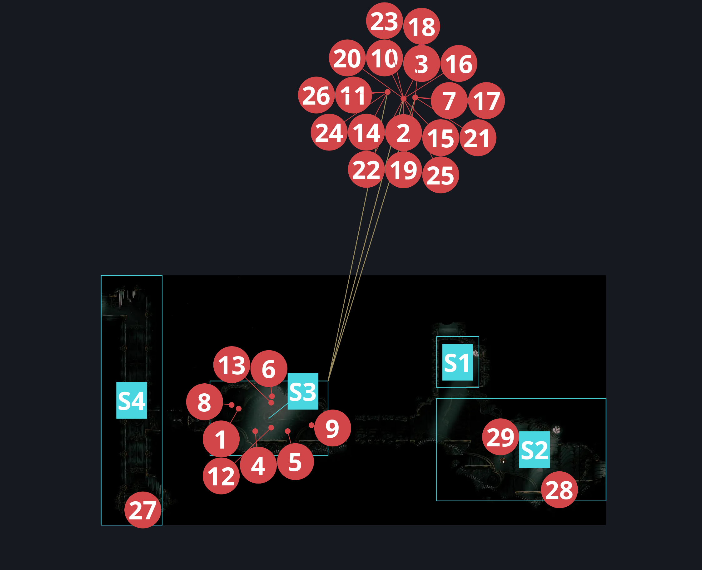

# Cogwork Core West Gauntlet (Cog_05)

**Game ID:** Cog_05

**Contributors:** Rebel, Gallos

## Subrooms

| No. | Subroom | Annotated |
| --- | --- | --- |
| S1 | Top Entrance | ✓ |
| S2 | Main | ✓ |
| S3 | Arena | ✓ |
| S4 | Left Entrance | ✓ |

## Room Transitions

| Alias | Name | From subroom | Destination | Destination alias | Requirements | TODO | Verification | Annotated | Notes |
| --- | --- | --- | --- | --- | --- | --- | --- | --- | --- |
| R | right2 | Main | [Cogwork Core South Main (Cog_04)](cogwork-core-south-main.md) | ML | Nothing. |  | Verified | ✓ |  |
| L | left1 | Left Entrance | [Choral Chambers Over Dining (Song_09)](../choral-chambers/choral-chambers-over-dining.md) | R | silk soar OR easy scuttlebrace OR cling grip either |  | Verified | ✓ |  |
| T | top1 | Top Entrance | [Cogwork Core Second Sentinel (Cog_10)](cogwork-core-second-sentinel.md) | B | Nothing. |  | Verified | ✓ |  |

## Subroom Connections

| Alias | Name | Source | Destination | Requirements | TODO | Verification | Annotated | Notes |
| --- | --- | --- | --- | --- | --- | --- | --- | --- |
| MT | Main-Top | Main | Top Entrance | Silk Soar OR (Faydown Cloak AND (Cling Grip either OR easy Scuttlebrace OR Ledge Grab right OR easy shaman pogo)) |  | Verified | ✓ |  |
| MT | Main-Top | Top Entrance | Main | Nothing. (fall) |  | Verified | ✓ |  |
| MA | Main <> arena | Main | Arena | none |  | Verified | ✓ |  |
| MA | Main <> arena | Arena | Main | Complete Cogwork Core: Gauntlet #1 |  | Verified | ✓ |  |
| AE | Arena <> left | Left Entrance | Arena | none |  | Verified | ✓ |  |
| AE | Arena <> left | Arena | Left Entrance | Complete Cogwork Core: Gauntlet #1 |  | Verified | ✓ |  |

## Check Locations

| No. | Check | Subroom | Requirements | TODO | Verification | Location Type | Annotated | Notes |
| --- | --- | --- | --- | --- | --- | --- | --- | --- |
| 1 | Cogwork Core: Gauntlet #1 | Arena | Combat Requirements |  | Verified | gauntlet | ✓ |  |
| 2 | Cogwork Choirbug Gauntlet 1 | Arena | none |  | Verified | enemy | ✓ |  |
| 3 | Cogwork Choirbug Gauntlet 2 | Arena | none |  | Verified | enemy | ✓ |  |
| 4 | Cogwork Spine Gauntlet 1 | Arena | none |  | Verified | enemy | ✓ |  |
| 5 | Cogwork Spine Gauntlet 2 | Arena | none |  | Verified | enemy | ✓ |  |
| 6 | Cogwork Spine Gauntlet 3 | Arena | none |  | Verified | enemy | ✓ |  |
| 7 | Cogwork Cleanser Gauntlet 1 | Arena | none |  | Verified | enemy | ✓ |  |
| 8 | Cogworker Gauntlet 1 | Arena | none |  | Verified | enemy | ✓ |  |
| 9 | Cogworker Gauntlet 2 | Arena | none |  | Verified | enemy | ✓ |  |
| 10 | Cogwork Choirbug Gauntlet 3 | Arena | none |  | Verified | enemy | ✓ |  |
| 11 | Cogwork Defender Gauntlet 1 | Arena | none |  | Verified | enemy | ✓ |  |
| 12 | Cogworker Gauntlet 3 | Arena | none |  | Verified | enemy | ✓ |  |
| 13 | Cogworker Gauntlet 4 | Arena | none |  | Verified | enemy | ✓ |  |
| 14 | Cogwork Defender Gauntlet 2 | Arena | none |  | Verified | enemy | ✓ |  |
| 15 | Cogwork Choirbug 4 | Arena | Complete Cogwork Core: Gauntlet #1 |  | Verified | enemy | ✓ |  |
| 16 | Cogwork Choirbug 5 | Arena | Complete Cogwork Core: Gauntlet #1 |  | Verified | enemy | ✓ |  |
| 17 | Cogwork Cleanser 2 | Arena | Complete Cogwork Core: Gauntlet #1 |  | Verified | enemy | ✓ |  |
| 18 | Cogwork Cleanser 3 | Arena | Complete Cogwork Core: Gauntlet #1 |  | Verified | enemy | ✓ |  |
| 19 | Cogwork Cleanser 4 | Arena | Complete Cogwork Core: Gauntlet #1 |  | Verified | enemy | ✓ |  |
| 20 | Cogwork Choirbug 6 | Arena | Complete Cogwork Core: Gauntlet #1 |  | Verified | enemy | ✓ |  |
| 21 | Cogwork Cleanser 5 | Arena | Complete Cogwork Core: Gauntlet #1 |  | Verified | enemy | ✓ |  |
| 22 | Cogwork Choirbug 7 | Arena | Complete Cogwork Core: Gauntlet #1 |  | Verified | enemy | ✓ |  |
| 23 | Cogwork Choirbug 8 | Arena | Complete Cogwork Core: Gauntlet #1 |  | Verified | enemy | ✓ |  |
| 24 | Cogwork Defender 3 | Arena | Complete Cogwork Core: Gauntlet #1 |  | Verified | enemy | ✓ |  |
| 25 | Cogwork Choirbug 9 | Arena | Complete Cogwork Core: Gauntlet #1 |  | Verified | enemy | ✓ |  |
| 26 | Cogwork Defender 4 | Arena | Complete Cogwork Core: Gauntlet #1 |  | Verified | enemy | ✓ |  |
| 27 | Drapemite 1 | Left Entrance | Invalid |  | Verified | enemy | ✓ | Disabled; no activation found. |
| 28 | Cogwork Spine 4 | Main | none |  | Verified | enemy | ✓ |  |
| 29 | Cogwork Spine 5 | Main | none |  | Verified | enemy | ✓ |  |

## Room Images

### Connections

### Checks

### Scene

